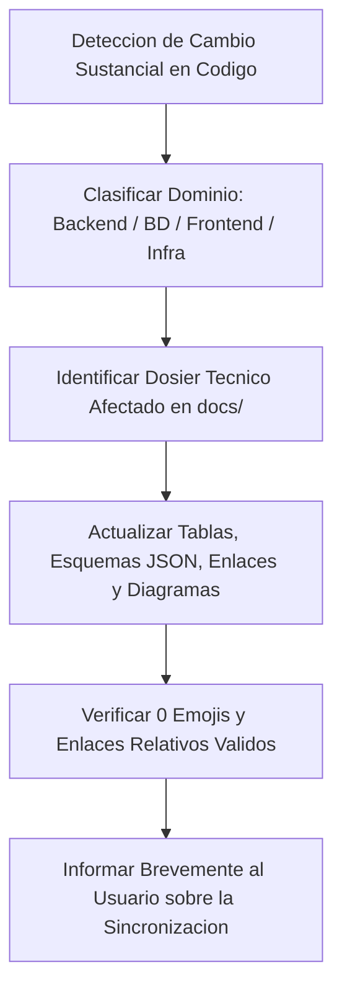

# Directrices de Sincronizacion Proactiva de Documentacion (Delivery Platform)

Esta habilidad define el protocolo de actualizacion continua, automatica y proactiva de la documentacion tecnica Docs-as-Code del proyecto **Delivery Platform**.

---

## 1. Principio Fundamental: Sincronizacion Proactiva sin Aviso

El agente opera con **responsabilidad documental continua**. Cuando durante cualquier tarea de ingenieria, desarrollo, refactorizacion o correccion de errores se introduzcan cambios sustanciales en el sistema, el agente debe **actualizar de forma proactiva la documentacion tecnica afectada en el mismo turno o antes de cerrar la tarea**, sin esperar a que el desarrollador lo solicite expresamente.

---

## 2. Matriz de Triggers Sustanciales y Dosieres Afectados

Se considera cambio sustancial cualquier modificacion que altere contratos, estructuras de datos, rutas, flujos operacionales o configuraciones de despliegue.

| Tipo de Cambio Tecnico | Criterios de Deteccion (Codigo) | Dosieres de Actualizacion Obligatoria |
| :--- | :--- | :--- |
| **Modelo de Datos y BD** | • Nuevas entidades o columnas en `Delivery.Core/Domain/` • Nuevas migraciones EF Core en `Delivery.Core/Infrastructure/Persistence/Migrations/` • Modificaciones en `init-postgis.sql` o indices GiST NetTopologySuite. | • `docs/03-base-de-datos/01-modelo-datos-postgis.md` • `docs/03-base-de-datos/03-kardex-inventario-y-recetas.md` (si involucra stock/recetas) • `docs/03-base-de-datos/04-semillas-y-entornos-de-prueba.md` (si afecta seeds) |
| **Cache, Colas y GEO** | • Nuevas claves o estructuras en Redis (`GEOADD`, hashes, strings, sets) • Ajustes en throttling de slots de 20 min o TTLs de idempotencia. | • `docs/03-base-de-datos/02-redis-geo-cache.md` |
| **APIs y Vertical Slices** | • Creacion o alteracion de handlers/endpoints en `Delivery.Features/` • Modificacion de DTOs de peticion/respuesta, validadores FluentValidation o codigos RFC 7807. | • `docs/02-backend-servicios/01-vertical-slices-api.md` |
| **Tiempo Real (SignalR)** | • Metodos cliente/servidor nuevos o modificados en `KitchenHub.cs` o `TrackingHub.cs` • Nuevos grupos de difusion o eventos de difusion. | • `docs/02-backend-servicios/02-signalr-hubs.md` |
| **Seguridad, JWT y RBAC** | • Nuevos roles, claims, politicas de autorizacion o ajustes en cookies `HttpOnly` y rotacion criptografica. | • `docs/02-backend-servicios/03-autenticacion-y-seguridad-rbac.md` |
| **Multitenancy y Temas** | • Cambios en `TenantResolutionMiddleware`, `TenantContext`, `TenantSetting` o motor de plantillas. | • `docs/02-backend-servicios/04-multitenancy-y-personalizacion.md` • `docs/04-frontend-web/06-personalizacion-storefront-y-plantillas.md` |
| **Rutas y Vistas Frontend** | • Creacion, renombramiento o reestructuracion de paginas en `frontend/src/app/` (`(storefront)`, `(dashboard)`, `(driver)`) • Nuevos guards perimetrales en `middleware.ts` o `AuthGuard.tsx`. | • `docs/04-frontend-web/01-estructura-route-groups.md` |
| **Sistemas Operativos UI** | • Cambios en logica de KDS cocina (`features/kitchen/`, Web Audio API, semaforo) • Cambios en tracking GPS repartidor (`features/tracking/`, MapLibre GL JS) • Cambios en flujo checkout (`features/checkout/`, validacion Zod, geocerca). | • `docs/04-frontend-web/02-pantalla-cocina-kds.md` • `docs/04-frontend-web/03-pantalla-repartidor-gps.md` • `docs/04-frontend-web/05-flujo-checkout-y-cobertura.md` |
| **Diseno y Tokens UI** | • Nuevas variables en `globals.css`, tokens de color, componentes base compartidos o reglas tipograficas. | • `docs/04-frontend-web/04-sistema-de-diseno-y-temas.md` |
| **Docker e Infraestructura** | • Modificacion de `docker-compose.yml`, perfiles de ejecucion (`profiles`), puertos asignados, variables en `.env.example` o healthchecks. | • `docs/05-despliegue-y-operaciones/01-infraestructura-docker.md` • `README.md` (si altera puertos de servicios) |
| **CI/CD y Scripts** | • Creacion o modificacion de scripts en `scripts/` • Modificacion de flujos GitHub Actions en `.github/workflows/`. | • `docs/05-despliegue-y-operaciones/03-guia-despliegue-devops.md` |
| **Empaquetado Movil** | • Modificacion de `capacitor.config.ts`, permisos en `AndroidManifest.xml` o plugins nativos. | • `docs/05-despliegue-y-operaciones/02-empaquetado-capacitor.md` |
| **Roadmap y Negocio** | • Culminacion o redefinicion de funcionalidades planificadas. | • `docs/06-roadmap-y-especificacion/01-especificacion-funcional-y-roadmap.md` |

---

## 3. Filtro Estricto: Que NO Requiere Sincronizacion

Para evitar ruido y consumo innecesario de tokens, **no** se debe actualizar la documentacion ante:
1. Correccion de errores ortograficos o renombre de variables internas privadas que no afecten contratos publicos.
2. Ajustes cosmeticos de CSS (padding, margenes, colores puntuales) que no alteren el sistema de tokens ni el layout general.
3. Optimizaciones de rendimiento internas sin modificacion de APIs ni firmas de metodos.
4. Adicion de casos de prueba unitarios adicionales a suites existentes.

---

## 4. Estandar de Calidad Docs-as-Code Innegociable

Al realizar cualquier actualizacion documental, el agente debe cumplir rigurosamente:

1. **Taxonomia Numerica Jerarquica:**
   - Estructura obligatoria en dos digitos: `01-`, `02-`, etc.
   - **Prohibido** crear archivos `README.md` dentro de subdirectorios de `docs/`.
2. **Cero Emojis y Cero Lenguaje Publicitario:**
   - Queda estrictamente prohibido el uso de emojis, iconos decorativos o expresiones publicitarias (*"la mejor solucion"*, *"diseno revolucionario"*).
   - Tono sobrio, directo, tecnico y descriptivo.
3. **Rutas Dinamicas y Enlaces Relativos:**
   - Todo enlace debe ser relativo al archivo actual (`./archivo.md`, `../directorio/archivo.md`, `../../backend/...`).
   - Queda estrictamente prohibido escribir enlaces absolutos locales (`file:///`, `C:\`, `/home/`).
   - En URLs hacia directorios con parentesis de Route Groups de Next.js, utilizar codificacion URL limpia (`%28storefront%29`, `%28dashboard%29`, `%28driver%29`) para garantizar compatibilidad con parsers estandares de Markdown.
4. **Diagramas Mermaid Exhaustivos:**
   - Actualizar los diagramas de secuencia, estado o topologia si la interaccion entre componentes cambia.
   - Mantener sintaxis valida Mermaid compatible con GitHub Flavored Markdown.
5. **Tablas Tecnicas Formales:**
   - Documentar tipos de datos exactos, restricciones de longitud, nulabilidad, indices y valores por defecto.
6. **Mantenimiento del Indice Central:**
   - Si se anade un nuevo archivo de documentacion o se renombra uno existente, actualizar de inmediato la tabla de contenidos de la raiz en [`README.md`](../../README.md).

---

## 5. Protocolo de Ejecucion al Detectar Cambios

Ante un cambio sustancial en el codigo, el agente debe seguir este flujo en su mismo ciclo de intervencion:

1. **Aplicar el cambio en el codigo:** Resolver la funcionalidad con estandar senior y sin parches.
2. **Identificar los dosieres impactados:** Segun la matriz de la Seccion 2.
3. **Editar la documentacion:** Usar `edit_file` para actualizar las secciones especificas (tablas de endpoints, diagramas Mermaid, matrices de rutas o schemas).
4. **Verificar consistencia:** Asegurar que los nombres de tablas, metodos y rutas coincidan con precision milimetrica con el codigo escrito.
5. **Resumir con concision:** En la respuesta final al desarrollador, anadir una linea sobria indicando que documento fue sincronizado (ej. *"Se sincronizo `docs/02-backend-servicios/01-vertical-slices-api.md` con el nuevo endpoint de cancelacion de comanda"*).

