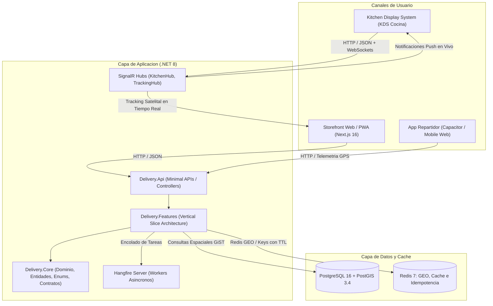

# 01. Vision General de la Arquitectura

## 1. Proposito del Sistema
La plataforma de delivery directo es una solucion integral orientada a eliminar la intermediacion de terceros en pedidos de comida preparada, proporcionando canales directos de venta, despacho en cocina, gestion de repartidores y facturacion para 2 sucursales operativas en Quito, Ecuador.

## 2. Diagrama de Topologia General

## 3. Patrones Arquitectonicos Implementados

### 3.1. Vertical Slice Architecture en Backend
En lugar de capas horizontales tradicionales (N-Tier o Clean clasica), el backend organiza el codigo por caracteristicas funcionales autocontenidas (*Vertical Slices*). Cada caracteristica agrupa su comando/consulta, validador FluentValidation, manejador y DTOs:
* `Delivery.Features/Geofencing`: Resolucion espacial de cobertura por coordenadas.
* `Delivery.Features/Catalog`: Catalogo activo con grupos de modificadores jerarquicos.
* `Delivery.Features/Orders`: Creacion de orden con blindaje de subtotal en backend y maquina de estados.
* `Delivery.Features/Kitchen`: Obtencion de comandas activas en orden FIFO para cocina.
* `Delivery.Features/Tracking`: Ingesta de geolocalizacion del repartidor en Redis GEO.

### 3.2. Feature-Driven Architecture en Frontend
El frontend Next.js 16 con App Router organiza los componentes y la logica por dominios funcionales en `src/features/`:
* `cart`: Estado global persistido con Zustand para el carrito de compras.
* `catalog`: Consultas con TanStack Query y modal de seleccion de modificadores.
* `checkout`: Resolucion de cobertura, formulario reactivo con React Hook Form + Zod, idempotencia.
* `kitchen`: Gestion de comandas con SignalR y alertas sonoras nativas con Web Audio API.
* `tracking`: Enlace de telemetria satelital y simulacion de recorrido para pruebas.

### 3.3. Manejo de Concurrencia e Idempotencia
* **Idempotency-Key en Cabecera HTTP:** Todo checkout genera un UUIDv4 enviado en la cabecera `Idempotency-Key`. El middleware en backend almacena el resultado en Redis con TTL de 24 horas (`idempotency:{key}`), bloqueando transacciones duplicadas por doble clic o interrupciones de red.
* **Control de Capacidad en Horno (Throttling):** Restriccion configurable `max_orders_per_slot` por intervalo de 20 minutos para prevenir saturacion de cocina.
