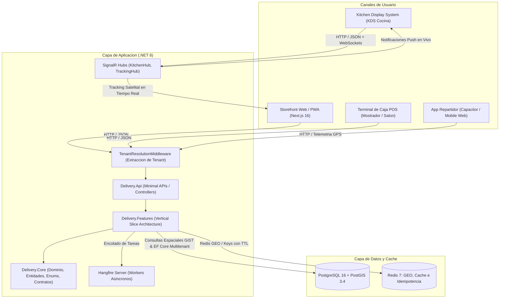

# 01. Vision General de la Arquitectura

## 1. Proposito del Sistema
La plataforma de delivery directo es una solucion integral orientada a eliminar la intermediacion de terceros en pedidos de comida preparada (asaderos de pollos y carnes a la brasa), proporcionando canales directos de venta web, despacho en cocina (KDS), gestion de inventario y recetas, turnos de caja POS, telemetria satelital de repartidores y facturacion electronica SRI para multiples sucursales operativas en Quito, Ecuador.

---

## 2. Diagrama de Topologia General

---

## 3. Patrones Arquitectonicos Implementados

### 3.1. Multitenancy Discriminador y Filtros Globales
El sistema esta disenado bajo un modelo SaaS multitenant seguro:
* **Resolucion de Tenant:** El middleware [`TenantResolutionMiddleware`](file:///c:/Users/DESARROLLADOR/Desktop/Proyectos/delivery-platform/backend/src/Delivery.Api/Multitenancy/TenantResolutionMiddleware.cs) extrae el `TenantId` a partir del subdominio de cabecera (`Host`), la cabecera `X-Tenant-Slug` o el claim del JWT.
* **Inyeccion Automatica:** El metodo `ApplyTenantIds()` en [`AppDbContext`](file:///c:/Users/DESARROLLADOR/Desktop/Proyectos/delivery-platform/backend/src/Delivery.Core/Infrastructure/Persistence/AppDbContext.cs) asigna automaticamente el `TenantId` a toda entidad que implemente [`IMustHaveTenant`](file:///c:/Users/DESARROLLADOR/Desktop/Proyectos/delivery-platform/backend/src/Delivery.Core/Domain/Common/IMustHaveTenant.cs) durante `SaveChanges` y `SaveChangesAsync`.
* **Aislamiento Estricto:** Se configuran `Global Query Filters` (`HasQueryFilter(x => CurrentTenantId == null || x.TenantId == CurrentTenantId)`) en todas las entidades del dominio para garantizar que ningun cliente ni empleado acceda a datos de otra marca.

### 3.2. Autenticacion, Sesiones y Seguridad RBAC
La seguridad de la plataforma opera bajo un modelo hibrido de alto rendimiento y cero almacenamiento vulnerable:
* **Tokens de Acceso JWT (15 min):** Emitidos con firma HMAC-SHA256 y claims auditables (`sub`, `email`, `role`, `tenant_id`, `branch_id`).
* **Refresh Tokens con Rotacion Criptografica (7 dias):** Entregados mediante cookies seguras `HttpOnly`, `SameSite=Strict` y `Path=/api/v1/auth`, almacenados en PostgreSQL como hashes criptograficos SHA-256 para evitar persistencia de secretos en texto plano.
* **Matriz RBAC y Politicas de Autorizacion:** Politicas granulares (`SuperAdminOnly`, `TenantAdminOnly`, `BranchStaffOnly`, `KitchenOnly`, `CashierOnly`, `DriverOnly`) que gobiernan los accesos a minimal APIs y SignalR hubs.
* **Documentacion Detallada:** Consulte la especificacion tecnica completa en [03. Autenticacion, Sesiones y Seguridad RBAC](../02-backend-servicios/03-autenticacion-y-seguridad-rbac.md).

### 3.3. Vertical Slice Architecture en Backend
En lugar de capas horizontales tradicionales (N-Tier o Clean clasica), el backend organiza el codigo por caracteristicas funcionales autocontenidas (*Vertical Slices*). Cada caracteristica agrupa su comando/consulta, validador FluentValidation, manejador y DTOs:
* `Delivery.Features/Auth`: Autenticacion (`Login`, `RefreshToken`, `GetCurrentUser`, `RevokeToken`).
* `Delivery.Features/Geofencing`: Resolucion espacial de cobertura por coordenadas y poligono PostGIS.
* `Delivery.Features/Catalog`: Catalogo activo con grupos de modificadores jerarquicos y disponibilidad por sucursal.
* `Delivery.Features/Orders`: Creacion de orden con blindaje de subtotal en backend, snapshot inmutable de precios y maquina de estados.
* `Delivery.Features/Kitchen`: Obtencion de comandas activas en orden FIFO para cocina con numero de comanda corto (`OrderNumber`).
* `Delivery.Features/Tracking`: Ingesta de geolocalizacion del repartidor en Redis GEO.

### 3.4. Feature-Driven Architecture en Frontend
El frontend Next.js 16 con App Router organiza los componentes y la logica por dominios funcionales en `src/features/`:
* `cart`: Estado global persistido con Zustand para el carrito de compras con identificador deterministico.
* `catalog`: Consultas con TanStack Query, modal de seleccion de modificadores y vitrina comercial.
* `checkout`: Resolucion de cobertura espacial, formulario reactivo con React Hook Form + Zod, idempotencia.
* `kitchen`: Gestion de comandas con SignalR y alertas sonoras nativas con Web Audio API.
* `tracking`: Enlace de telemetria satelital y simulacion de recorrido para pruebas.

### 3.5. Control de Inventario por Explosion de Recetas y Kardex
* **Recetas Estandar:** Cada producto del menú tiene asociada su receta en [`ProductRecipes`](file:///c:/Users/DESARROLLADOR/Desktop/Proyectos/delivery-platform/backend/src/Delivery.Core/Domain/Entities/ProductRecipe.cs), consumiendo insumos crudos (ej. 8 octavos de pollo crudo y 1 contenedor térmico por cada combo familiar vendido).
* **Kardex Inmutable:** Todo movimiento genera un registro inmutable en [`InventoryMovements`](file:///c:/Users/DESARROLLADOR/Desktop/Proyectos/delivery-platform/backend/src/Delivery.Core/Domain/Entities/InventoryMovement.cs) que guarda delta, stock anterior y posterior para auditoría.

### 3.6. Manejo de Concurrencia e Idempotencia
* **Idempotency-Key en Cabecera HTTP:** Todo checkout genera un UUIDv4 enviado en la cabecera `Idempotency-Key`. El middleware en backend almacena el resultado en Redis con TTL de 24 horas (`idempotency:{key}`), bloqueando transacciones duplicadas por doble clic o interrupciones de red.
* **Control de Capacidad en Horno (Throttling):** Restriccion configurable `MaxOrdersPerSlot` por intervalo de 20 minutos para prevenir saturacion de cocina.

---

## Navegacion de Documentacion
* **Siguiente:** [02. Maquina de Estados del Pedido](./02-maquina-estados.md)
* **Indice General:** [README Principal](../../README.md)
