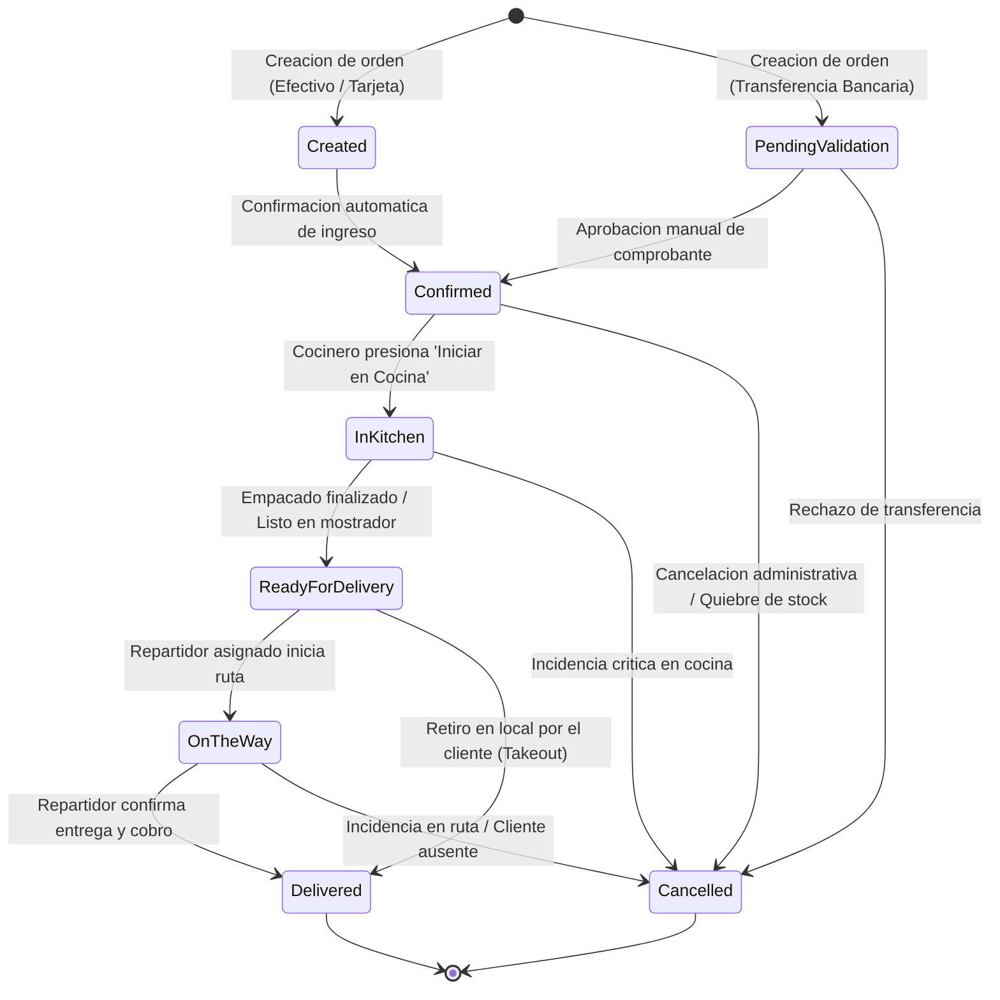

# 02. Maquina de Estados del Pedido

## 1. Definicion Formal del Ciclo de Vida
El ciclo de vida de un pedido se gestiona a traves de una maquina de estados finita y unidireccional implementada en `Delivery.Features.Orders.UpdateOrderStatus.UpdateOrderStatusHandler`.

## 2. Diagrama de Transiciones de Estado

## 3. Matriz de Transiciones Permitidas

| Estado Origen | Estado Destino Permitido | Disparador / Actor | Efectos Colaterales del Sistema |
| :--- | :--- | :--- | :--- |
| `Created` (1) | `Confirmed` (3) | Sistema / Operador | Emite evento `ReceiveNewOrder` al grupo SignalR `KitchenHub:{branchId}` |
| `PendingValidation` (2) | `Confirmed` (3) | Operador administrativo | Valida comprobante y emite evento a `KitchenHub:{branchId}` |
| `PendingValidation` (2) | `Cancelled` (8) | Operador administrativo | Notifica cancelacion al cliente |
| `Confirmed` (3) | `InKitchen` (4) | Cocinero en KDS | Cambia comanda a columna de preparacion en KDS; notifica a `TrackingHub` |
| `InKitchen` (4) | `ReadyForDelivery` (5) | Cocinero en KDS | Alerta a repartidores disponibles; notifica al cliente que el pedido esta empacado |
| `ReadyForDelivery` (5) | `OnTheWay` (6) | Repartidor en app movil | Inicia ingesta de telemetria GPS en Redis; emite ubicacion al cliente via `TrackingHub` |
| `ReadyForDelivery` (5) | `Delivered` (7) | Operador en mostrador | Aplica a pedidos con modalidad `Takeout` (Retiro en local) |
| `OnTheWay` (6) | `Delivered` (7) | Repartidor en app movil | Cierra la orden, detiene el tracking GPS y encola facturacion electronica SRI |
| Cualquier estado previo a `Delivered` | `Cancelled` (8) | Administrador | Revierte inventario comprometido y notifica via SignalR |

> [!IMPORTANT]
> Queda estrictamente bloqueada cualquier transicion que intente retroceder estados (por ejemplo, pasar de `ReadyForDelivery` a `InKitchen`) o saltar de `Created` directamente a `Delivered`. Toda transicion invalida responde `400 Bad Request` con el codigo de error `Orders.InvalidStatusTransition`.

---

## Navegacion de Documentacion
* **Anterior:** [01. Vision General de la Arquitectura](./01-vision-general.md)
* **Siguiente:** [01. Vertical Slices y APIs Backend](../02-backend-servicios/01-vertical-slices-api.md)
* **Indice General:** [README Principal](../../README.md)
