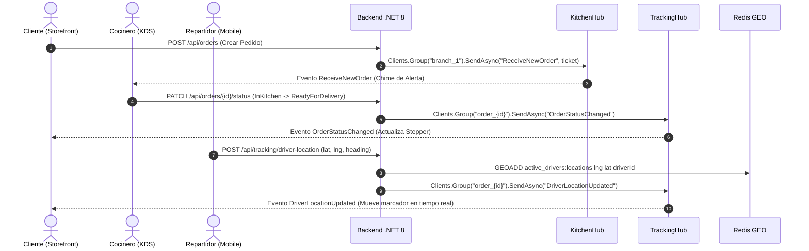

# 02. Especificacion de SignalR Hubs en Tiempo Real

## 1. Descripcion General
La comunicacion bidireccional en tiempo real esta provista por ASP.NET Core SignalR alojada en `Delivery.Api/Hubs/`. El sistema utiliza dos concentradores (*Hubs*) especializados con particionamiento por grupos para evitar difusiones masivas innecesarias (*broadcast noise*).

## 2. Hub de Cocina (`KitchenHub`)

* **Ruta WebSocket:** `/hubs/kitchen`
* **Proposito:** Transmitir nuevas comandas a la pantalla KDS de la sucursal correspondiente y sincronizar avances de estado en cocina.

### 2.1. Metodos Invocables desde el Cliente
| Metodo | Parametros | Descripcion |
| :--- | :--- | :--- |
| `JoinBranchKitchen` | `int branchId` | Agrega la conexion de la terminal KDS al grupo de sucursal `kitchen_branch_{branchId}` |
| `LeaveBranchKitchen` | `int branchId` | Remueve la conexion del grupo de cocina al finalizar turno |
| `JoinTenantChannel` | `string tenantSlug` | Une la sesion al canal de eventos de stock y catalogo de una marca `kitchen_tenant_{slug}` |
| `LeaveTenantChannel`| `string tenantSlug` | Abandona el canal de eventos de catalogo del comercio |

### 2.2. Eventos Emitidos por el Servidor (`IKitchenClient`)
| Evento | Payload | Disparador | Accion en Frontend |
| :--- | :--- | :--- | :--- |
| `ReceiveNewOrder` | `KitchenOrderTicketDto` | Pedido confirmado (`CreateOrder` o aprobacion de transferencia) | Reproduce alarma sonora nativa y agrega la comanda a la columna de pendientes |
| `OrderStatusChanged` | `string orderId, string status` | Transicion de estado de orden | Mueve la tarjeta de comanda a la columna correspondiente en el tablero FIFO |
| `StockUpdated` | `int productId, bool isAvailable` | Conmutacion operativa de disponibilidad (`ToggleProductStatus`) | Actualiza instantaneamente el estado del plato en cartas y comanderas |

---

## 3. Hub de Seguimiento de Pedido y Repartidor (`TrackingHub`)

* **Ruta WebSocket:** `/hubs/tracking`
* **Proposito:** Difundir telemetria satelital del repartidor y cambios de estado en vivo hacia la pantalla de seguimiento del cliente.

### 3.1. Metodos Invocables desde el Cliente
| Metodo | Parametros | Descripcion |
| :--- | :--- | :--- |
| `JoinOrderTracking` | `string orderId` | Suscribe al cliente al canal exclusivo de su pedido activo `order_tracking_{orderId}` |
| `SendDriverLocation`| `string orderId, double lat, double lng, double? heading` | El repartidor transmite su geolocalizacion en vivo hacia el grupo de la orden |
| `LeaveOrderTracking`| `string orderId` | Cancela la suscripcion al canal de rastreo de la orden |

### 3.2. Eventos Emitidos por el Servidor (`ITrackingClient`)
| Evento | Payload | Disparador | Accion en Frontend |
| :--- | :--- | :--- | :--- |
| `ReceiveDriverLocation` | `double latitude, double longitude, double? heading` | Coordenadas emitidas por el repartidor en ruta | Actualiza en tiempo real la posicion y orientacion del marcador en MapLibre |
| `OrderStatusChanged` | `string status` | Cambio de estado de la orden (`OnTheWay`, `Delivered`) | Actualiza el stepper visual de progreso en la vista del cliente |

---

## 4. Diagrama de Flujo de Comunicacion en Tiempo Real

---

## Navegacion de Documentacion
* **Anterior:** [01. Vertical Slices y APIs Backend](./01-vertical-slices-api.md)
* **Siguiente:** [03. Autenticacion, Sesiones y Seguridad RBAC](./03-autenticacion-y-seguridad-rbac.md)
* **Indice General:** [README Principal](../../README.md)
