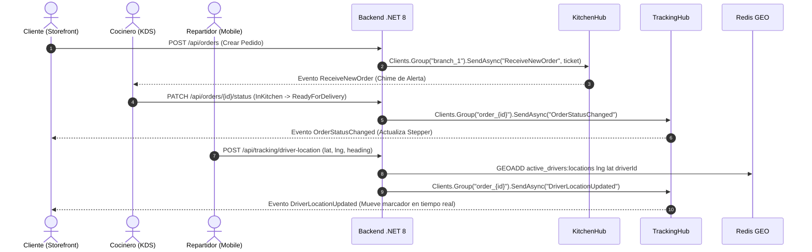

# 02. Especificacion de SignalR Hubs en Tiempo Real

## 1. Descripcion General
La comunicacion bidireccional en tiempo real esta provista por ASP.NET Core SignalR alojada en `Delivery.Api/Hubs/`. El sistema utiliza dos concentradores (*Hubs*) especializados con particionamiento por grupos para evitar difusiones masivas innecesarias (*broadcast noise*).

## 2. Hub de Cocina (`KitchenHub`)

* **Ruta WebSocket:** `/hubs/kitchen`
* **Proposito:** Transmitir nuevas comandas a la pantalla KDS de la sucursal correspondiente y sincronizar avances de estado en cocina.

### 2.1. Metodos Invocables desde el Cliente
| Metodo | Parametros | Descripcion |
| :--- | :--- | :--- |
| `JoinBranchKitchenGroup` | `string branchId` | Agrega la conexion al grupo de la sucursal `branch_{branchId}` |
| `LeaveBranchKitchenGroup` | `string branchId` | Remueve la conexion del grupo de cocina |

### 2.2. Eventos Emitidos por el Servidor
| Evento | Payload | Disparador | Accion en Frontend |
| :--- | :--- | :--- | :--- |
| `ReceiveNewOrder` | `KitchenOrderTicketDto` | Pedido confirmado (`Orders.CreateOrder` o aprobacion de transferencia) | Reproduce alarma sonora nativa y agrega la comanda a la columna 'En Espera' |
| `OrderStatusChanged` | `{ orderId: string, status: OrderStatus }` | Transicion de estado en cocina | Mueve la tarjeta de comanda a la columna correspondiente o la retira si fue despachada |

---

## 3. Hub de Seguimiento de Pedido y Repartidor (`TrackingHub`)

* **Ruta WebSocket:** `/hubs/tracking`
* **Proposito:** Difundir telemetria satelital del repartidor y cambios de estado en vivo hacia la pantalla de seguimiento del cliente.

### 3.1. Metodos Invocables desde el Cliente
| Metodo | Parametros | Descripcion |
| :--- | :--- | :--- |
| `JoinOrderGroup` | `string orderId` | Suscribe al cliente a las actualizaciones de su pedido especifico `order_{orderId}` |
| `LeaveOrderGroup` | `string orderId` | Cancela la suscripcion al pedido |

### 3.2. Eventos Emitidos por el Servidor
| Evento | Payload | Disparador | Accion en Frontend |
| :--- | :--- | :--- | :--- |
| `DriverLocationUpdated` | `{ orderId: string, latitude: number, longitude: number, heading: number }` | Ingesta de geoposicion desde la app del repartidor | Actualiza la posicion del repartidor en el mapa del cliente |
| `OrderStatusChanged` | `{ orderId: string, status: OrderStatus }` | Avance en el ciclo de vida del pedido | Actualiza el stepper visual de progreso en la vista del cliente |

---

## 4. Diagrama de Flujo de Comunicacion en Tiempo Real

---

## Navegacion de Documentacion
* **Anterior:** [01. Vertical Slices y APIs Backend](./01-vertical-slices-api.md)
* **Siguiente:** [03. Autenticacion, Sesiones y Seguridad RBAC](./03-autenticacion-y-seguridad-rbac.md)
* **Indice General:** [README Principal](../../README.md)
