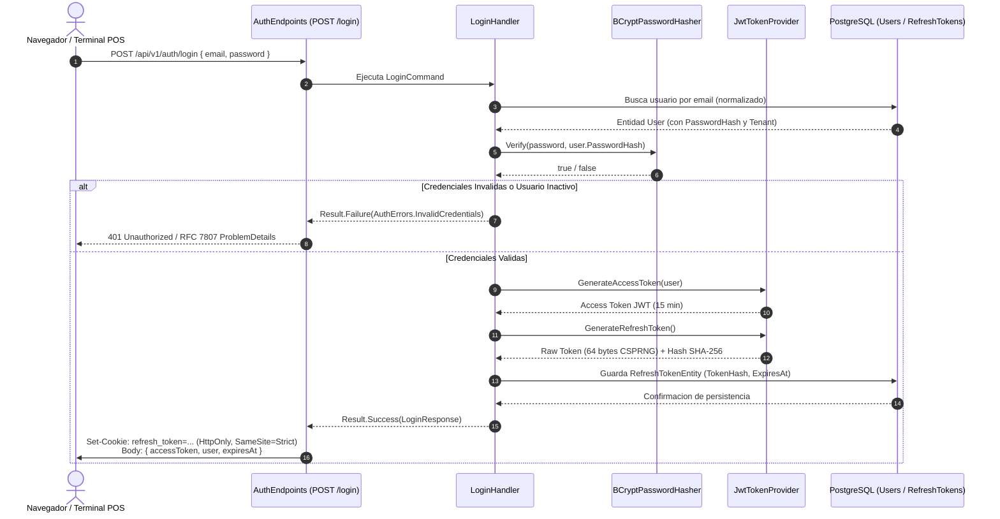
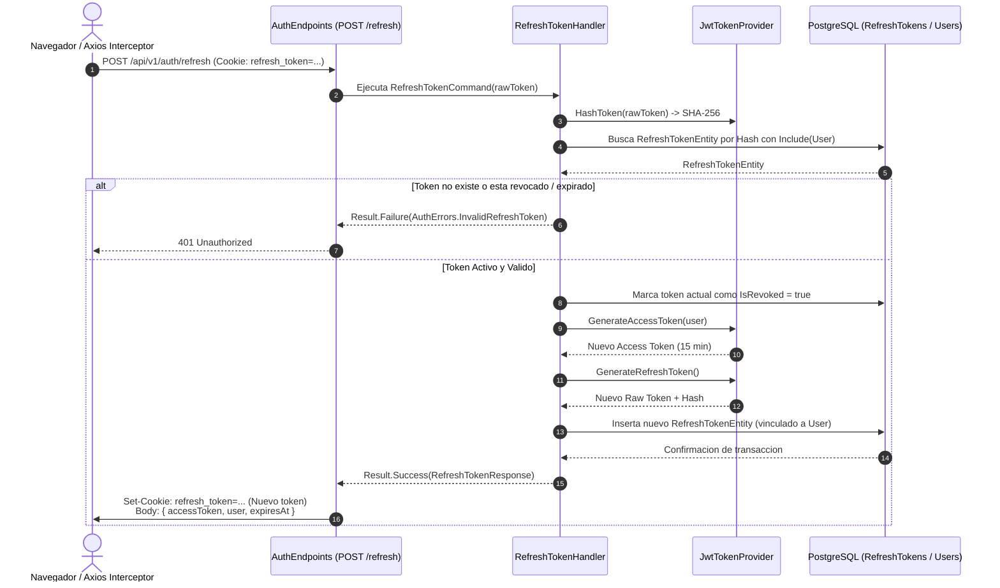

# 03. Autenticacion, Sesiones y Seguridad RBAC

Este documento define la arquitectura integral de seguridad, emision de tokens JWT, gestion de sesiones persistentes mediante rotacion de refresh tokens y control de acceso basado en roles (RBAC) con soporte multitenant en la plataforma.

---

## 1. Arquitectura de Seguridad y Flujo de Sesion

El sistema implementa autenticacion sin estado (*stateless*) mediante tokens de acceso de corta duracion (15 minutos) acompanados de tokens de refresco (*Refresh Tokens*) criptograficamente seguros de larga duracion (7 dias).

### 1.1. Principios de Seguridad Aplicados
* **Cero Parches y Cero Almacenamiento Inseguro:** El `refresh_token` nunca se almacena en `localStorage` ni en `sessionStorage` en el cliente. Se transmite exclusivamente a traves de una cookie `HttpOnly`, `Secure` y `SameSite=Strict` acotada a la ruta `/api/v1/auth`.
* **Hashing Criptografico en Base de Datos:** Los refresh tokens no se guardan en texto plano en la base de datos. Se almacena un resumen criptografico SHA-256 (`TokenHash`) para mitigar el impacto ante una eventual fuga de datos.
* **Rotacion Estricta y Deteccion de Reutilizacion:** Cada llamada a renovacion invalida el token actual y emite uno nuevo. Si un token revocado intenta ser reutilizado, se detecta un posible compromiso de sesion y se revoca inmediatamente toda la familia de tokens asociada al usuario.
* **Aislamiento Multitenant en JWT:** El token de acceso incluye el claim `tenant_id` y `branch_id`. El middleware [`TenantResolutionMiddleware`](file:///c:/Users/DESARROLLADOR/Desktop/Proyectos/delivery-platform/backend/src/Delivery.Api/Multitenancy/TenantResolutionMiddleware.cs) prioriza este claim para resolver el contexto de la peticion sin permitir manipulacion por cabeceras del cliente.

---

## 2. Diagramas de Secuencia Criptografica

### 2.1. Flujo de Autenticacion Inicial (Login)



### 2.2. Flujo de Renovacion de Token y Rotacion (Refresh)



---

## 3. Especificacion del Token JWT (Access Token)

### 3.1. Estructura de Claims

El token de acceso es firmado mediante el algoritmo **HMAC-SHA256 (HS256)** utilizando una clave secreta simetrica configurable de al menos 256 bits (`Jwt:SecretKey`).

| Claim | Estandar / Clave | Descripcion | Ejemplo |
| :--- | :--- | :--- | :--- |
| `sub` | `ClaimTypes.NameIdentifier` | Identificador unico del usuario (UUID) | `"b9a71dc1-1a32-4754-a957-3b2d13aa11e1"` |
| `email` | `ClaimTypes.Email` | Correo electronico del usuario | `"admin@asaderochic.com"` |
| `name` | `ClaimTypes.Name` | Nombre completo o razon social | `"Administrador Sucursal Norte"` |
| `role` | `ClaimTypes.Role` | Rol operativo asignado en el sistema | `"TenantAdmin"` |
| `tenant_id` | Personalizado (`tenant_id`) | UUID del Tenant al que pertenece el usuario | `"00000000-0000-0000-0000-000000000001"` |
| `branch_id` | Personalizado (`branch_id`) | UUID de la sucursal asignada (si aplica) | `"550e8400-e29b-41d4-a716-446655440000"` |
| `jti` | `JwtRegisteredClaimNames.Jti` | Identificador unico del JWT para prevencion de repeticion | UUIDv4 |
| `exp` | `JwtRegisteredClaimNames.Exp` | Marca de tiempo UNIX de expiracion (15 min) | `1730214300` |
| `iss` | `JwtRegisteredClaimNames.Iss` | Emisor configurado (`Jwt:Issuer`) | `"DeliveryPlatform"` |
| `aud` | `JwtRegisteredClaimNames.Aud` | Audiencia configurada (`Jwt:Audience`) | `"DeliveryPlatformClients"` |

### 3.2. Configuracion de la Cookie de Refresh Token

| Atributo | Valor | Proposito de Seguridad |
| :--- | :--- | :--- |
| `HttpOnly` | `true` | Bloquea el acceso a la cookie desde scripts de JavaScript, previniendo robo via XSS. |
| `Secure` | `true` en Produccion | Transmite la cookie unicamente bajo canales cifrados HTTPS. |
| `SameSite` | `SameSiteMode.Strict` | Impide que la cookie sea enviada en peticiones cross-site, neutralizando ataques CSRF. |
| `Path` | `/api/v1/auth` | Restringe el envio automatico de la cookie unicamente a las rutas de autenticacion. |
| `Expires` | `DateTimeOffset.UtcNow.AddDays(7)` | Caducidad sincronizada con la vigencia del registro en base de datos. |

---

## 4. Matriz de Roles y Politicas de Autorizacion (RBAC)

El sistema define siete roles operativos estandarizados en el enum [`UserRole`](file:///c:/Users/DESARROLLADOR/Desktop/Proyectos/delivery-platform/backend/src/Delivery.Core/Domain/Enums/UserRole.cs):

| Rol | Alcance de Acceso | Funciones Permitidas |
| :--- | :--- | :--- |
| `SuperAdmin` | Global (Plataforma) | Administracion de todos los tenants, provisionamiento de bases de datos y configuraciones globales. |
| `TenantAdmin` | Tenant (Empresa) | Gestion comercial de la empresa, alta de sucursales, definicion de cartas, precios, recetas y usuarios. |
| `BranchManager` | Sucursal | Supervision de operaciones locales, arqueos de caja, reportes de turno e inventario fisico. |
| `Cashier` | Terminal POS / Sucursal | Apertura y cierre de caja, registro de ventas de mostrador, cobros en efectivo y tarjeta. |
| `KitchenStaff` | KDS / Sucursal | Visualizacion de comandas en tiempo real, cambio de estado de preparacion a listo. |
| `Driver` | Logistica / Despacho | Telemetria GPS, recepcion de asignaciones de pedido, marcacion de salida y entrega al cliente. |
| `Customer` | Storefront Web / PWA | Navegacion del catalogo, realizacion de pedidos, seguimiento satelital de entregas. |

### 4.1. Politicas de Autorizacion en ASP.NET Core

Las politicas estan registradas formalmente en [`Program.cs`](file:///c:/Users/DESARROLLADOR/Desktop/Proyectos/delivery-platform/backend/src/Delivery.Api/Program.cs):

```csharp
builder.Services.AddAuthorization(options =>
{
    options.AddPolicy("SuperAdminOnly", policy =>
        policy.RequireRole(UserRole.SuperAdmin.ToString()));

    options.AddPolicy("TenantAdminOnly", policy =>
        policy.RequireRole(UserRole.SuperAdmin.ToString(), UserRole.TenantAdmin.ToString()));

    options.AddPolicy("BranchStaffOnly", policy =>
        policy.RequireRole(
            UserRole.SuperAdmin.ToString(),
            UserRole.TenantAdmin.ToString(),
            UserRole.BranchManager.ToString(),
            UserRole.Cashier.ToString(),
            UserRole.KitchenStaff.ToString()));

    options.AddPolicy("KitchenOnly", policy =>
        policy.RequireRole(
            UserRole.SuperAdmin.ToString(),
            UserRole.TenantAdmin.ToString(),
            UserRole.BranchManager.ToString(),
            UserRole.KitchenStaff.ToString()));

    options.AddPolicy("CashierOnly", policy =>
        policy.RequireRole(
            UserRole.SuperAdmin.ToString(),
            UserRole.TenantAdmin.ToString(),
            UserRole.BranchManager.ToString(),
            UserRole.Cashier.ToString()));

    options.AddPolicy("DriverOnly", policy =>
        policy.RequireRole(
            UserRole.SuperAdmin.ToString(),
            UserRole.Driver.ToString()));
});
```

---

## 5. Implementacion de Vertical Slices (`Delivery.Features/Auth`)

La funcionalidad de seguridad se encuentra dividida en 4 rebanadas verticales independientes y cohesivas:

### 5.1. Catalogo de Slices

1. **Login:** [`Delivery.Features.Auth.Login`](file:///c:/Users/DESARROLLADOR/Desktop/Proyectos/delivery-platform/backend/src/Delivery.Features/Auth/Login/LoginEndpoint.cs)
   - Endpoint: `POST /api/v1/auth/login`
   - Validacion de credenciales con BCrypt, emision de JWT y establecimiento de cookie de refresh token.
2. **RefreshToken:** [`Delivery.Features.Auth.RefreshToken`](file:///c:/Users/DESARROLLADOR/Desktop/Proyectos/delivery-platform/backend/src/Delivery.Features/Auth/RefreshToken/RefreshTokenEndpoint.cs)
   - Endpoint: `POST /api/v1/auth/refresh`
   - Extraccion del token desde cookie o cabecera, rotacion atomica y emision de nuevo par de credenciales.
3. **GetCurrentUser:** [`Delivery.Features.Auth.GetCurrentUser`](file:///c:/Users/DESARROLLADOR/Desktop/Proyectos/delivery-platform/backend/src/Delivery.Features/Auth/GetCurrentUser/GetCurrentUserEndpoint.cs)
   - Endpoint: `GET /api/v1/auth/me`
   - Protegido por autenticacion JWT Bearer. Retorna el perfil y los claims del usuario activo.
4. **RevokeToken (Logout):** [`Delivery.Features.Auth.RevokeToken`](file:///c:/Users/DESARROLLADOR/Desktop/Proyectos/delivery-platform/backend/src/Delivery.Features/Auth/RevokeToken/RevokeTokenEndpoint.cs)
   - Endpoint: `POST /api/v1/auth/logout`
   - Invalida el refresh token en base de datos y expira inmediatamente la cookie `HttpOnly`.

---

## 6. Pruebas Unitarias y de Integracion Arquitectonica

La suite de pruebas en [`AuthHandlerTests.cs`](file:///c:/Users/DESARROLLADOR/Desktop/Proyectos/delivery-platform/backend/tests/Delivery.UnitTests/Features/Auth/AuthHandlerTests.cs) y las pruebas de arquitectura en [`VerticalSliceArchitectureBoundaryTests.cs`](file:///c:/Users/DESARROLLADOR/Desktop/Proyectos/delivery-platform/backend/tests/Delivery.UnitTests/Architecture/VerticalSliceArchitectureBoundaryTests.cs) garantizan:

* Autenticacion correcta con hash de contrasena valido y bloqueo ante contrasenas erroneas.
* Bloqueo de inicio de sesion para usuarios inactivos (`IsActive = false`) o tenants inactivos.
* Rotacion criptografica exitosa del refresh token con invalidacion del token precedente.
* Cero dependencias cruzadas entre las rebanadas de `Delivery.Features.Auth.*`.
* Cumplimiento estricto de convenciones de nombres de VSA (sin sufijos prohibidos `Service`, `Repository` o `Manager` en la capa de caracteristicas).

---

## Navegacion de Documentacion
* **Anterior:** [02. SignalR Hubs](./02-signalr-hubs.md)
* **Siguiente:** [01. Modelo de Datos y PostGIS](../03-base-de-datos/01-modelo-datos-postgis.md)
* **Indice General:** [README Principal](../../README.md)

