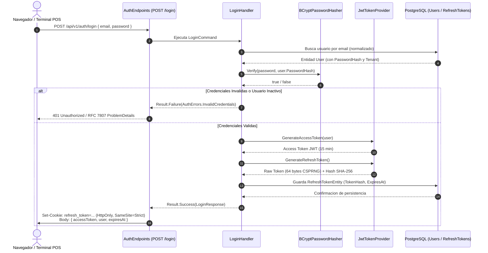
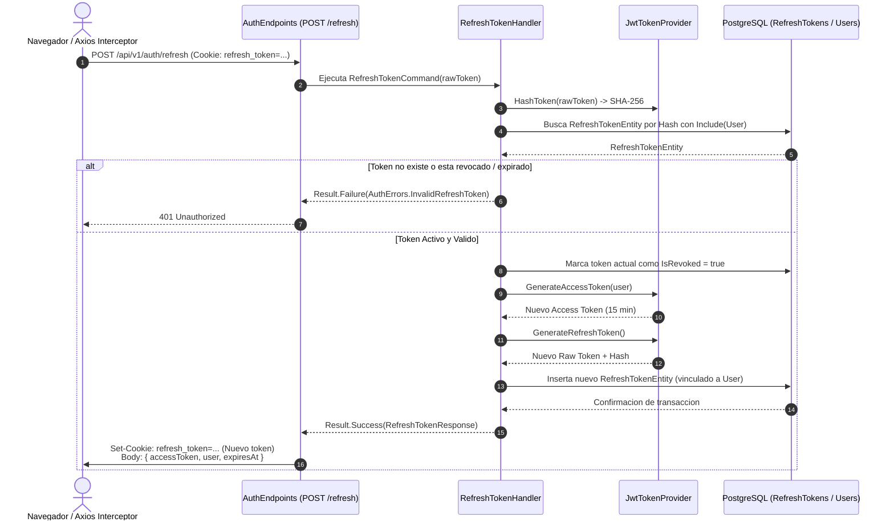
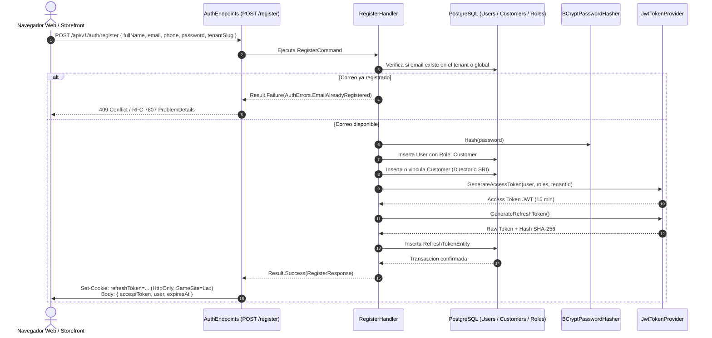
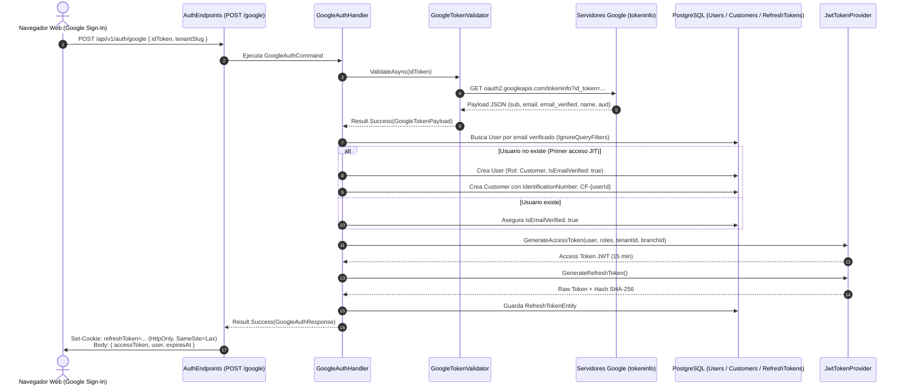

# 03. Autenticacion, Sesiones y Seguridad RBAC

Este documento define la arquitectura integral de seguridad, emision de tokens JWT, gestion de sesiones persistentes mediante rotacion de refresh tokens y control de acceso basado en roles (RBAC) con soporte multitenant en la plataforma.

---

## 1. Arquitectura de Seguridad y Flujo de Sesion

El sistema implementa autenticacion sin estado (*stateless*) mediante tokens de acceso de corta duracion (15 minutos) acompanados de tokens de refresco (*Refresh Tokens*) criptograficamente seguros de larga duracion (7 dias).

### 1.1. Principios de Seguridad Aplicados
* **Cero Parches y Cero Almacenamiento Inseguro:** El `refresh_token` nunca se almacena en `localStorage` ni en `sessionStorage` en el cliente. Se transmite exclusivamente a traves de una cookie `HttpOnly`, `Secure` y `SameSite=Strict` acotada a la ruta `/api/v1/auth`.
* **Hashing Criptografico en Base de Datos:** Los refresh tokens no se guardan en texto plano en la base de datos. Se almacena un resumen criptografico SHA-256 (`TokenHash`) para mitigar el impacto ante una eventual fuga de datos.
* **Rotacion Estricta y Deteccion de Reutilizacion:** Cada llamada a renovacion invalida el token actual y emite uno nuevo. Si un token revocado intenta ser reutilizado, se detecta un posible compromiso de sesion y se revoca inmediatamente toda la familia de tokens asociada al usuario.
* **Aislamiento Multitenant en JWT:** El token de acceso incluye el claim `tenant_id` y `branch_id`. El middleware `TenantResolutionMiddleware` prioriza este claim para resolver el contexto de la peticion sin permitir manipulacion por cabeceras del cliente.

---

## 2. Diagramas de Secuencia Criptografica

### 2.1. Flujo de Autenticacion Inicial (Login)



### 2.2. Flujo de Renovacion de Token y Rotacion (Refresh)



### 2.3. Flujo de Registro de Cliente con Sesion Inmediata (Register)



### 2.4. Flujo de Autenticacion Federada con Google (OpenID Connect)



---

## 3. Especificacion del Token JWT (Access Token)

### 3.1. Estructura de Claims

El token de acceso es firmado mediante el algoritmo **HMAC-SHA256 (HS256)** utilizando una clave secreta simetrica configurable de al menos 256 bits inyectada desde la variable de entorno `JWT_SECRET` (o `Jwt__SecretKey` en `.env`). Por politica de repositorio publico seguro, esta clave nunca reside en `appsettings.json`.

| Claim | Estandar / Clave | Descripcion | Ejemplo |
| :--- | :--- | :--- | :--- |
| `sub` | `ClaimTypes.NameIdentifier` | Identificador unico del usuario (UUID) | `"b9a71dc1-1a32-4754-a957-3b2d13aa11e1"` |
| `email` | `ClaimTypes.Email` | Correo electronico del usuario | `"admin@asaderochic.com"` |
| `name` | `ClaimTypes.Name` | Nombre completo o razon social | `"Administrador Sucursal Norte"` |
| `role` | `ClaimTypes.Role` | Rol operativo asignado en el sistema | `"TenantAdmin"` |
| `tenant_id` | Personalizado (`tenant_id`) | UUID del Tenant al que pertenece el usuario | `"00000000-0000-0000-0000-000000000001"` |
| `branch_id` | Personalizado (`branch_id`) | UUID de la sucursal asignada (si aplica) | `"550e8400-e29b-41d4-a716-446655440000"` |
| `jti` | `JwtRegisteredClaimNames.Jti` | Identificador unico del JWT para prevencion de repeticion | UUIDv4 |
| `exp` | `JwtRegisteredClaimNames.Exp` | Marca de tiempo UNIX de expiracion (15 min) | `1730214300` |
| `iss` | `JwtRegisteredClaimNames.Iss` | Emisor configurado (`Jwt:Issuer`) | `"DeliveryPlatform"` |
| `aud` | `JwtRegisteredClaimNames.Aud` | Audiencia configurada (`Jwt:Audience`) | `"DeliveryPlatformClients"` |

### 3.2. Configuracion de la Cookie de Refresh Token

| Atributo | Valor | Proposito de Seguridad |
| :--- | :--- | :--- |
| `HttpOnly` | `true` | Bloquea el acceso a la cookie desde scripts de JavaScript, previniendo robo via XSS. |
| `Secure` | `true` en Produccion | Transmite la cookie unicamente bajo canales cifrados HTTPS. |
| `SameSite` | `SameSiteMode.Strict` | Impide que la cookie sea enviada en peticiones cross-site, neutralizando ataques CSRF. |
| `Path` | `/api/v1/auth` | Restringe el envio automatico de la cookie unicamente a las rutas de autenticacion. |
| `Expires` | `DateTimeOffset.UtcNow.AddDays(7)` | Caducidad sincronizada con la vigencia del registro en base de datos. |

---

## 4. Matriz de Roles y Politicas de Autorizacion (RBAC)

El sistema define siete roles operativos estandarizados en el enum `UserRole`:

| Rol | Alcance de Acceso | Funciones Permitidas |
| :--- | :--- | :--- |
| `SuperAdmin` | Global (Plataforma) | Administracion de todos los tenants, provisionamiento de bases de datos y configuraciones globales. |
| `TenantAdmin` | Tenant (Empresa) | Gestion comercial de la empresa, alta de sucursales, definicion de cartas, precios, recetas y usuarios. |
| `BranchManager` | Sucursal | Supervision de operaciones locales, arqueos de caja, reportes de turno e inventario fisico. |
| `Cashier` | Terminal POS / Sucursal | Apertura y cierre de caja, registro de ventas de mostrador, cobros en efectivo y tarjeta. |
| `KitchenStaff` | KDS / Sucursal | Visualizacion de comandas en tiempo real, cambio de estado de preparacion a listo. |
| `Driver` | Logistica / Despacho | Telemetria GPS, recepcion de asignaciones de pedido, marcacion de salida y entrega al cliente. |
| `Customer` | Storefront Web / PWA | Navegacion del catalogo, realizacion de pedidos, seguimiento satelital de entregas. |

### 4.1. Politicas de Autorizacion en ASP.NET Core

Las politicas estan registradas formalmente en `Program.cs`:

```csharp
builder.Services.AddAuthorization(options =>
{
    options.AddPolicy("SuperAdminOnly", policy =>
        policy.RequireRole(UserRole.SuperAdmin.ToString()));

    options.AddPolicy("TenantAdminOnly", policy =>
        policy.RequireRole(UserRole.SuperAdmin.ToString(), UserRole.TenantAdmin.ToString()));

    options.AddPolicy("BranchStaffOnly", policy =>
        policy.RequireRole(
            UserRole.SuperAdmin.ToString(),
            UserRole.TenantAdmin.ToString(),
            UserRole.BranchManager.ToString(),
            UserRole.Cashier.ToString(),
            UserRole.KitchenStaff.ToString()));

    options.AddPolicy("KitchenOnly", policy =>
        policy.RequireRole(
            UserRole.SuperAdmin.ToString(),
            UserRole.TenantAdmin.ToString(),
            UserRole.BranchManager.ToString(),
            UserRole.KitchenStaff.ToString()));

    options.AddPolicy("CashierOnly", policy =>
        policy.RequireRole(
            UserRole.SuperAdmin.ToString(),
            UserRole.TenantAdmin.ToString(),
            UserRole.BranchManager.ToString(),
            UserRole.Cashier.ToString()));

    options.AddPolicy("DriverOnly", policy =>
        policy.RequireRole(
            UserRole.SuperAdmin.ToString(),
            UserRole.Driver.ToString()));
});
```

---

## 5. Implementacion de Vertical Slices (`Delivery.Features/Auth`)

La funcionalidad de seguridad se encuentra dividida en 6 rebanadas verticales independientes y cohesivas:

### 5.1. Catalogo de Slices

1. **Login:** `Delivery.Features.Auth.Login`
   - Endpoint: `POST /api/v1/auth/login`
   - Validacion de credenciales con BCrypt, emision de JWT y establecimiento de cookie de refresh token.
2. **Register:** `Delivery.Features.Auth.Register`
   - Endpoint: `POST /api/v1/auth/register`
   - Registro de comensales con rol `Customer`, alta en directorio SRI del tenant y emision de sesion inmediata.
3. **GoogleAuth:** `Delivery.Features.Auth.GoogleAuth`
   - Endpoint: `POST /api/v1/auth/google`
   - Verificacion criptografica de Google ID Token (OpenID Connect) con soporte FedCM, aprovisionamiento Just-In-Time de cuenta comensal con correo verificado (`IsEmailVerified = true`), resolucion determinista de directorio fiscal y emision de sesion JWT.
   - **Manejo de Unicidad Fiscal:** A los clientes autenticados via Google se les asigna `IdentificationNumber = $"CF-{user.Id:N}"[..18]` de tipo `CONSUMIDOR_FINAL`. Esto evita colisiones con el indice unico `IX_Customers_TenantId_IdentificationNumber` de PostgreSQL cuando multiples clientes operan en el mismo tenant sin haber ingresado cedula/RUC todavia.
   - **Integracion Frontend:** SDK Google Identity Services (GIS) configurado con `renderButton` para soporte universal de popups y modo incognito, complementado con fallback accesible y desacoplado en `GoogleDevAuthModal.tsx`.
4. **RefreshToken:** `Delivery.Features.Auth.RefreshToken`
   - Endpoint: `POST /api/v1/auth/refresh`
   - Extraccion del token desde cookie o cabecera, rotacion atomica y emision de nuevo par de credenciales.
5. **GetCurrentUser:** `Delivery.Features.Auth.GetCurrentUser`
   - Endpoint: `GET /api/v1/auth/me`
   - Protegido por autenticacion JWT Bearer. Retorna el perfil y los claims del usuario activo.
6. **RevokeToken (Logout):** `Delivery.Features.Auth.RevokeToken`
   - Endpoint: `POST /api/v1/auth/logout`
   - Invalida el refresh token en base de datos y expira inmediatamente la cookie `HttpOnly`.

### 5.1. Registro de Diagnóstico y Causas Raíz Resueltas (Google OAuth)

| Incidente / Síntoma | Causa Raíz Identificada | Solución Arquitectónica Aplicada |
| :--- | :--- | :--- |
| **`Client ID is not found (403)`** | Se había copiado por error el `Client Secret` (`GOCSPX-...`) en lugar del `Client ID` (`...apps.googleusercontent.com`) en las variables de entorno. | Centralización canónica de variables en `.env` en la raíz con el `Client ID` correcto `747427996536-srqjcuroq0m7r9knu7dotqlefc7qp1oc.apps.googleusercontent.com`. |
| **`The given origin is not allowed for the given client ID`** | Google Cloud Console no tenía autorizado `http://localhost:3005` y los cambios no se habían persistido en la consola (botón "Guardar" pendiente). Adicionalmente, la red CDN de Google requiere un tiempo de propagación de 5 a 15 minutos. | Registro explícito de los orígenes JavaScript (`http://localhost:3005`, `http://localhost`, `http://127.0.0.1:3005`, dominios de producción) y persistencia consolidada en Google Cloud. |
| **Google One Tap bloqueado / Sin popup al hacer clic** | Se invocaba `window.google.accounts.id.prompt()` en el `onClick` de un botón HTML personalizado. La API `prompt()` corresponde exclusivamente al banner flotante superior (One Tap), el cual se suprime automáticamente si no hay cookies de sesión activas (ej. modo incógnito) o tras cierres previos. | Implementación del método oficial `google.accounts.id.renderButton()`. Google monta su iframe con botón píldora que abre directamente la ventana emergente nativa de selección de cuentas. |
| **Error de Hidratación React (`<form> cannot be descendant of <form>`)** | El modal de pruebas de Google Auth contenía una etiqueta `<form>` y estaba incrustado dentro del `<form>` de `LoginForm`. | Sustitución del `<form>` interno del modal por contenedores `<div>` accesibles con control de tecla `Enter` y extracción modular a `GoogleDevAuthModal.tsx`. |
| **`DbUpdateException: 23505 duplicate key value violates unique constraint "IX_Customers_TenantId_IdentificationNumber"`** | En la creación Just-In-Time de clientes dentro de `GoogleAuthHandler`, se asignaba estáticamente `IdentificationNumber = "9999999999999"` (Consumidor Final). Al existir un índice único sobre `(TenantId, IdentificationNumber)`, cualquier segundo usuario que iniciara sesión con Google en el mismo restaurante colisionaba en PostgreSQL arrojando error 500. | Generación determinista y única de identificación para clientes sin cédula fiscal: `IdentificationNumber = $"CF-{user.Id:N}"[..18]`. Garantiza unicidad absoluta por cliente y tenant. |
| **Advertencia FedCM en consola del navegador** | Google Identity Services deprecó los flujos tradicionales de cookies de terceros y requiere la especificación Federated Credential Management. | Activación explícita de `use_fedcm_for_prompt: true` en la inicialización del SDK de Google. |

---

## 6. Pruebas Unitarias y de Integracion Arquitectonica

La suite de pruebas en `AuthHandlerTests.cs` y las pruebas de arquitectura en `VerticalSliceArchitectureBoundaryTests.cs` garantizan:

* Autenticacion correcta con hash de contrasena valido y bloqueo ante contrasenas erroneas.
* Bloqueo de inicio de sesion para usuarios inactivos (`IsActive = false`) o tenants inactivos.
* Rotacion criptografica exitosa del refresh token con invalidacion del token precedente.
* Cero dependencias cruzadas entre las rebanadas de `Delivery.Features.Auth.*`.
* Cumplimiento estricto de convenciones de nombres de VSA (sin sufijos prohibidos `Service`, `Repository` o `Manager` en la capa de caracteristicas).

---

## 7. Politica Perimetral de CORS y Origenes Permitidos

Para mitigar riesgos de CSRF y fuga de tokens de sesion con credenciales (`AllowCredentials()`), el backend implementa una politica de validacion dinamica de origenes en `Program.cs` vinculada a la variable `PLATFORM_DOMAIN` (o `NEXT_PUBLIC_PLATFORM_DOMAIN`):

```csharp
policy.SetIsOriginAllowed(origin =>
{
    if (string.IsNullOrWhiteSpace(origin)) return false;
    if (!Uri.TryCreate(origin, UriKind.Absolute, out var uri)) return false;
    var host = uri.Host;

    // 1. Origenes locales de desarrollo
    if (host.Equals("localhost", StringComparison.OrdinalIgnoreCase) ||
        host.Equals("127.0.0.1", StringComparison.OrdinalIgnoreCase))
        return true;

    // 2. Origenes explícitamente configurados en Cors:AllowedOrigins
    if (allowedOrigins.Any(ao => string.Equals(ao, origin, StringComparison.OrdinalIgnoreCase)))
        return true;

    // 3. Dominio raiz de produccion y subdominios dinamicos de tenants (*.mesafy.doicela.dev)
    if (host.Equals(platformDomain, StringComparison.OrdinalIgnoreCase) ||
        host.EndsWith("." + platformDomain, StringComparison.OrdinalIgnoreCase))
        return true;

    return false;
})
.AllowAnyHeader()
.AllowAnyMethod()
.AllowCredentials();
```

---

## Navegacion de Documentacion
* **Anterior:** [02. SignalR Hubs](./02-signalr-hubs.md)
* **Siguiente:** [04. Motor Multitenant y Personalizacion](./04-multitenancy-y-personalizacion.md)
* **Indice General:** [README Principal](../../README.md)

