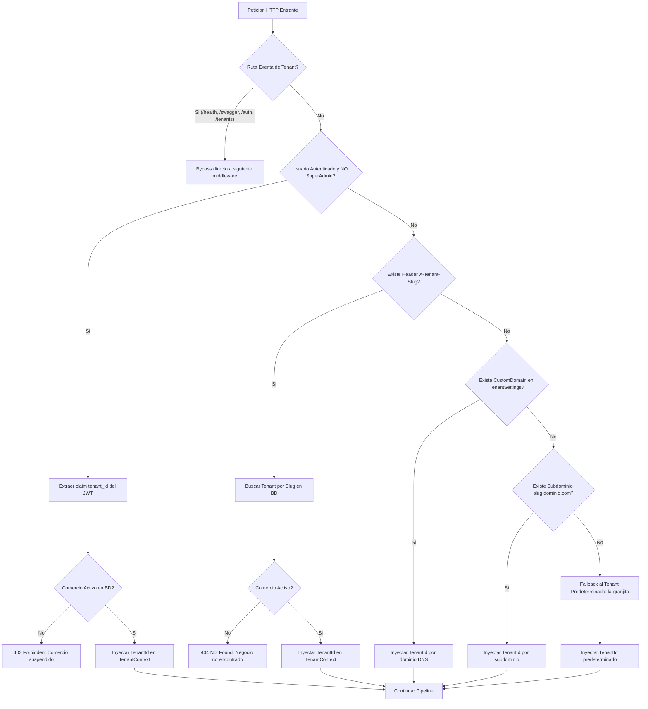
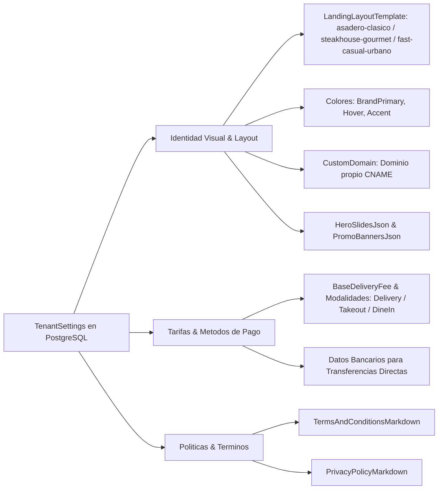

# 04. Motor Multitenant y Personalizacion de Plataforma

## 1. Descripcion General del Modelo SaaS

La plataforma opera bajo un modelo de **Multitenancy Discriminador con Base de Datos Compartida** (*Shared Database, Shared Schema*), aislando la informacion de cada franquicia o comercio mediante la columna `TenantId` (UUID) y filtros globales de consulta en Entity Framework Core.

Este diseno permite alojar multiples marcas comerciales independientes en la misma infraestructura con maximo rendimiento y garantia estricta de no-contaminacion de datos entre competidores.

---

## 2. Pipeline de Resolucion de Tenant (`TenantResolutionMiddleware`)

Cada peticion HTTP entrante atraviesa el [`TenantResolutionMiddleware`](../../backend/src/Delivery.Api/Multitenancy/TenantResolutionMiddleware.cs) antes de alcanzar los endpoints o controladores. La resolucion sigue una jerarquia estricta de 6 niveles de prioridad:



### 2.1. Reglas de Prioridad y Seguridad
1. **Bypass de Sistema:** Endpoints globales como `/health`, `/swagger`, `/hangfire`, `/hubs`, autenticacion `/api/v1/auth`, y gobernanza `/api/tenants` no requieren contexto de tenant previo.
2. **Aislamiento Criptografico Estricto por JWT:** Si un usuario esta autenticado como operador (cajero, cocina, administrador de tienda) y no es `SuperAdmin`, el middleware **fuerza el `tenant_id` contenido en su token de acceso**. Queda bloqueada cualquier posibilidad de que un operador intente usurpar datos de otra marca enviando cabeceras `X-Tenant-Slug` manipuladas.
3. **Cabecera `X-Tenant-Slug`:** Habilitada para navegacion publica en vitrinas B2C (Storefront) o peticiones de diagnostico del `SuperAdmin`.
4. **Dominio Personalizado (`CustomDomain`):** Permite a cada marca apuntar su propio dominio (ej. `pedidos.lagranjita.com` o `carnesbrasas.ec`) resolviendose contra la tabla `TenantSettings`.
5. **Subdominio:** Extraccion del prefijo en dominios wildcard (ej. `la-granjita.deliveryplatform.com`).
6. **Fallback de Configuracion:** Si no coincide ninguna regla, se asigna el tenant configurado en `Multitenancy:DefaultTenantSlug` (por defecto `la-granjita`).

---

## 3. Servicio de Contexto Scoped: `TenantContext`

El contexto del comercio se mantiene vivo durante la vida de la peticion HTTP como un servicio Scoped:

```csharp
public interface ITenantContext
{
    Guid? TenantId { get; }
    string? TenantSlug { get; }
    bool HasResolvedTenant { get; }
}

public class TenantContext : ITenantContext
{
    public Guid? TenantId { get; private set; }
    public string? TenantSlug { get; private set; }
    public bool HasResolvedTenant => TenantId.HasValue;

    public void SetTenant(Guid tenantId, string slug)
    {
        TenantId = tenantId;
        TenantSlug = slug;
    }
}
```

---

## 4. Filtros Globales de Consulta (Global Query Filters) en EF Core

En `AppDbContext.cs`, todas las entidades de dominio que pertenecen a una marca implementan la interfaz marcadora `IMustHaveTenant`:

```csharp
public interface IMustHaveTenant
{
    Guid TenantId { get; set; }
}
```

### 4.1. Filtrado Transparente y Automatico
En la configuracion de cada entidad, se define el filtro global:

```csharp
modelBuilder.Entity<Product>()
    .HasQueryFilter(x => CurrentTenantId == null || x.TenantId == CurrentTenantId);
```

* **Para Clientes y Operadores de Marca:** `CurrentTenantId` contiene el GUID del tenant resuelto. Cualquier consulta SQL ejecutada por EF Core (`SELECT`) incluye automaticamente la clausula `WHERE "TenantId" = @CurrentTenantId`.
* **Para SuperAdmin:** Si el usuario no tiene tenant asignado (`CurrentTenantId == null`), el filtro se evalua como verdadero, permitiendo auditoria transversal de toda la base de datos.
* **Sobreescritura Explicita:** Si un servicio de segundo plano o tarea Hangfire requiere procesar todos los tenants, utiliza `.IgnoreQueryFilters()`.

### 4.2. Inyeccion Automatica en Escritura (`SaveChanges`)
Para evitar omisiones accidentales al insertar registros, `AppDbContext` sobreescribe `SaveChanges` y `SaveChangesAsync`:

```csharp
private void ApplyTenantIds()
{
    if (!CurrentTenantId.HasValue) return;

    foreach (var entry in ChangeTracker.Entries<IMustHaveTenant>())
    {
        if (entry.State == EntityState.Added && entry.Entity.TenantId == Guid.Empty)
        {
            entry.Entity.TenantId = CurrentTenantId.Value;
        }
    }
}
```

---

## 5. Personalizacion Dinamica de Storefront y Plantillas

Cada comercio gestiona su apariencia visual, metodos de pago y operacion comercial mediante la entidad [`TenantSetting`](../03-base-de-datos/01-modelo-datos-postgis.md#tabla-tenantsettings):



### 5.1. Matriz de Propiedades de Personalizacion

| Categoria | Propiedad | Tipo | Descripcion |
| :--- | :--- | :--- | :--- |
| **Plantilla** | `LandingLayoutTemplate` | `varchar(50)` | Identificador del layout frontend (`asadero-clasico`, `steakhouse-gourmet`). |
| **Banners** | `HeroSlidesJson` | `text` | Array JSON con diapositivas hero (badge, titulo, subtitulo, imagen, boton CTA). |
| **Ofertas** | `PromotionalBannersJson`| `text` | Array JSON con banners intermedios de promocion en vitrina. |
| **Logistica** | `BaseDeliveryFee` | `numeric(10,2)`| Costo base de despacho a domicilio en la zona de cobertura. |
| **Modalidades**| `EnableDelivery` / `Takeout` / `DineIn` | `boolean` | Habilita o deshabilita canales de despacho de forma independiente. |
| **Pagos** | `AcceptsCash` / `Transfer` / `Card` | `boolean` | Pasarelas y metodos de cobro autorizados por el comercio. |
| **Banco** | `BankName`, `BankAccountNumber`... | `varchar` | Datos de la cuenta bancaria donde el cliente transfiere fondos. |
| **Legal** | `TermsAndConditionsMarkdown` | `text` | Contenido en Markdown renderizado en `/terminos`. |
| **Privacidad**| `PrivacyPolicyMarkdown` | `text` | Contenido en Markdown renderizado en `/privacidad`. |

---

## Navegacion de Documentacion
* **Anterior:** [03. Autenticacion, Sesiones y Seguridad RBAC](./03-autenticacion-y-seguridad-rbac.md)
* **Siguiente:** [01. Modelo de Datos y PostGIS](../03-base-de-datos/01-modelo-datos-postgis.md)
* **Indice General:** [README Principal](../../README.md)

