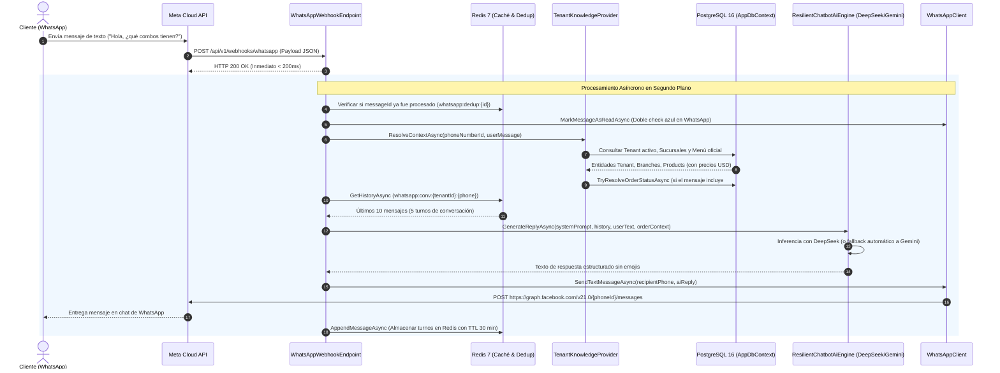

# 05. Subsistema Conversacional WhatsApp Cloud API e IA Multi-Tenant (DeepSeek & Gemini)

Este documento especifica la arquitectura, flujo de datos, seguridad, integración de modelos de lenguaje e infraestructura del chatbot oficial de WhatsApp para **Delivery Platform**, diseñado para operar de forma multi-tenant y multi-sucursal con aislamiento estricto de datos.

---

## 1. Arquitectura General del Sistema

El subsistema conversacional está implementado como una Vertical Slice autónoma en `.NET 8` (`Delivery.Features.Chatbot.WhatsAppWebhook`), desacoplada de capas intermedias y gobernada por contratos independientes.



---

## 2. Componentes de la Vertical Slice

| Componente | Tipo / Patrón | Propósito y Responsabilidad |
| :--- | :--- | :--- |
| **`WhatsAppWebhookEndpoint`** | `IEndpoint` (Minimal API) | Expone el apretón de manos `GET` y la ingesta asíncrona `POST`. |
| **`WhatsAppWebhookProcessor`** | `IWhatsAppWebhookProcessor` | Orquesta la verificación de idempotencia, llamada a IA y despacho. |
| **`TenantKnowledgeProvider`** | `ITenantKnowledgeProvider` | Carga el menú, horarios de sucursales y estado de comandas desde la base de datos. |
| **`RedisConversationStore`** | `IConversationStore` | Mantiene el historial conversacional y la deduplicación de eventos en Redis. |
| **`DeepSeekAiEngine`** | `IChatbotAiEngine` | Motor primario de inferencia conectado a la API de DeepSeek (`deepseek-chat`). |
| **`GeminiAiEngine`** | `IChatbotAiEngine` | Motor de contingencia conectado a la API de Google Gemini (`gemini-2.0-flash`). |
| **`ResilientChatbotAiEngine`** | `IChatbotAiEngine` (Composite) | Conmutador de resiliencia con fallback automático en caso de fallos de red. |
| **`WhatsAppClient`** | `IWhatsAppClient` | Envío de mensajes salientes y acuse de lectura hacia Meta Graph API v21.0. |

---

## 3. Resolución Multi-Tenant y Multi-Sucursal

El motor conversacional inyecta contexto dinámico de forma que el bot responda con los datos reales de la base de datos de cada establecimiento:

### 3.1. Identificación del Establecimiento
1. **Por Identificador de Teléfono (`PhoneNumberId`):** Cada sucursal o comercio puede vincular su propio número de teléfono en la configuración de su establecimiento.
2. **Por Mención Contextual:** Si el cliente menciona el nombre o slug de un restaurante afiliado (ej. *"en La Granjita"*, *"en Brasas del Valle"*), el sistema enlaza la sesión a dicho tenant.
3. **Por Defecto de Plataforma:** En entornos de prueba o número centralizado, el sistema resuelve el tenant principal (`la-granjita`).

### 3.2. Estructura del Prompt del Sistema (System Prompt)
El `TenantKnowledgeProvider` genera en memoria un prompt dinámico estructurado:
* **Identidad de Marca:** Nombre, eslogan y políticas del establecimiento.
* **Directorio de Sucursales:** Nombre de la sucursal, dirección física exacta, teléfono de contacto y horarios de apertura y cierre.
* **Catálogo Categorizado:** Listado de productos activos agrupados por categoría, descripción y precio exacto en dólares estadounidenses (USD).
* **Enlace Oficial de Checkout:** Generación del enlace canónico hacia la tienda web (`https://{platform_domain}/{slug}/menu`) para que el comensal concrete el pago formal.

### 3.3. Consulta de Estado de Pedidos en Tiempo Real
Si el comensal escribe una consulta como *"¿Cómo va mi pedido #1001?"* o *"Estado de orden 1002"*, el analizador sintáctico por expresiones regulares extrae el número de ticket y consulta `Orders` en `AppDbContext`:
* Informa el estado actual: `Recibido`, `En preparación en cocina`, `Listo para despacho`, `En camino con repartidor` o `Entregado`.
* Proporciona la sucursal de origen y el enlace de rastreo en vivo con mapa: `https://{platform_domain}/{slug}/rastreo/{orderId}`.

---

## 4. Persistencia, Idempotencia y SLA en Redis 7

Meta exige que el webhook responda con código HTTP 200 en menos de 5 segundos; de lo contrario, reintenta el envío de forma exponencial. Para garantizar este comportamiento:

1. **Retorno Inmediato:** El endpoint `POST` delega la ejecución a un subproceso desacoplado mediante `IServiceScopeFactory` y responde `HTTP 200 OK` en menos de 100 milisegundos.
2. **Deduplicación Estricta:** Antes de invocar a los modelos de lenguaje, el procesador verifica la existencia de la clave `whatsapp:dedup:{messageId}` en Redis con un tiempo de vida (TTL) de 10 minutos. Si el mensaje ya fue recibido, se descarta silenciosamente.
3. **Ventana Deslizante de Memoria:** El historial conversacional se almacena bajo `whatsapp:conv:{tenantId}:{customerPhone}` con un límite de los últimos 10 mensajes y una expiración de 30 minutos desde la última interacción.

---

## 5. Configuración de Variables de Entorno

En el archivo `.env` del servidor o entorno local se configuran los siguientes parámetros:

```ini
# ------------------------------------------------------------------------------
# Asistente Conversacional WhatsApp Cloud API e IA
# ------------------------------------------------------------------------------
WHATSAPP_PHONE_NUMBER_ID=1349339028273599
WHATSAPP_BUSINESS_ACCOUNT_ID=1138295258791070
WHATSAPP_ACCESS_TOKEN=EAAVHpZBEyQLsBS4...
WHATSAPP_VERIFY_TOKEN=mesafy_secure_webhook_token_2026

# Proveedores de IA
DEEPSEEK_API_KEY=tu_deepseek_api_key_aqui
GEMINI_API_KEY=tu_google_gemini_api_key_aqui
```

---

## 6. Configuración del Webhook en Meta for Developers

Para conectar el webhook local o de producción en la consola de Meta:

1. En Meta for Developers, ingresar a **WhatsApp > Configuración de la API** (o **Webhooks**).
2. En la sección **Webhook**, hacer clic en **Editar**.
3. **URL de devolución de llamada:** `https://{tu-dominio-o-tunel}/api/v1/webhooks/whatsapp`
4. **Identificador de verificación:** El valor exacto de `WHATSAPP_VERIFY_TOKEN` (por defecto: `mesafy_secure_webhook_token_2026`).
5. Hacer clic en **Verificar y guardar**. Meta ejecutará una petición `GET` con `hub.challenge` que el backend responderá inmediatamente.
6. En **Campos de webhook**, suscribirse al evento **`messages`**.

---

## 7. Ejecución con Cloudflare Tunnel en Desarrollo Local

Para exponer el puerto `5005` del backend local a Meta sin necesidad de abrir puertos en el router:

```powershell
& "C:\Program Files (x86)\cloudflared\cloudflared.exe" tunnel --url http://localhost:5005
```

Cloudflare generará una URL pública HTTPS temporal como `https://random-subdomain.trycloudflare.com`, la cual se registra en Meta como URL de devolución de llamada.

---

## Navegación de Documentación
* **Anterior:** [04. Multi-Tenancy y Personalización Dinámica](./04-multitenancy-y-personalizacion.md)
* **Siguiente:** [01. Arquitectura Frontend y App Router](../03-frontend-tienda/01-arquitectura-frontend-app-router.md)
* **Índice General:** [README Principal](../../README.md)

