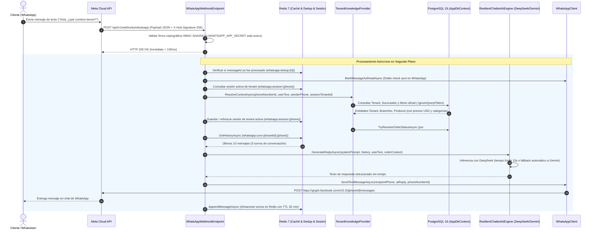

# 05. Subsistema Conversacional WhatsApp Cloud API e IA Multi-Tenant (DeepSeek & Gemini)

Este documento especifica la arquitectura, flujo de datos, seguridad, integración de modelos de lenguaje e infraestructura del chatbot oficial de WhatsApp para **Delivery Platform**, diseñado para operar de forma multi-tenant y multi-sucursal con aislamiento estricto de datos.

---

## 1. Arquitectura General del Sistema

El subsistema conversacional está implementado como una Vertical Slice autónoma en `.NET 8` (`Delivery.Features.Chatbot.WhatsAppWebhook`), desacoplada de capas intermedias y gobernada por contratos independientes.



---

## 2. Componentes de la Vertical Slice

| Componente | Tipo / Patrón | Propósito y Responsabilidad |
| :--- | :--- | :--- |
| **`WhatsAppWebhookEndpoint`** | `IEndpoint` (Minimal API) | Expone el apretón de manos `GET`, validación criptográfica HMAC-SHA256 y la ingesta asíncrona `POST`. |
| **`WhatsAppWebhookProcessor`** | `IWhatsAppWebhookProcessor` | Orquesta la verificación de idempotencia, sesión en Redis, consentimiento LOPDP, llamada a IA y despacho. |
| **`CustomerConsentTracker`** | `ICustomerConsentTracker` | Gestiona la persistencia auditable, consulta en Redis y revocatoria legal de consentimiento LOPDP. |
| **`TenantKnowledgeProvider`** | `ITenantKnowledgeProvider` | Carga el menú, configuración del tenant, horarios de sucursales, hora local y estado de comandas. |
| **`RedisConversationStore`** | `IConversationStore` | Mantiene el historial conversacional, sesiones multi-tenant y deduplicación de eventos en Redis. |
| **`DeepSeekAiEngine`** | `IChatbotAiEngine` | Motor primario de inferencia conectado a la API de DeepSeek (`deepseek-chat`). |
| **`GeminiAiEngine`** | `IChatbotAiEngine` | Motor de contingencia conectado a la API de Google Gemini (`gemini-2.0-flash`). |
| **`ResilientChatbotAiEngine`** | `IChatbotAiEngine` (Composite) | Conmutador de resiliencia con cancelación de 15 segundos y fallback automático a Gemini. |
| **`WhatsAppClient`** | `IWhatsAppClient` | Envío de mensajes salientes y acuse de lectura hacia Meta Graph API v21.0. |

---

## 3. Resolución Multi-Tenant y Multi-Sucursal

El motor conversacional inyecta contexto dinámico de forma que el bot responda con los datos reales de la base de datos de cada establecimiento sin perder el hilo de la conversación:

### 3.1. Cascada de Resolución del Establecimiento (5 Niveles)
Para evitar que un cliente cambie de establecimiento involuntariamente entre turnos o cuando se comparte un número de soporte central:
1. **Mención Explícita:** Si el cliente menciona el nombre o slug de un restaurante afiliado (ej. *"en La Granjita"*, *"en Brasas del Valle"*), el sistema vincula inmediatamente la sesión a dicho tenant.
2. **Número Telefónico Asignado:** Si el `phoneNumberId` o número emisor coincide con el teléfono de contacto del Tenant o con el teléfono de una de sus Sucursales físicas en base de datos.
3. **Pedido Activo Reciente:** Si el comensal posee un pedido creado en las últimas 24 horas asociado a su número de WhatsApp, se prioriza el tenant donde realizó la compra.
4. **Continuidad de Sesión en Redis:** Si el cliente ya venía conversando con un restaurante específico, el sistema recupera la clave `whatsapp:session:{cleanPhone}` (TTL de 30 minutos).
5. **Fallback de Plataforma:** En caso de no existir sesión previa ni pedido, se enlaza al establecimiento insignia (`la-granjita`) o al primer tenant activo.

### 3.2. Inteligencia Multi-Sucursal y Horarios Locales
El `TenantKnowledgeProvider` genera en memoria un prompt dinámico adaptado:
* **Hora y Fecha Local:** Inyección explícita de la hora actual en Ecuador (UTC-5) para que el asistente determine con precisión si el local está abierto o cerrado en ese instante.
* **Directorio de Sucursales:** Nombre de la sucursal, dirección física exacta, teléfono de contacto y horarios de apertura y cierre.
* **Instrucciones de Orientación:** Si el cliente consulta sobre coberturas o locales cercanos, el bot indica las sucursales existentes para que el cliente elija la más conveniente.
* **Catálogo Categorizado:** Listado de productos activos agrupados por categoría oficial (`CategoryEntity.Name`), descripción y precio en USD.
* **Enlace Oficial de Checkout:** Generación del enlace canónico hacia la tienda web (`https://{platform_domain}/{slug}/menu`) para concretar el pedido y pago en línea.

### 3.3. Consulta de Estado de Pedidos en Tiempo Real
El sistema procesa consultas de seguimiento bajo dos modalidades:
1. **Por Número de Ticket:** Analiza expresiones regulares (`#1001`, `pedido 1002`, `orden 1003`, `ticket 1004`, `comanda 1005`) y localiza el pedido.
2. **Automático por Teléfono:** Si el comensal no recuerda su número y escribe *"¿Cómo va mi comida?"*, *"¿Dónde está mi pedido?"* o *"¿Ya salió el repartidor?"*, el sistema busca automáticamente la última orden en curso (últimas 24 horas) asociada a su número de WhatsApp.
3. **Detalle Entregado:**
   * Estado de la orden (`Recibido`, `En preparación en cocina`, `Listo para despacho`, `En camino`, `Entregado`).
   * Sucursal encargada con dirección física y teléfono de contacto directo.
   * Enlace canónico de rastreo satelital con mapa vectorial en vivo: `https://{platform_domain}/{slug}/rastreo/{orderId}`.

---

## 4. Gobernanza de Consentimiento LOPDP y Feature Flags Multi-Tenant

Conforme a la **Ley Orgánica de Protección de Datos Personales (LOPDP)** de Ecuador y estándares internacionales de privacidad, el subsistema incorpora un interceptor legal previo a cualquier inferencia con modelos de lenguaje:

### 4.1. Configuración por Establecimiento (`TenantSetting`)
Cada restaurante puede gestionar granularmente el comportamiento del chatbot:
* `EnableWhatsAppBot`: Interruptor operativo (*Feature Flag*) para activar o desactivar la atención automática. Si está deshabilitado, el comensal recibe un mensaje informativo con la tienda web y teléfono directo, sin activar la IA.
* `RequireDataProtectionConsent`: Exige aceptación legal expresa antes de tratar datos.
* `CustomPrivacyPolicyUrl`: Enlace personalizado de privacidad (por defecto apunta a `https://{domain}/{slug}/privacidad`).

### 4.2. Flujo de Consentimiento y Auditoría (`CustomerConsentTracker`)
1. **Comensal Nuevo (Sin Consentimiento):** Al enviar cualquier mensaje, el sistema bloquea el consumo de tokens y envía el aviso formal de privacidad solicitando responder con la palabra `ACEPTO`.
2. **Aceptación (`ACEPTO`, `SI`, `1`):** Se almacena un registro inmutable en PostgreSQL (`CustomerConsent`) con evidencia JSON (`messageId`, canal, timestamp UTC y base jurídica LOPDP Art. 12/15) y se actualiza la memoria caché en Redis (`whatsapp:consent:{tenantId}:{phone}`). El bot envía confirmación de bienvenida y desbloquea el flujo.
3. **Turnos Subsecuentes:** El procesador valida el estado en Redis en menos de 1 milisegundo sin saturar PostgreSQL.
4. **Derecho a Revocatoria (`REVOCAR`, `ELIMINAR MIS DATOS`):** El cliente puede revocar su consentimiento en cualquier momento. El sistema marca el registro como `IsRevoked = true` en base de datos, invalida la clave en Redis y confirma la revocatoria.

---

## 5. Persistencia, Idempotencia y SLA en Redis 7

Meta exige que el webhook responda con código HTTP 200 en menos de 5 segundos; de lo contrario, reintenta el envío de forma exponencial. Para garantizar este comportamiento:

1. **Retorno Inmediato:** El endpoint `POST` delega la ejecución a un subproceso desacoplado mediante `IServiceScopeFactory` y responde `HTTP 200 OK` en menos de 100 milisegundos.
2. **Validación Criptográfica HMAC-SHA256:** Si `WHATSAPP_APP_SECRET` está configurado, se valida el encabezado `X-Hub-Signature-256` con `CryptographicOperations.FixedTimeEquals` para prevenir ataques de falsificación y timing attacks.
3. **Deduplicación Estricta:** Antes de invocar a los modelos de lenguaje, el procesador verifica la existencia de la clave `whatsapp:dedup:{messageId}` en Redis con un tiempo de vida (TTL) de 10 minutos. Si el mensaje ya fue recibido, se descarta silenciosamente.
4. **Ventana Deslizante de Memoria:** El historial conversacional se almacena bajo `whatsapp:conv:{tenantId}:{customerPhone}` con un límite de los últimos 10 mensajes y una expiración de 30 minutos desde la última interacción.

---

## 6. Configuración de Variables de Entorno

En el archivo `.env` del servidor o entorno local se configuran los siguientes parámetros:

```ini
# ------------------------------------------------------------------------------
# Asistente Conversacional WhatsApp Cloud API e IA
# ------------------------------------------------------------------------------
WHATSAPP_PHONE_NUMBER_ID=1349339028273599
WHATSAPP_BUSINESS_ACCOUNT_ID=1138295258791070
WHATSAPP_ACCESS_TOKEN=EAAVHpZBEyQLsBS4...
WHATSAPP_VERIFY_TOKEN=mesafy_secure_webhook_token_2026
WHATSAPP_APP_SECRET=tu_meta_app_secret_aqui

# Proveedores de IA
DEEPSEEK_API_KEY=tu_deepseek_api_key_aqui
GEMINI_API_KEY=tu_google_gemini_api_key_aqui
```

---

## 7. Configuración del Webhook en Meta for Developers

Para conectar el webhook local o de producción en la consola de Meta:

1. En Meta for Developers, ingresar a **WhatsApp > Configuración de la API** (o **Webhooks**).
2. En la sección **Webhook**, hacer clic en **Editar**.
3. **URL de devolución de llamada:** `https://{tu-dominio-o-tunel}/api/v1/webhooks/whatsapp`
4. **Identificador de verificación:** El valor exacto de `WHATSAPP_VERIFY_TOKEN` (por defecto: `mesafy_secure_webhook_token_2026`).
5. Hacer clic en **Verificar y guardar**. Meta ejecutará una petición `GET` con `hub.challenge` que el backend responderá inmediatamente.
6. En **Campos de webhook**, suscribirse al evento **`messages`**.

---

## 8. Ejecución con Cloudflare Tunnel en Desarrollo Local

Para exponer el puerto `5005` del backend local a Meta sin necesidad de abrir puertos en el router:

```powershell
& "C:\Program Files (x86)\cloudflared\cloudflared.exe" tunnel --url http://localhost:5005
```

Cloudflare generará una URL pública HTTPS temporal como `https://random-subdomain.trycloudflare.com`, la cual se registra en Meta como URL de devolución de llamada.

---

## Navegación de Documentación
* **Anterior:** [04. Multi-Tenancy y Personalización Dinámica](./04-multitenancy-y-personalizacion.md)
* **Siguiente:** [01. Arquitectura Frontend y App Router](../03-frontend-tienda/01-arquitectura-frontend-app-router.md)
* **Índice General:** [README Principal](../../README.md)

