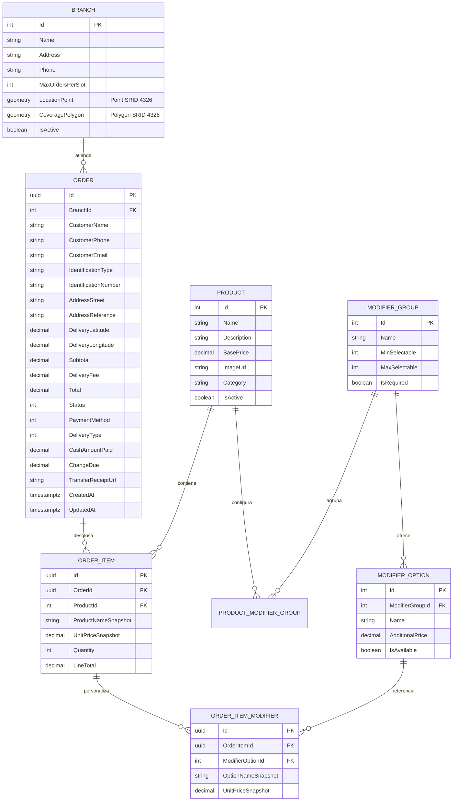

# 01. Modelo de Datos Relacional y Extension Espacial PostGIS

## 1. Descripcion del Motor de Base de Datos
* **Motor:** PostgreSQL 16
* **Extension:** PostGIS 3.4 (Habilitada via `CREATE EXTENSION IF NOT EXISTS postgis;`)
* **ORM:** Entity Framework Core 8 con `Npgsql.EntityFrameworkCore.PostgreSQL.NetTopologySuite`
* **Sistema de Coordenadas de Referencia (SRID):** `4326` (WGS 84 - Coordenadas geograficas mundiales en grados decimales: Longitud X, Latitud Y).

## 2. Diagrama Entidad-Relacion (ERD)



## 3. Diccionario de Tablas Principales

### 3.1. Tabla `Branches` (Sucursales y Poligonos de Cobertura)
| Columna | Tipo de Dato | Nulo | Descripcion |
| :--- | :--- | :--- | :--- |
| `Id` | `serial` | NO | Identificador unico entero (PK) |
| `Name` | `varchar(150)` | NO | Nombre operativo de la sucursal |
| `Address` | `varchar(250)` | NO | Direccion fisica del local |
| `Phone` | `varchar(20)` | NO | Telefono de contacto de la sede |
| `MaxOrdersPerSlot` | `int` | NO | Limite de pedidos por ventana de 20 min |
| `LocationPoint` | `geometry(Point, 4326)` | NO | Coordenadas exactas del local |
| `CoveragePolygon` | `geometry(Polygon, 4326)`| NO | Geocerca vectorial de cobertura directa |
| `IsActive` | `boolean` | NO | Estado operativo de la sucursal |

> [!IMPORTANT]
> **Indice Espacial GiST:** Para garantizar resoluciones espaciales en menos de 5ms, la tabla cuenta con el indice GiST:
> ```sql
> CREATE INDEX idx_branches_coverage_polygon ON "Branches" USING GIST ("CoveragePolygon");
> ```

### 3.2. Tabla `Orders` (Encabezado de Pedido)
Almacena el registro inmutable del pedido. Los precios finales, subtotales y costos de envio quedan fijados en esta tabla para proteger la contabilidad ante futuros cambios en el catalogo.

### 3.3. Tablas `OrderItems` y `OrderItemModifiers` (Snapshots Inmutables)
Cada linea de pedido almacena `ProductNameSnapshot` y `OptionNameSnapshot` junto a sus `UnitPriceSnapshot`. Esto garantiza que los historiales de venta y facturacion permanezcan 100% fieles al momento exacto de la compra.
