# 01. Modelo de Datos Relacional y Extension Espacial PostGIS

## 1. Descripcion del Motor de Base de Datos
* **Motor:** PostgreSQL 16
* **Extensiones Requeridas:**
  - `postgis` (PostGIS 3.4 para calculo geometrico y resolucion de geocercas poligonales con SRID 4326).
  - `uuid-ossp` (Generacion de identificadores unicos universales).
* **ORM:** Entity Framework Core 8 con proveedor `Npgsql.EntityFrameworkCore.PostgreSQL.NetTopologySuite`.
* **Aislamiento Multitenant:** Arquitectura discriminadora por columna `TenantId` con asignacion automatica en `SaveChanges`/`SaveChangesAsync` y filtros globales de consulta (`HasQueryFilter`) a nivel de contexto.
* **Sistema de Coordenadas de Referencia (SRID):** `4326` (WGS 84 - Coordenadas geograficas en grados decimales: Longitud X, Latitud Y).

---

## 2. Diagrama Entidad-Relacion Completo (24 Tablas)

```mermaid
erDiagram
    TENANT ||--o{ TENANT_SETTING : "configura"
    TENANT ||--o{ USER : "pertenece"
    TENANT ||--o{ BRANCH : "opera"
    TENANT ||--o{ CATEGORY : "clasifica"
    TENANT ||--o{ PRODUCT : "ofrece"
    TENANT ||--o{ MODIFIER_GROUP : "define"
    TENANT ||--o{ SUPPLIER : "abastece"
    TENANT ||--o{ CUSTOMER : "registra"
    TENANT ||--o{ ORDER : "factura"

    USER ||--o{ USER_ROLE : "posee"
    ROLE ||--o{ USER_ROLE : "asigna"
    BRANCH ||--o{ USER_ROLE : "delimita"
    USER ||--o{ REFRESH_TOKEN : "autentica"
    USER ||--o{ DRIVER : "habilita"

    BRANCH ||--o{ DINING_TABLE : "dispone"
    BRANCH ||--o{ CASH_SHIFT : "abre"
    BRANCH ||--o{ INVENTORY_ITEM : "almacena"
    BRANCH ||--o{ BRANCH_PRODUCT : "habilita"
    BRANCH ||--o{ ORDER : "recibe"
    BRANCH ||--o{ INVOICE : "emite"

    PRODUCT ||--o{ BRANCH_PRODUCT : "distribuye"
    CATEGORY ||--o{ PRODUCT : "agrupa"
    PRODUCT ||--o{ PRODUCT_MODIFIER_GROUP : "asocia"
    MODIFIER_GROUP ||--o{ PRODUCT_MODIFIER_GROUP : "vincula"
    MODIFIER_GROUP ||--o{ MODIFIER_OPTION : "contiene"

    PRODUCT ||--o{ PRODUCT_RECIPE : "formula"
    INVENTORY_ITEM ||--o{ PRODUCT_RECIPE : "consume"
    INVENTORY_ITEM ||--o{ INVENTORY_MOVEMENT : "registra"
    SUPPLIER ||--o{ INVENTORY_MOVEMENT : "provee"

    CASH_SHIFT ||--o{ CASH_TRANSACTION : "registra"
    CASH_SHIFT ||--o{ ORDER : "asocia"

    CUSTOMER ||--o{ ORDER : "realiza"
    DINING_TABLE ||--o{ ORDER : "ubica"
    ORDER ||--o{ ORDER_ITEM : "desglosa"
    ORDER ||--o{ INVOICE : "genera"
    ORDER ||--o| ORDER_DELIVERY : "despacha"
    ORDER ||--o{ INVENTORY_MOVEMENT : "descuenta"

    ORDER_ITEM ||--o{ ORDER_ITEM_MODIFIER : "personaliza"
    PRODUCT ||--o{ ORDER_ITEM : "referencia"
    MODIFIER_OPTION ||--o{ ORDER_ITEM_MODIFIER : "aplica"

    DRIVER ||--o{ ORDER_DELIVERY : "transporta"

    TENANT {
        uuid Id PK
        string Slug UK
        string Name
        string BusinessName
        string TaxId
        string BrandPrimaryColor
        string LogoUrl
        boolean IsActive
        timestamptz CreatedAt
    }

    TENANT_SETTING {
        uuid Id PK
        uuid TenantId FK
        string CustomDomain
        string CurrencyCode
        string SriEnvironment
        string SriCertificatePath
        string SriCertificatePasswordHash
    }

    USER {
        uuid Id PK
        uuid TenantId FK
        string Email
        string PasswordHash
        string FullName
        string Phone
        boolean IsActive
        timestamptz CreatedAt
    }

    ROLE {
        int Id PK
        string Name
        string Description
    }

    USER_ROLE {
        uuid Id PK
        uuid UserId FK
        int RoleId FK
        int BranchId FK
    }

    REFRESH_TOKEN {
        uuid Id PK
        uuid UserId FK
        string TokenHash
        timestamptz ExpiresAt
        timestamptz CreatedAt
        string CreatedByIp
        timestamptz RevokedAt
    }

    BRANCH {
        int Id PK
        uuid TenantId FK
        string Name
        string Address
        string Phone
        geometry LocationPoint "Point SRID 4326"
        geometry CoveragePolygon "Polygon SRID 4326"
        int MaxOrdersPerSlot
        string SriEstablishmentCode
        string SriEmissionPoint
        int NextInvoiceSequence
        string OpeningTime
        string ClosingTime
        boolean IsActive
    }

    DINING_TABLE {
        int Id PK
        uuid TenantId FK
        int BranchId FK
        string Name
        boolean IsActive
    }

    CASH_SHIFT {
        uuid Id PK
        uuid TenantId FK
        int BranchId FK
        uuid CashierUserId FK
        timestamptz OpenedAt
        timestamptz ClosedAt
        decimal InitialCashAmount
        decimal CashSalesTotal
        decimal TransferSalesTotal
        decimal CashoutTotal
        decimal FinalCountedCash
        decimal Difference
    }

    CASH_TRANSACTION {
        uuid Id PK
        uuid TenantId FK
        uuid ShiftId FK
        string Type
        decimal Amount
        string Reason
        timestamptz CreatedAt
    }

    CATEGORY {
        int Id PK
        uuid TenantId FK
        string Name
        int DisplayOrder
        boolean IsActive
    }

    PRODUCT {
        int Id PK
        uuid TenantId FK
        int CategoryId FK
        string Sku
        string Name
        string Description
        decimal BasePrice
        decimal TaxRate
        string ImageUrl
        string Category
        boolean IsKitchen
        boolean IsActive
    }

    BRANCH_PRODUCT {
        int BranchId PK_FK
        int ProductId PK_FK
        uuid TenantId FK
        boolean IsAvailable
        decimal CustomPrice
    }

    MODIFIER_GROUP {
        int Id PK
        uuid TenantId FK
        string Name
        int MinSelectable
        int MaxSelectable
        boolean IsRequired
    }

    PRODUCT_MODIFIER_GROUP {
        int ProductId PK_FK
        int ModifierGroupId PK_FK
    }

    MODIFIER_OPTION {
        int Id PK
        int ModifierGroupId FK
        string Name
        decimal AdditionalPrice
        boolean IsAvailable
    }

    INVENTORY_ITEM {
        int Id PK
        uuid TenantId FK
        int BranchId FK
        string Sku
        string Name
        string UnitOfMeasure
        decimal CurrentStock
        decimal MinAlertStock
        decimal CostPrice
        boolean IsActive
    }

    PRODUCT_RECIPE {
        int Id PK
        int ProductId FK
        int InventoryItemId FK
        decimal QuantityUsed
    }

    SUPPLIER {
        uuid Id PK
        uuid TenantId FK
        string Name
        string TaxId
        string Phone
        string Email
        string Address
        boolean IsActive
    }

    INVENTORY_MOVEMENT {
        uuid Id PK
        uuid TenantId FK
        int InventoryItemId FK
        uuid SupplierId FK
        uuid OrderId FK
        string MovementType
        decimal QuantityDelta
        decimal StockBefore
        decimal StockAfter
        decimal UnitCostSnapshot
        string Notes
        timestamptz CreatedAt
    }

    CUSTOMER {
        uuid Id PK
        uuid TenantId FK
        string IdentificationType
        string IdentificationNumber
        string FullName
        string Phone
        string Email
        string DefaultAddressStreet
        string DefaultAddressReference
        geometry DefaultLocationPoint "Point SRID 4326"
        int TotalOrdersCount
        timestamptz CreatedAt
        timestamptz LastOrderAt
    }

    ORDER {
        uuid Id PK
        uuid TenantId FK
        int BranchId FK
        int OrderNumber
        uuid CustomerId FK
        uuid ShiftId FK
        int DiningTableId FK
        string CustomerName
        string CustomerPhone
        string CustomerEmail
        string IdentificationType
        string IdentificationNumber
        string AddressStreet
        string AddressReference
        string CustomerNotes
        geometry DeliveryLocation "Point SRID 4326"
        decimal Subtotal
        decimal DiscountAmount
        decimal TaxAmount
        decimal DeliveryFee
        decimal Total
        string Source
        string Status
        string PaymentMethod
        string DeliveryType
        string CancellationReason
        uuid CreatedByUserId FK
        decimal CashAmountPaid
        decimal ChangeDue
        string TransferReceiptUrl
        timestamptz CreatedAt
        timestamptz UpdatedAt
    }

    ORDER_ITEM {
        uuid Id PK
        uuid OrderId FK
        int ProductId FK
        string ProductNameSnapshot
        decimal UnitPriceSnapshot
        decimal TaxRateSnapshot
        int Quantity
        string Notes
    }

    ORDER_ITEM_MODIFIER {
        uuid Id PK
        uuid OrderItemId FK
        int ModifierOptionId FK
        string ModifierNameSnapshot
        decimal PriceSnapshot
    }

    INVOICE {
        uuid Id PK
        uuid TenantId FK
        int BranchId FK
        uuid OrderId FK
        string SequentialNumber
        string SriAccessKey
        string SriStatus
        string BuyerIdentificationType
        string BuyerIdentificationNumber
        string BuyerName
        string BuyerEmail
        decimal SubtotalZeroTax
        decimal SubtotalTaxable
        decimal TaxAmount
        decimal Total
        timestamptz IssuedAt
        timestamptz AuthorizedAt
        string SriErrorMessage
    }

    DRIVER {
        uuid Id PK
        uuid TenantId FK
        uuid UserId FK
        string VehicleType
        string LicensePlate
        boolean IsAvailable
        geometry CurrentLocation "Point SRID 4326"
    }

    ORDER_DELIVERY {
        uuid Id PK
        uuid OrderId FK
        uuid DriverId FK
        timestamptz AssignedAt
        timestamptz PickedUpAt
        timestamptz DeliveredAt
    }
```



---

## 3. Diccionario Exhaustivo de Datos por Dominio

### 3.1. Dominio 1: Multitenancy y Parametrizacion

#### Tabla `Tenants`
Identifica la marca o franquicia en la plataforma SaaS.
| Columna | Tipo de Dato | Nulo | Restriccion | Descripcion |
| :--- | :--- | :--- | :--- | :--- |
| `Id` | `uuid` | NO | PK | Identificador unico universal del tenant |
| `Slug` | `varchar(50)` | NO | UK | Identificador URL de la marca (ej. `la-granjita`) |
| `Name` | `varchar(150)` | NO | - | Nombre comercial visible de la marca |
| `BusinessName` | `varchar(200)` | SI | - | Razon social legal para facturacion ante el SRI |
| `TaxId` | `varchar(20)` | SI | - | RUC tributario en Ecuador (13 digitos) |
| `LogoUrl` | `varchar(500)` | SI | - | Ruta publica al isotipo/logotipo |
| `BrandPrimaryColor` | `varchar(10)` | SI | - | Color de acento de marca en formato hexadecimal (ej. `#E4002B`) |
| `IsActive` | `boolean` | NO | Default: `true` | Estado de acceso y operacion de la marca |
| `CreatedAt` | `timestamptz` | NO | UtcNow | Fecha y hora de creacion del registro |

#### Tabla `TenantSettings`
Almacena parametros tecnicos y fiscales por marca.
| Columna | Tipo de Dato | Nulo | Restriccion | Descripcion |
| :--- | :--- | :--- | :--- | :--- |
| `Id` | `uuid` | NO | PK | Identificador unico |
| `TenantId` | `uuid` | NO | FK (`Tenants.Id`), UK | Enlace obligatorio 1:1 con el Tenant |
| `CustomDomain` | `varchar(150)` | SI | - | Dominio personalizado DNS opcional |
| `CurrencyCode` | `varchar(3)` | NO | Default: `'USD'` | Codigo ISO monetario |
| `SriEnvironment` | `varchar(20)` | NO | Default: `'PRUEBAS'` | Ambiente SRI (`'PRUEBAS'` o `'PRODUCCION'`) |
| `SriCertificatePath` | `varchar(500)` | SI | - | Ruta al archivo de firma electronica PKCS#12 (`.p12`) |
| `SriCertificatePasswordHash` | `text` | SI | - | Hash/secreto para desencriptar el certificado |

---

### 3.2. Dominio 2: Seguridad, Usuarios y RBAC

#### Tabla `Users`
Cuentas de acceso para todos los roles del sistema (administradores, cajeros, cocina, repartidores).
| Columna | Tipo de Dato | Nulo | Restriccion | Descripcion |
| :--- | :--- | :--- | :--- | :--- |
| `Id` | `uuid` | NO | PK | Identificador unico universal |
| `TenantId` | `uuid` | SI | FK (`Tenants.Id`), UK(`TenantId`, `Email`) | Tenant al que pertenece (`null` solo para SuperAdmin) |
| `Email` | `varchar(200)` | NO | - | Correo electronico para autenticacion |
| `PasswordHash` | `varchar(255)` | NO | - | Hash seguro de la contrasena (BCrypt / Argon2) |
| `FullName` | `varchar(150)` | NO | - | Nombre y apellido del usuario |
| `Phone` | `varchar(30)` | SI | - | Telefono de contacto directo |
| `IsActive` | `boolean` | NO | Default: `true` | Estado de habilitacion de la cuenta |
| `CreatedAt` | `timestamptz` | NO | UtcNow | Fecha de creacion |

#### Tabla `Roles`
Catalogo de roles estandar del sistema (Ids 1 a 7).
| Id | Nombre de Rol | Descripcion Operativa |
| :--- | :--- | :--- |
| `1` | `SuperAdmin` | Administrador tecnico global de la plataforma SaaS |
| `2` | `TenantAdmin` | Gerente o propietario de la marca con control integral |
| `3` | `BranchManager` | Administrador a cargo de una sede fisica especifica |
| `4` | `Cashier` | Cajero de mostrador y salon para apertura y cierre de turnos |
| `5` | `KitchenStaff` | Maestro hornero y operadores de pantallas KDS |
| `6` | `Driver` | Repartidor motorizado asignado a despacho |
| `7` | `Customer` | Cliente registrado en el canal de venta web |

#### Tabla `UserRoles`
Vincula usuarios con roles y permite acotar el rol a una sucursal fisica o mantenerlo global.
| Columna | Tipo de Dato | Nulo | Restriccion | Descripcion |
| :--- | :--- | :--- | :--- | :--- |
| `Id` | `uuid` | NO | PK | Identificador unico |
| `UserId` | `uuid` | NO | FK (`Users.Id`), UK(`UserId`, `RoleId`, `BranchId`) | Usuario asignado |
| `RoleId` | `int` | NO | FK (`Roles.Id`) | Rol conferido |
| `BranchId` | `int` | SI | FK (`Branches.Id`) | Sucursal delimitada (`null` para administracion global) |

#### Tabla `RefreshTokens`
Gestiona la rotacion segura de sesiones JWT.
| Columna | Tipo de Dato | Nulo | Restriccion | Descripcion |
| :--- | :--- | :--- | :--- | :--- |
| `Id` | `uuid` | NO | PK | Identificador unico del token |
| `UserId` | `uuid` | NO | FK (`Users.Id`) | Usuario titular de la sesion |
| `TokenHash` | `varchar(255)` | NO | - | Hash criptografico del token emitido |
| `ExpiresAt` | `timestamptz` | NO | - | Momento de caducidad |
| `CreatedAt` | `timestamptz` | NO | UtcNow | Momento de emision |
| `CreatedByIp` | `varchar(45)` | SI | - | Direccion IP del cliente solicitante |
| `RevokedAt` | `timestamptz` | SI | - | Momento de revocacion anticipada |

---

### 3.3. Dominio 3: Sucursales, Salón y Geocercas PostGIS

#### Tabla `Branches`
Locales fisicos con resolucion de geocerca espacial vectorial e integracion de facturacion SRI.
| Columna | Tipo de Dato | Nulo | Restriccion | Descripcion |
| :--- | :--- | :--- | :--- | :--- |
| `Id` | `serial` | NO | PK | Identificador entero de la sucursal |
| `TenantId` | `uuid` | NO | FK (`Tenants.Id`) | Marca propietaria |
| `Name` | `varchar(150)` | NO | - | Nombre descriptivo (ej. `Sucursal #1 (Norte)`) |
| `Address` | `varchar(300)` | SI | - | Direccion fisica de la sucursal |
| `Phone` | `varchar(30)` | SI | - | Telefono del local |
| `LocationPoint` | `geometry(Point, 4326)` | NO | - | Coordenadas exactas del establecimiento |
| `CoveragePolygon` | `geometry(Polygon, 4326)` | NO | Indice GiST | Poligono que delimita la zona de entrega directa |
| `MaxOrdersPerSlot` | `int` | NO | Default: `15` | Capacidad maxima de pedidos por ranura de 20 min |
| `SriEstablishmentCode`| `varchar(3)` | NO | Default: `'001'` | Codigo de establecimiento SRI (`001`, `002`) |
| `SriEmissionPoint` | `varchar(3)` | NO | Default: `'001'` | Punto de emision SRI asignado |
| `NextInvoiceSequence` | `int` | NO | Default: `1` | Secuencial numerico incremental de facturacion |
| `OpeningTime` | `varchar(10)` | NO | Default: `'10:30'`| Hora de apertura en formato `HH:mm` |
| `ClosingTime` | `varchar(10)` | NO | Default: `'21:30'`| Hora de cierre en formato `HH:mm` |
| `IsActive` | `boolean` | NO | Default: `true` | Estado operativo del local |

#### Tabla `DiningTables`
Mesas de salon para pedidos en sitio y comandas fisicas.
| Columna | Tipo de Dato | Nulo | Restriccion | Descripcion |
| :--- | :--- | :--- | :--- | :--- |
| `Id` | `serial` | NO | PK | Identificador de la mesa |
| `TenantId` | `uuid` | NO | FK (`Tenants.Id`) | Marca propietaria |
| `BranchId` | `int` | NO | FK (`Branches.Id`) | Sucursal a la que pertenece |
| `Name` | `varchar(50)` | NO | - | Identificador visible (ej. `Mesa 1` a `Mesa 8`) |
| `IsActive` | `boolean` | NO | Default: `true` | Disponibilidad operativa de la mesa |

---

### 3.4. Dominio 4: Turnos de Caja y Gastos Operativos

#### Tabla `CashShifts`
Turnos de caja para arqueo de efectivo y transferencias (equivalente a `closedcash` de VentaFácil).
| Columna | Tipo de Dato | Nulo | Restriccion | Descripcion |
| :--- | :--- | :--- | :--- | :--- |
| `Id` | `uuid` | NO | PK | Identificador del turno |
| `TenantId` | `uuid` | NO | FK (`Tenants.Id`) | Marca |
| `BranchId` | `int` | NO | FK (`Branches.Id`) | Sucursal física |
| `CashierUserId` | `uuid` | NO | FK (`Users.Id`) | Cajero responsable del turno |
| `OpenedAt` | `timestamptz` | NO | UtcNow | Momento de apertura de caja |
| `ClosedAt` | `timestamptz` | SI | - | Momento de cierre y liquidacion |
| `InitialCashAmount` | `numeric(18,2)` | NO | Default: `0.00` | Fondo inicial de caja |
| `CashSalesTotal` | `numeric(18,2)` | NO | Default: `0.00` | Total acumulado de ventas en efectivo |
| `TransferSalesTotal`| `numeric(18,2)` | NO | Default: `0.00` | Total acumulado en transferencias |
| `CashoutTotal` | `numeric(18,2)` | NO | Default: `0.00` | Total de retiros operativos de dinero |
| `FinalCountedCash` | `numeric(18,2)` | SI | - | Efectivo físico contado al cierre |
| `Difference` | `numeric(18,2)` | SI | - | Diferencia (Sobrante / Faltante de caja) |

#### Tabla `CashTransactions`
Registro de retiros de dinero en efectivo de caja para compras menores operativas (`CASHOUT`).
| Columna | Tipo de Dato | Nulo | Restriccion | Descripcion |
| :--- | :--- | :--- | :--- | :--- |
| `Id` | `uuid` | NO | PK | Identificador de la transaccion |
| `TenantId` | `uuid` | NO | FK (`Tenants.Id`) | Marca |
| `ShiftId` | `uuid` | NO | FK (`CashShifts.Id`)| Turno de caja afectado |
| `Type` | `varchar(20)` | NO | Default: `'CASHOUT'`| Tipo de movimiento (`CASHOUT`, `CASHIN`) |
| `Amount` | `numeric(18,2)` | NO | - | Monto retirado o ingresado |
| `Reason` | `varchar(250)` | NO | - | Justificacion (ej. *"Compra de cilindro de gas industrial"*, *"Hielo"*) |
| `CreatedAt` | `timestamptz` | NO | UtcNow | Momento del movimiento |

---

### 3.5. Dominio 5: Catálogo, Recetas, Disponibilidad y Kárdex

#### Tabla `Categories`
Clasificacion principal de los productos del menú.
| Columna | Tipo de Dato | Nulo | Restriccion | Descripcion |
| :--- | :--- | :--- | :--- | :--- |
| `Id` | `serial` | NO | PK | Identificador de categoria |
| `TenantId` | `uuid` | NO | FK (`Tenants.Id`) | Marca |
| `Name` | `varchar(100)` | NO | - | Nombre (ej. `Combos`, `Porciones`, `Extras`, `Bebidas`) |
| `DisplayOrder` | `int` | NO | Default: `0` | Orden de presentacion en el menú |
| `IsActive` | `boolean` | NO | Default: `true` | Estado |

#### Tabla `Products`
Productos maestros del catálogo comercial.
| Columna | Tipo de Dato | Nulo | Restriccion | Descripcion |
| :--- | :--- | :--- | :--- | :--- |
| `Id` | `serial` | NO | PK | Identificador de producto |
| `TenantId` | `uuid` | NO | FK (`Tenants.Id`) | Marca |
| `CategoryId` | `int` | SI | FK (`Categories.Id`) | Categoria asignada |
| `Sku` | `varchar(50)` | SI | - | Codigo comercial (ej. `CMB-FAM-01`) |
| `Name` | `varchar(150)` | NO | - | Nombre comercial |
| `Description` | `varchar(500)` | SI | - | Descripcion de preparacion |
| `BasePrice` | `numeric(18,2)` | NO | - | Precio base en USD |
| `TaxRate` | `numeric(5,2)` | NO | Default: `0.00` | Tarifa de IVA (0.00% o 15.00%) |
| `ImageUrl` | `varchar(500)` | SI | - | Ruta de imagen ilustrativa |
| `Category` | `varchar(100)` | SI | - | Etiqueta rapida de categoria |
| `IsKitchen` | `boolean` | NO | Default: `true` | Si requiere preparacion y envio a comanda KDS |
| `IsActive` | `boolean` | NO | Default: `true` | Estado de comercializacion |

#### Tabla `BranchProducts`
Control de disponibilidad independiente por cada sede fisica.
| Columna | Tipo de Dato | Nulo | Restriccion | Descripcion |
| :--- | :--- | :--- | :--- | :--- |
| `BranchId` | `int` | NO | PK, FK (`Branches.Id`) | Sucursal |
| `ProductId` | `int` | NO | PK, FK (`Products.Id`) | Producto |
| `TenantId` | `uuid` | NO | FK (`Tenants.Id`) | Marca |
| `IsAvailable` | `boolean` | NO | Default: `true` | Si el plato esta disponible o agotado en esa sede |
| `CustomPrice` | `numeric(18,2)` | SI | - | Precio especial para esa sucursal (opcional) |

#### Tabla `ModifierGroups` y `ModifierOptions`
Grupos y opciones de configuracion de platos (guarniciones, salsas, ajies, bebidas).
* `ModifierGroups`: Define reglas de eleccion (`MinSelectable`, `MaxSelectable`, `IsRequired`).
* `ModifierOptions`: Opciones individuales con recargo opcional (`AdditionalPrice`).

#### Tabla `InventoryItems`
Insumos crudos y materiales de empaque con stock localizado por sucursal.
| Columna | Tipo de Dato | Nulo | Restriccion | Descripcion |
| :--- | :--- | :--- | :--- | :--- |
| `Id` | `serial` | NO | PK | Identificador de insumo |
| `TenantId` | `uuid` | NO | FK (`Tenants.Id`) | Marca |
| `BranchId` | `int` | NO | FK (`Branches.Id`), UK(`TenantId`, `BranchId`, `Sku`) | Sucursal física donde reposa el stock |
| `Sku` | `varchar(50)` | NO | - | Codigo estandar (ej. `INS-POLLO-OCT`, `INS-CONT-TERM`) |
| `Name` | `varchar(150)` | NO | - | Nombre (ej. `Pollo Crudo (Octavos)`) |
| `UnitOfMeasure`| `varchar(50)` | NO | Default: `'OCTAVO'` | Unidad (`OCTAVO`, `BOLSA`, `UNIDAD`, `KG`) |
| `CurrentStock` | `numeric(18,3)` | NO | - | Existencia física actual disponible |
| `MinAlertStock`| `numeric(18,3)` | NO | - | Umbral para alerta de reabastecimiento |
| `CostPrice` | `numeric(18,2)` | NO | - | Costo promedio unitario de adquisicion |
| `IsActive` | `boolean` | NO | Default: `true` | Estado del insumo |

#### Tabla `ProductRecipes`
Formula de explosion de materiales para descuento automatizado de inventario.
| Columna | Tipo de Dato | Nulo | Restriccion | Descripcion |
| :--- | :--- | :--- | :--- | :--- |
| `Id` | `serial` | NO | PK | Identificador de receta |
| `ProductId` | `int` | NO | FK (`Products.Id`) | Producto comercial que se vende |
| `InventoryItemId`| `int` | NO | FK (`InventoryItems.Id`) | Insumo crudo consumido |
| `QuantityUsed` | `numeric(18,3)` | NO | - | Unidades consumidas (ej. `8.0` octavos para 1 pollo entero, `4.0` para medio pollo, `1.0` para contenedor) |

#### Tabla `Suppliers` e `InventoryMovements` (Kárdex Inmutable)
Auditoría estricta de todos los ingresos y egresos de mercadería.
* `Suppliers`: Directorio de proveedores de materia prima (ej. Avícolas).
* `InventoryMovements`: Kárdex inmutable equivalente a `stockdiary` en VentaFácil:
  - Registra `MovementType` (`COMPRA_PROVEEDOR`, `VENTA_PEDIDO`, `DESPERDICIO_MERMA`, `AJUSTE_MANUAL`).
  - Almacena snapshots exactos: `QuantityDelta`, `StockBefore`, `StockAfter` y `UnitCostSnapshot`.

---

### 3.6. Dominio 6: Clientes, Pedidos y Facturación Electrónica SRI

#### Tabla `Customers`
Directorio de clientes frecuentes para autocompletado instantáneo por Cédula/RUC o Teléfono.
| Columna | Tipo de Dato | Nulo | Restriccion | Descripcion |
| :--- | :--- | :--- | :--- | :--- |
| `Id` | `uuid` | NO | PK | Identificador unico |
| `TenantId` | `uuid` | NO | FK (`Tenants.Id`) | Marca |
| `IdentificationType` | `varchar(50)` | NO | Default: `'CEDULA'` | Tipo (`CEDULA`, `RUC`, `PASAPORTE`) |
| `IdentificationNumber`| `varchar(50)`| NO | UK(`TenantId`, `IdentificationNumber`)| Numero de identificacion fiscal |
| `FullName` | `varchar(150)` | NO | - | Nombre o Razon Social |
| `Phone` | `varchar(30)` | NO | Indice(`TenantId`, `Phone`) | Telefono de contacto |
| `Email` | `varchar(150)` | SI | - | Correo para envio de factura SRI |
| `DefaultAddressStreet`| `varchar(300)`| SI | - | Calle principal y numeracion habitual |
| `DefaultAddressReference`|`varchar(300)`| SI | - | Referencia de ubicacion habitual |
| `DefaultLocationPoint`| `geometry(Point, 4326)` | SI | - | Coordenadas GPS de entrega habitual |
| `TotalOrdersCount` | `int` | NO | Default: `0` | Contador historico de pedidos |
| `CreatedAt` | `timestamptz` | NO | UtcNow | Fecha de registro |
| `LastOrderAt` | `timestamptz` | SI | - | Ultimo pedido realizado |

#### Tabla `Orders`
Cabecera central del pedido comercial y operativo.
| Columna | Tipo de Dato | Nulo | Restriccion | Descripcion |
| :--- | :--- | :--- | :--- | :--- |
| `Id` | `uuid` | NO | PK | Identificador UUID del pedido |
| `TenantId` | `uuid` | NO | FK (`Tenants.Id`) | Marca |
| `BranchId` | `int` | NO | FK (`Branches.Id`) | Sucursal asignada por geocerca |
| `OrderNumber` | `int` | NO | - | Numero corto legible de comanda (#1001, #1002) |
| `CustomerId` | `uuid` | SI | FK (`Customers.Id`) | Cliente registrado/frecuente opcional |
| `ShiftId` | `uuid` | SI | FK (`CashShifts.Id`) | Turno de caja en que se cobro el pedido |
| `DiningTableId` | `int` | SI | FK (`DiningTables.Id`) | Mesa asignada si el pedido es de salón |
| `CustomerName` | `varchar(150)` | NO | - | Nombre del cliente |
| `CustomerPhone` | `varchar(30)` | NO | - | Telefono del cliente |
| `CustomerEmail` | `varchar(150)` | SI | - | Correo del cliente |
| `IdentificationType` | `varchar(50)` | NO | Default: `'CONSUMIDOR_FINAL'` | Tipo de identificacion fiscal |
| `IdentificationNumber`|`varchar(50)` | NO | Default: `'9999999999999'` | Numero de identificacion |
| `AddressStreet` | `varchar(300)` | NO | - | Calle de entrega |
| `AddressReference` | `varchar(300)` | SI | - | Referencia de entrega |
| `CustomerNotes` | `varchar(500)` | SI | - | Instrucciones especiales de entrega o preparacion |
| `DeliveryLocation` | `geometry(Point, 4326)` | SI | - | Ubicacion exacta del pin en el mapa |
| `Subtotal` | `numeric(18,2)` | NO | - | Subtotal de los productos |
| `DiscountAmount` | `numeric(18,2)` | NO | Default: `0.00` | Descuento total aplicado |
| `TaxAmount` | `numeric(18,2)` | NO | Default: `0.00` | Impuesto al valor agregado (IVA) |
| `DeliveryFee` | `numeric(18,2)` | NO | - | Costo de envio |
| `Total` | `numeric(18,2)` | NO | - | Total final a pagar |
| `Source` | `varchar(50)` | NO | Default: `'WebStorefront'`| Canal de origen (`WebStorefront`, `DineIn`, `CounterTakeout`, `PhoneWhatsApp`) |
| `Status` | `varchar(50)` | NO | Default: `'Created'` | Estado (`Created`, `Confirmed`, `InKitchen`, `ReadyForPickup`, `OutForDelivery`, `Delivered`, `Cancelled`) |
| `PaymentMethod` | `varchar(50)` | NO | Default: `'CashOnDelivery'` | Metodo de pago (`CashOnDelivery`, `TransferOnDelivery`, `PayPhoneOnline`, `DebitCreditPos`) |
| `DeliveryType` | `varchar(50)` | NO | Default: `'Delivery'` | Tipo de entrega (`Delivery`, `Takeaway`, `DineIn`) |
| `CancellationReason` | `varchar(300)` | SI | - | Motivo de anulacion del pedido |
| `CreatedByUserId` | `uuid` | SI | FK (`Users.Id`) | Cajero/personal que ingreso la orden en local |
| `CashAmountPaid` | `numeric(18,2)` | SI | - | Efectivo entregado por el cliente |
| `ChangeDue` | `numeric(18,2)` | SI | - | Cambio a devolver al cliente |
| `TransferReceiptUrl` | `varchar(500)` | SI | - | Comprobante de transferencia bancaria |
| `CreatedAt` | `timestamptz` | NO | UtcNow | Fecha y hora de creacion |
| `UpdatedAt` | `timestamptz` | SI | - | Ultima actualizacion |

#### Tabla `OrderItems` y `OrderItemModifiers`
Detalle desglosado con snapshots inmutables de precios y tarifas de IVA:
* `OrderItems`: Almacena `ProductNameSnapshot`, `UnitPriceSnapshot`, `TaxRateSnapshot`, `Quantity` y `Notes` de cocina.
* `OrderItemModifiers`: Almacena `ModifierNameSnapshot` y `PriceSnapshot`.

#### Tabla `Invoices`
Documento tributario electronico emitido ante el Servicio de Rentas Internas (SRI Ecuador).
| Columna | Tipo de Dato | Nulo | Restriccion | Descripcion |
| :--- | :--- | :--- | :--- | :--- |
| `Id` | `uuid` | NO | PK | Identificador de factura |
| `TenantId` | `uuid` | NO | FK (`Tenants.Id`) | Marca |
| `BranchId` | `int` | NO | FK (`Branches.Id`) | Sucursal emisora |
| `OrderId` | `uuid` | NO | FK (`Orders.Id`), UK | Pedido asociado (1:1) |
| `SequentialNumber` | `varchar(30)` | NO | - | Formato legal `001-001-000000001` |
| `SriAccessKey` | `varchar(49)` | NO | UK | Clave de acceso de 49 digitos generada con modulo 11 |
| `SriStatus` | `varchar(30)` | NO | Default: `'PENDIENTE'` | Estado (`PENDIENTE`, `AUTORIZADO`, `RECHAZADO`, `ANULADO`) |
| `BuyerIdentificationType`|`varchar(50)`| NO | - | Tipo de documento del comprador |
| `BuyerIdentificationNumber`|`varchar(50)`| NO | - | Cédula, RUC o 9999999999999 |
| `BuyerName` | `varchar(200)` | NO | - | Razon social del comprador |
| `BuyerEmail` | `varchar(150)` | SI | - | Correo para envio del XML y RIDE |
| `SubtotalZeroTax` | `numeric(18,2)` | NO | - | Base imponible 0% IVA |
| `SubtotalTaxable` | `numeric(18,2)` | NO | - | Base imponible gravada con IVA (15%) |
| `TaxAmount` | `numeric(18,2)` | NO | - | Valor del IVA |
| `Total` | `numeric(18,2)` | NO | - | Valor total de la factura |
| `IssuedAt` | `timestamptz` | NO | UtcNow | Fecha de emision |
| `AuthorizedAt` | `timestamptz` | SI | - | Fecha de autorizacion del SRI |
| `SriErrorMessage` | `varchar(500)` | SI | - | Detalle de error si fue rechazada |

---

### 3.7. Dominio 7: Flota de Repartidores y Telemetría

#### Tabla `Drivers`
Perfil operativo del repartidor motorizado.
| Columna | Tipo de Dato | Nulo | Restriccion | Descripcion |
| :--- | :--- | :--- | :--- | :--- |
| `Id` | `uuid` | NO | PK | Identificador del conductor |
| `TenantId` | `uuid` | NO | FK (`Tenants.Id`) | Marca |
| `UserId` | `uuid` | NO | FK (`Users.Id`), UK | Usuario titular de la cuenta |
| `VehicleType` | `varchar(50)` | NO | Default: `'MOTO'` | Tipo de vehiculo |
| `LicensePlate` | `varchar(20)` | SI | - | Placa del vehiculo |
| `IsAvailable` | `boolean` | NO | Default: `true` | Disponibilidad para recibir ordenes |
| `CurrentLocation` | `geometry(Point, 4326)` | SI | - | Ultima coordenada geografica satelital |

#### Tabla `OrderDeliveries`
Ciclo de vida del despacho del pedido.
| Columna | Tipo de Dato | Nulo | Restriccion | Descripcion |
| :--- | :--- | :--- | :--- | :--- |
| `Id` | `uuid` | NO | PK | Identificador del despacho |
| `OrderId` | `uuid` | NO | FK (`Orders.Id`), UK | Pedido asignado |
| `DriverId` | `uuid` | NO | FK (`Drivers.Id`) | Conductor a cargo |
| `AssignedAt` | `timestamptz` | NO | UtcNow | Momento de asignacion |
| `PickedUpAt` | `timestamptz` | SI | - | Momento en que el motorizado retira de cocina |
| `DeliveredAt` | `timestamptz` | SI | - | Momento de entrega al cliente |

---

## 4. Indices de Rendimiento Espacial y Operativo

Para garantizar tiempos de respuesta menores a 5ms en producción, se definen los siguientes índices:

```sql
-- 1. Indice Espacial GiST para resolucion de geocercas en tiempo constante
CREATE INDEX idx_branches_coverage_polygon ON "Branches" USING GIST ("CoveragePolygon");

-- 2. Indice Compuesto para el Tablero Kanban KDS de Cocina y Despacho
CREATE INDEX idx_orders_kds ON "Orders" ("TenantId", "BranchId", "Status", "CreatedAt");

-- 3. Indice Compuesto para Arqueo y Localizacion de Turnos de Caja Abiertos
CREATE INDEX idx_cash_shifts_active ON "CashShifts" ("TenantId", "BranchId", "ClosedAt");

-- 4. Indice Unico de Insumos por Sucursal
CREATE UNIQUE INDEX idx_inventory_items_sku ON "InventoryItems" ("TenantId", "BranchId", "Sku");

-- 5. Indice de Auditoria Cronologica del Kardex
CREATE INDEX idx_inventory_movements_history ON "InventoryMovements" ("TenantId", "InventoryItemId", "CreatedAt");

-- 6. Indices de Autocompletado Rapido de Clientes en POS y Checkout
CREATE UNIQUE INDEX idx_customers_tax_id ON "Customers" ("TenantId", "IdentificationNumber");
CREATE INDEX idx_customers_phone ON "Customers" ("TenantId", "Phone");

-- 7. Clave Unica de Facturacion SRI
CREATE UNIQUE INDEX idx_invoices_access_key ON "Invoices" ("SriAccessKey");
```

---

## Navegacion de Documentacion
* **Anterior:** [02. Especificacion de SignalR Hubs en Tiempo Real](../02-backend-servicios/02-signalr-hubs.md)
* **Siguiente:** [02. Especificacion de Redis: GEO, Cache e Idempotencia](./02-redis-geo-cache.md)
* **Indice General:** [README Principal](../../README.md)
