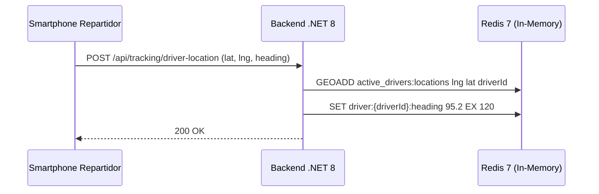

# 02. Especificacion de Redis: GEO, Cache e Idempotencia

## 1. Descripcion General
Redis 7 opera como capa de memoria ultrarrapida en el sistema, cumpliendo tres roles criticos:
1. **Telemetria de Repartidores (Redis GEO):** Almacenamiento y calculo geoespacial de conductores activos.
2. **Control de Idempotencia en Checkout:** Prevencion de transacciones duplicadas por caidas de red o reintentos.
3. **Cache de Menu y Disponibilidad:** Alivio de carga a la base de datos PostgreSQL durante horas pico.

## 2. Telemetria GPS con Redis GEO

### 2.1. Estructura de Claves
* **Conjunto Geoespacial:** `active_drivers:locations`
  - Tipo: `GEO (ZSET)`
  - Comando de Ingesta: `GEOADD active_drivers:locations <longitude> <latitude> <driverId>`
  - Comando de Lectura: `GEOPOS active_drivers:locations <driverId>`
* **Metadata de Rumbo (Heading):** `driver:{driverId}:heading`
  - Tipo: `STRING`
  - Formato: Grados decimales `0 - 360`
  - TTL: 120 segundos (autolimpieza si el repartidor pierde conexion)

### 2.2. Flujo de Ingesta y Consulta

---

## 3. Claves de Idempotencia en Checkout

### 3.1. Clave y TTL
* **Formato de Clave:** `idempotency:{Idempotency-Key}`
* **Tipo:** `STRING` (JSON serializado de la respuesta original)
* **TTL:** `86400` segundos (24 horas)

### 3.2. Politica de Evaluacion en `IdempotencyMiddleware`
1. Si la cabecera `Idempotency-Key` no esta presente, la peticion pasa normalmente.
2. Si la clave ya existe en Redis, el middleware interrumpe el pipeline y retorna de inmediato la respuesta previamente almacenada con la cabecera `X-Cache-Lookup: HIT`.
3. Si la clave no existe, el middleware procesa la orden, captura el stream de respuesta y lo persiste en Redis de manera atomica.
