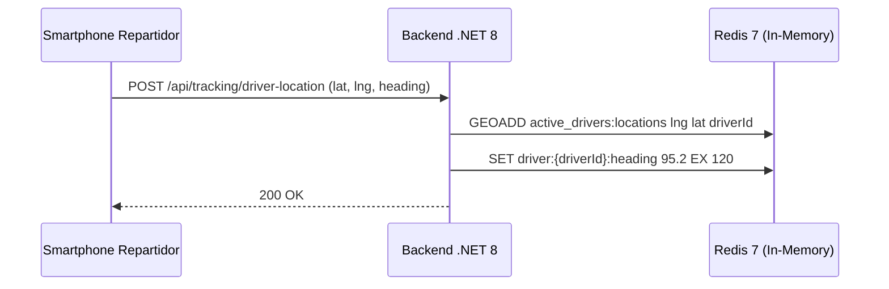
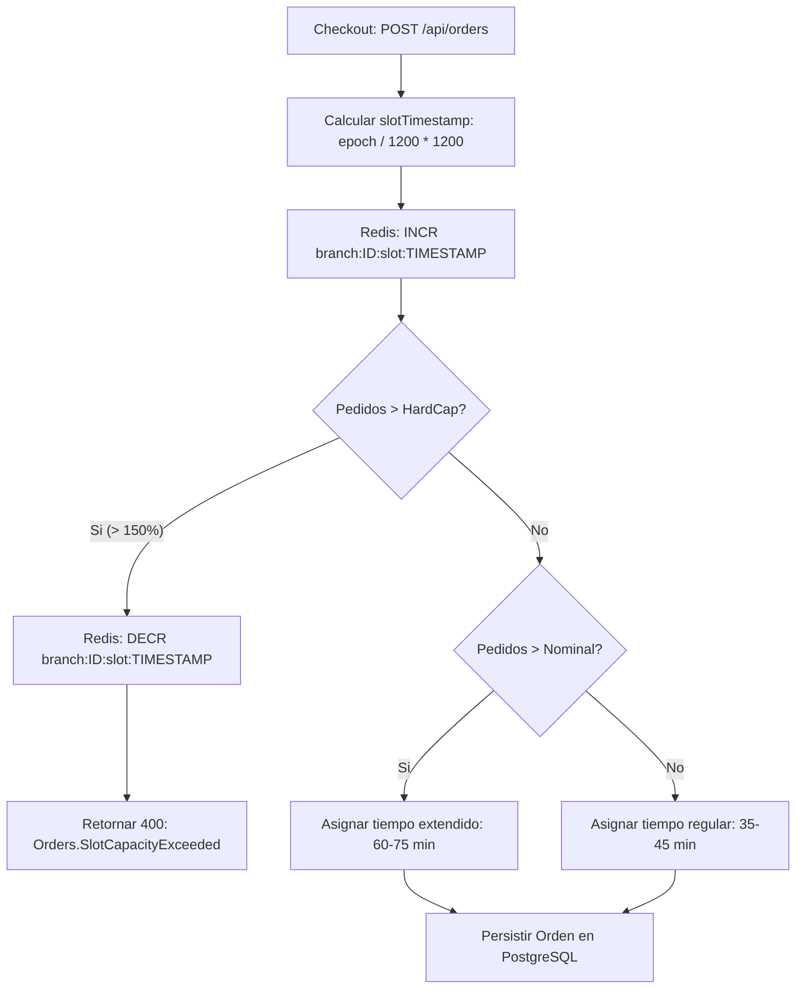

# 02. Especificacion de Redis: GEO, Cache e Idempotencia

## 1. Descripcion General
Redis 7 opera como capa de memoria ultrarrapida en el sistema, cumpliendo tres roles criticos:
1. **Telemetria de Repartidores (Redis GEO):** Almacenamiento y calculo geoespacial de conductores activos.
2. **Control de Idempotencia en Checkout:** Prevencion de transacciones duplicadas por caidas de red o reintentos.
3. **Cache de Menu y Disponibilidad:** Alivio de carga a la base de datos PostgreSQL durante horas pico.

## 2. Telemetria GPS con Redis GEO

### 2.1. Estructura de Claves
* **Conjunto Geoespacial:** `active_drivers:locations`
  - Tipo: `GEO (ZSET)`
  - Comando de Ingesta: `GEOADD active_drivers:locations <longitude> <latitude> <driverId>`
  - Comando de Lectura: `GEOPOS active_drivers:locations <driverId>`
* **Metadata de Rumbo (Heading):** `driver:{driverId}:heading`
  - Tipo: `STRING`
  - Formato: Grados decimales `0 - 360`
  - TTL: 120 segundos (autolimpieza si el repartidor pierde conexion)

### 2.2. Flujo de Ingesta y Consulta


---

## 3. Claves de Idempotencia en Checkout

### 3.1. Clave y TTL
* **Formato de Clave:** `idempotency:{Idempotency-Key}`
* **Tipo:** `STRING` (JSON serializado de la respuesta original)
* **TTL:** `86400` segundos (24 horas)

### 3.2. Politica de Evaluacion en `IdempotencyMiddleware`
1. Si la cabecera `Idempotency-Key` no esta presente, la peticion pasa normalmente.
2. Si la clave ya existe en Redis, el middleware interrumpe el pipeline y retorna de inmediato la respuesta previamente almacenada con la cabecera `X-Cache-Lookup: HIT`.
3. Si la clave no existe, el middleware procesa la orden, captura el stream de respuesta y lo persiste en Redis de manera atomica.

---

## 4. Control de Capacidad de Cocina y Throttling por Ranuras (Slots de 20 Minutos)

Para evitar la saturacion fisica de los hornos de asadero en horas pico (12:00-14:00 y 18:30-20:30), Redis gestiona contadores atomicos en memoria segmentados en ranuras de 20 minutos (1200 segundos):

### 4.1. Algoritmo de Ranurado Temporal y Claves
* **Formato de Clave:** `branch:{branchId}:slot:{slotTimestamp}`
* **Calculo del Slot Unix:**
  ```csharp
  long currentSlot = (DateTimeOffset.UtcNow.ToUnixTimeSeconds() / 1200) * 1200;
  string slotKey = $"branch:{branchId}:slot:{currentSlot}";
  ```
* **Tipo de Dato:** `STRING` (entero de 64 bits para incremento atomico `INCR`).
* **TTL:** `7200` segundos (2 horas) configurado atomicamente en el primer incremento (`KeyExpireAsync`).

### 4.2. Logica de Admision y Rechazo Protector (Hard Cap)
* **Capacidad Nominal (`MaxOrdersPerSlot`):** Por defecto 12-15 pedidos por ranura segun la sucursal.
* **Capacidad Extendida (Demanda Alta):** Si el contador supera `MaxOrdersPerSlot`, el sistema amplia dinamicamente el tiempo estimado de entrega a *"60-75 min"* e incluye un aviso operacional (`demandNotice`).
* **Limite Infranqueable (`hardCap = MaxOrders * 1.5`):** Si el contador excede el 150% de la capacidad nominal (ej. 18 pedidos en un slot de 12), el backend ejecuta un decremento compensatorio (`DECR`) y rechaza la admision con error RFC 7807 `Orders.SlotCapacityExceeded` (HTTP 400).



---

## 5. Politicas de Resiliencia y Configuracion de Conexion

* **Conexion Singleton:** Administrada mediante `IConnectionMultiplexer` inyectado en `Program.cs`.
* **Modo de Resiliencia:** `abortConnect=false` para permitir arranques del backend en caliente sin bloquearse si Redis tarda milisegundos en inicializar.
* **Persistencia AOF:** Configurado con `--appendonly yes` en Docker para garantizar durabilidad de datos ante reinicios imprevistos.

---

## Navegacion de Documentacion
* **Anterior:** [01. Modelo de Datos Relacional y Extension Espacial PostGIS](./01-modelo-datos-postgis.md)
* **Siguiente:** [03. Explosion de Recetas y Kardex de Inventario](./03-kardex-inventario-y-recetas.md)
* **Indice General:** [README Principal](../../README.md)
