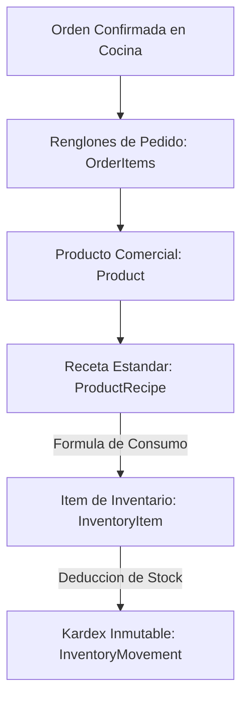
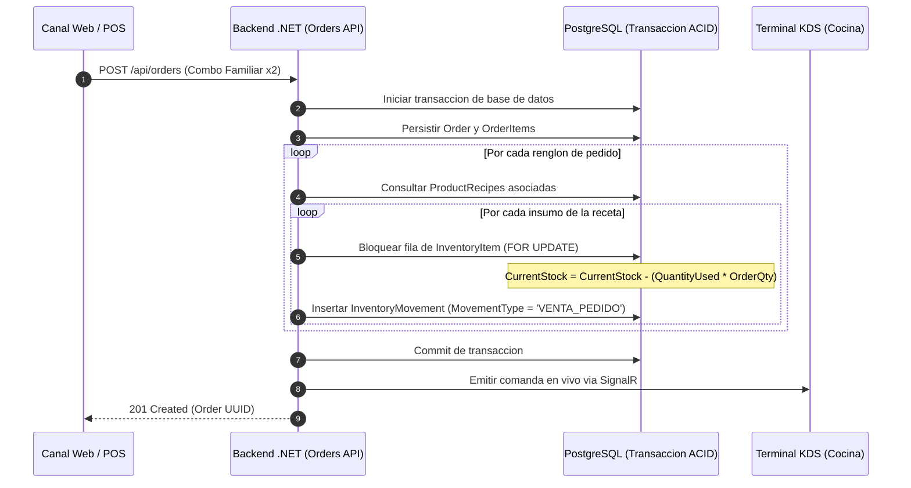

# 03. Explosion de Recetas y Kardex de Inventario

## 1. Descripcion General del Modelo de Inventario

La plataforma implementa un modelo de control de existencias basado en **Explosion de Recetas Estandarizadas** y un **Kardex Inmutable por Partida Doble**, disenado especificamente para asaderos de pollos y restaurantes de carnes a la brasa. 

El modelo resuelve la desconexion clasica entre lo que se vende comercialmente en carta (combos, cuartos, medios o pollos enteros) y lo que se adquiere a granel a nivel de cocina (octavos de pollo crudo, kilogramos de papas, envases y consumibles).

---

## 2. Arquitectura de Explosion de Materiales (BOM)

### 2.1. Desglose de Insumos por Receta Estandar

Cada sucursal gestiona su propio inventario fisico en [`InventoryItems`](./01-modelo-datos-postgis.md#tabla-inventoryitems). Las recetas asociadas en [`ProductRecipes`](./01-modelo-datos-postgis.md#tabla-productrecipes) definen el consumo exacto de materia prima por unidad de producto vendido, parametrizadas segun las recetas de produccion del asadero:

| Producto Comercial (`Product`) | Insumo Consumido (`InventoryItem`) | SKU del Insumo | Cantidad Deducida (`QuantityUsed`) | Unidad de Medida |
| :--- | :--- | :--- | :--- | :--- |
| **Octavo de Pollo Personal** | Pollo Crudo (Octavos) | `INS-POLLO-OCT` | `1.000` | Octavos |
| **Octavo de Pollo Personal** | Cola Personal (Botella Vidrio) | `INS-BEB-COLA-PERS-VID` | `1.000` | Unidad |
| **Cuarto de Pollo Completo** | Pollo Crudo (Octavos) | `INS-POLLO-OCT` | `2.000` | Octavos |
| **Cuarto de Pollo Completo** | Cola Personal (Botella Vidrio) | `INS-BEB-COLA-PERS-VID` | `1.000` | Unidad |
| **Cuarto de Pollo Para Llevar** | Pollo Crudo (Octavos) | `INS-POLLO-OCT` | `2.000` | Octavos |
| **Cuarto de Pollo Para Llevar** | Contenedor Termico Para Llevar | `INS-CONT-TERM` | `1.000` | Unidad |
| **Cuarto de Pollo Para Llevar** | Cola Personal (Plastico PET) | `INS-BEB-COLA-PERS-PET` | `1.000` | Unidad |
| **Medio Pollo Completo** | Pollo Crudo (Octavos) | `INS-POLLO-OCT` | `4.000` | Octavos |
| **Pollo Completo Tradicional** | Pollo Crudo (Octavos) | `INS-POLLO-OCT` | `8.000` | Octavos |
| **Pollo y Medio Completo** | Pollo Crudo (Octavos) | `INS-POLLO-OCT` | `12.000` | Octavos |
| **Super Promo 2x1 (2 Pollos)** | Pollo Crudo (Octavos) | `INS-POLLO-OCT` | `16.000` | Octavos |
| **Combo Familiar 8 (2.5 Pollos)** | Pollo Crudo (Octavos) | `INS-POLLO-OCT` | `20.000` | Octavos |
| **Combo 1 (Pollo y Medio + 2L)** | Pollo Crudo (Octavos) | `INS-POLLO-OCT` | `12.000` | Octavos |
| **Combo 1 (Pollo y Medio + 2L)** | Cola Familiar 2 Litros | `INS-BEB-COLA-2L` | `1.000` | Unidad |
| **Salchipapa Clásica + Cola** | Salchicha Especial | `INS-SALCHICHA` | `1.000` | Unidad |
| **Salchipapa Clásica + Cola** | Cola Personal (Botella Vidrio) | `INS-BEB-COLA-PERS-VID` | `1.000` | Unidad |
| **Parrillada Imperial al Quebracho** | Corte Bife de Chorizo Angus | `INS-BIFE-ANGUS` | `0.400` | Kilogramos |
| **Parrillada Imperial al Quebracho** | Chorizo Parrillero Argentino | `INS-CHOR-ARG` | `2.000` | Unidades |

---

## 3. Mecanica del Kardex Inmutable (`InventoryMovements`)

El historial de inventario es estrictamente acumulativo e inmutable (equivalente al libro diario `stockdiary` de sistemas POS industriales). Queda prohibida la actualizacion directa o sobreescritura de registros historicos.

### 3.1. Invariante de Consistencia Matematica
Para todo movimiento generado, debe cumplirse la ecuacion de balance:

$$\text{StockAfter} = \text{StockBefore} + \text{QuantityDelta}$$

Donde:
* $\text{QuantityDelta} > 0$ representa un ingreso fisico de mercaderia (compra a proveedor, sobrante justificado).
* $\text{QuantityDelta} < 0$ representa un egreso fisico (venta por comanda de cocina, merma por quema o descarte).

### 3.2. Catalogo de Tipos de Movimiento (`MovementType`)

| Codigo de Movimiento | Signo del Delta | Origen de Transaccion | Efecto Operacional |
| :--- | :--- | :--- | :--- |
| `COMPRA_PROVEEDOR` | Positivo (`+`) | Factura de compra mayorista | Incrementa el saldo fisico y actualiza el costo ponderado (`UnitCostSnapshot`). Vinculado a `SupplierId`. |
| `VENTA_PEDIDO` | Negativo (`-`) | Despacho de comanda KDS | Descuenta automaticamente los insumos explotados por la receta del pedido. Vinculado a `OrderId`. |
| `DESPERDICIO_MERMA` | Negativo (`-`) | Registro de cocina/horno | Registra presas caidas, pollo sobrecocido o producto vencido con motivo en `Notes`. |
| `AJUSTE_MANUAL` | Positivo o Negativo | Conteo fisico y auditoria | Cuadre de arqueo mensual o semanal entre el sistema y la bodega fisica. |

---

## 4. Diagrama de Secuencia: Descuento de Inventario por Venta

---

## 5. Control de Existencias Criticas y Alertas de Reabastecimiento

Cada insumo define un umbral minimo operativo en `MinAlertStock`:
* Cuando $\text{CurrentStock} \le \text{MinAlertStock}$, la interfaz de administracion [`/admin/inventario`](../04-frontend-web/01-estructura-route-groups.md) resalta el insumo en estado critico (alerta visual ambar).
* Si un insumo crudo llega a $\text{CurrentStock} \le 0$, el interruptor de disponibilidad en [`BranchProducts`](./01-modelo-datos-postgis.md#tabla-branchproducts) puede suspender automaticamente los productos dependientes para evitar vender platos sin existencias en bodega.

---

## Navegacion de Documentacion
* **Anterior:** [02. Especificacion de Redis: GEO, Cache e Idempotencia](./02-redis-geo-cache.md)
* **Siguiente:** [04. Semillas y Datos de Prueba para Entornos](./04-semillas-y-entornos-de-prueba.md)
* **Indice General:** [README Principal](../../README.md)

