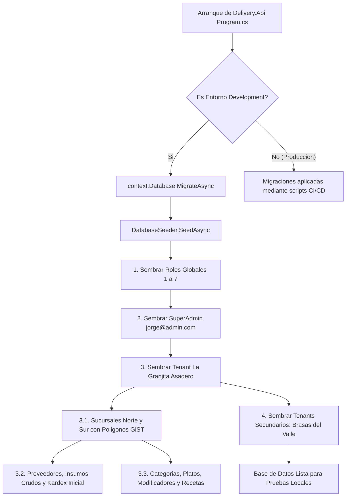

# 04. Semillas y Datos de Prueba para Entornos

## 1. Descripcion General del Sistema de Semillas

El backend de la plataforma incorpora un mecanismo de inicializacion y siembra automatica de datos (*Database Seeding*) desacoplado en clases parciales dentro de `backend/src/Delivery.Core/Infrastructure/Persistence/`:
* `DatabaseSeeder.cs`: Inicializacion de extensiones PostGIS, roles del sistema, superadministrador global y tenant principal.
* `DatabaseSeeder.Catalog.cs`: Siembra de sucursales con poligonos geofence reales en Quito, categorias, catalogo de platos, modificadores, recetas estandar e inventario base con kardex.
* `DatabaseSeeder.SecondaryTenants.cs`: Siembra de franquicias secundarias para validar multitenancy estricto, temas visuales y plantillas diferenciadas.

---

## 2. Flujo de Inicializacion en Arranque



---

## 3. Directorio de Cuentas y Credenciales de Prueba

En entornos de desarrollo local, todas las cuentas predeterminadas se crean con el hash seguro BCrypt de la contrasena `Admin123!`:

| Rol del Sistema | Correo Electronico | Contrasena | Tenant Asignado | Sucursal Asignada | Proposito de Prueba |
| :--- | :--- | :--- | :--- | :--- | :--- |
| **SuperAdmin** | `jorge@admin.com` | `Admin123!` | Global (`null`) | Global (`null`) | Gestion de franquicias en `/superadmin` |
| **TenantAdmin** | `esmeralda@lagranjita.com` | `Admin123!` | `la-granjita` | Todas las sedes | Administracion de carta, banners y politicas |
| **BranchManager**| `gerente.norte@lagranjita.com`| `Admin123!` | `la-granjita` | `1` (Sucursal Norte) | Control de capacidad y turnos de sede norte |
| **Cashier** | `cajero.norte@lagranjita.com` | `Admin123!` | `la-granjita` | `1` (Sucursal Norte) | Apertura/cierre de turnos y aprobacion de transferencias |
| **KitchenStaff** | `cocina.norte@lagranjita.com` | `Admin123!` | `la-granjita` | `1` (Sucursal Norte) | Terminal KDS en `/cocina` con alertas de audio |
| **Driver** | `repartidor@lagranjita.com` | `Admin123!` | `la-granjita` | `1` (Sucursal Norte) | Transmision GPS en `/repartidor` y `/active-delivery` |
| **TenantAdmin (T2)**| `admin@brasasdelvalle.com`| `Admin123!` | `brasas-del-valle`| Matriz Cumbaya | Validacion de aislamiento multitenant y tema verde |

---

## 4. Directorio de Tenants y Plantillas Sembradas

### 4.1. Tenant Principal: La Granjita Asadero (`la-granjita`)
* **Propuesta Gastronomica:** Asadero tradicional de pollos a la brasa y carnes al carbon en Quito.
* **Plantilla Visual:** `asadero-clasico`
* **Colores de Marca:** Primario `#E4002B` (rojo vivo), Hover `#C40024`, Acento `#F59E0B` (ambar calido).
* **Sucursales Activas:**
  1. `Sucursal #1 (Norte)`: Ubicada en Av. Amazonas y Gaspar de Villarroel (`-0.1782, -78.4845`). Poligono GiST de 8 vertices cubriendo Quito Norte (La Carolina, Inaquito, El Batan).
  2. `Sucursal #2 (Sur)`: Ubicada en Av. Rodrigo de Chavez y 5 de Junio (`-0.2312, -78.5189`). Poligono GiST de 6 vertices cubriendo Quito Sur (Villa Flora, La Magdalena, San Bartolo).

### 4.2. Tenant Secundario: Brasas del Valle (`brasas-del-valle`)
* **Propuesta Gastronomica:** Parrilla argentina gourmet y cortes Angus madurados.
* **Plantilla Visual:** `steakhouse-gourmet`
* **Colores de Marca:** Primario `#047857` (verde esmeralda oscuro), Hover `#065F46`, Acento `#D97706`.
* **Sucursal Activa:** `Matriz Cumbaya` (`-0.2014, -78.4312`). Poligono GiST cubriendo el Valle de Cumbaya y Tumbaco.

---

## 5. Script de Base de Datos Base (`scripts/db/init-postgis.sql`)

El contenedor Docker `delivery-postgres` ejecuta automaticamente al inicializarse el script montado en `/docker-entrypoint-initdb.d/01-init-postgis.sql`:

```sql
-- Habilitacion obligatoria de la extension PostGIS para calculo espacial
CREATE EXTENSION IF NOT EXISTS postgis;
CREATE EXTENSION IF NOT EXISTS "uuid-ossp";

-- Verificacion de version PostGIS instalada
DO $$
BEGIN
    RAISE NOTICE 'PostGIS Extension initialized successfully: %', postgis_full_version();
END $$;
```

---

## 6. Procedimiento de Reinicio Limpio de Datos en Desarrollo

Para restablecer la base de datos a su estado virgen con semillas frescas:

```powershell
# 1. Detener y destruir volumenes de datos
docker compose down -v

# 2. Levantar la infraestructura limpia
pnpm infra:up

# 3. Iniciar el backend para aplicar migraciones y semillas automaticamente
pnpm dev:backend
```

---

## Navegacion de Documentacion
* **Anterior:** [03. Explosion de Recetas y Kardex de Inventario](./03-kardex-inventario-y-recetas.md)
* **Siguiente:** [01. Estructura de Rutas y Route Groups en Frontend](../04-frontend-web/01-estructura-route-groups.md)
* **Indice General:** [README Principal](../../README.md)

