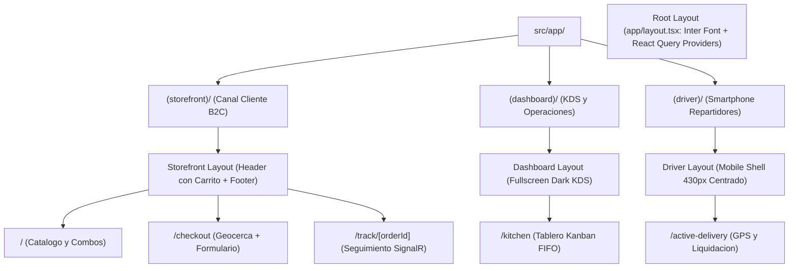

# 01. Estructura de Rutas y Route Groups en Frontend

## 1. Descripcion General
El frontend esta construido sobre Next.js 16 con App Router y TypeScript estricto en el directorio `frontend/src/`. Utiliza el patron de **Route Groups** con carpetas entre parentesis para separar los contextos visuales y de navegacion sin alterar la jerarquia de URLs finales.

## 2. Mapa de Route Groups y Layouts



## 3. Descripcion de Canales

### 3.1. Canal Storefront (`src/app/(storefront)/`)
* **URL Publica:** `/`, `/checkout`, `/track/[orderId]`
* **Diseno Visual:** Tema oscuro sobrio (`bg-neutral-950`), paleta ambar calida para acciones primarias.
* **Header Interactivo:** Indicador de carrito reactivo en vivo mediante `CartButtonBadge.tsx`.

### 3.2. Canal Dashboard / KDS (`src/app/(dashboard)/`)
* **URL Publica:** `/kitchen`
* **Diseno Visual:** Diseno optimizado para pantallas tactiles de cocina (1080p en modo horizontal) sin barras de desplazamiento innecesarias y alto contraste.

### 3.3. Canal Repartidor (`src/app/(driver)/`)
* **URL Publica:** `/active-delivery`
* **Diseno Visual:** Shell restringido a ancho de smartphone (maximo 512px) con botones de toque amplio para facilitar operacion a una sola mano con guantes o en motocicleta.

---

## 4. Gestion de Estado Global (Zustand Store)

El estado del carrito se administra mediante `src/features/cart/store/useCartStore.ts` con persistencia automatica en `localStorage`:

```typescript
interface CartItem {
  id: string; // Hash deterministico: `${productId}_${modifierIds.sort().join('-')}`
  productId: number;
  productName: string;
  basePrice: number;
  quantity: number;
  modifiers: SelectedModifier[];
  itemTotal: number;
}
```

> [!NOTE]
> La clave deterministica `id` permite que si el cliente anade dos veces el mismo combo con exactamente los mismos modificadores, se incremente la cantidad en lugar de duplicar lineas en la comanda.

---

## Navegacion de Documentacion
* **Anterior:** [02. Especificacion de Redis: GEO, Cache e Idempotencia](../03-base-de-datos/02-redis-geo-cache.md)
* **Siguiente:** [02. Pantalla de Cocina y Kitchen Display System (KDS)](./02-pantalla-cocina-kds.md)
* **Indice General:** [README Principal](../../README.md)
