# 01. Estructura de Rutas y Route Groups en Frontend

## 1. Descripcion General
El frontend esta construido sobre Next.js 16 con App Router y TypeScript estricto en el directorio `frontend/src/`. Utiliza el patron de **Route Groups** con carpetas entre parentesis para separar los contextos visuales y de navegacion sin alterar la jerarquia de URLs finales.

---

## 2. Mapa de Route Groups, Layouts y Rutas del Sistema

```mermaid
flowchart TD
    App["src/app/"]
    RootLayout["Root Layout (app/layout.tsx: Inter Font + React Query Providers)"]

    App --> Storefront["(storefront)/ (Canal Cliente B2C, Vitrina y Multitenancy)"]
    App --> Dashboard["(dashboard)/ (KDS, Administracion y SuperAdmin)"]
    App --> Driver["(driver)/ (Smartphone Repartidores)"]

    Storefront --> StoreLayout["Storefront Layout (Header reactivo + Footer + Modales)"]
    StoreLayout --> Home["/ (Landing Principal de Plataforma Multi-Tenant PlatformLandingView)"]
    StoreLayout --> TenantSlug["/[slug] (Vitrina Branded Dinamica por Comercio RestaurantStorefrontView)"]
    StoreLayout --> TenantSucursales["/[slug]/sucursales (Sedes con mapa vectorial del tenant)"]
    StoreLayout --> TenantRastreo["/[slug]/rastreo (Seguimiento satelital con contexto de marca)"]
    StoreLayout --> TenantCheckout["/[slug]/checkout (Finalizacion de pedido con geocercas)"]
    StoreLayout --> DomainRouter["_domain_router (Resolucion Transparente para Dominios CustomDomain CNAME)"]
    StoreLayout --> CatalogoRoute["/catalogo (Ruta de catalogo directo)"]
    StoreLayout --> SucursalesRoute["/sucursales (Ruta de mapa y sedes)"]
    StoreLayout --> CheckoutRoute["/checkout y /finalizar-pedido (Resolucion de Geocerca + Formulario)"]
    StoreLayout --> TrackRoute["/track/[orderId] y /rastreo (Seguimiento Satelital SignalR)"]
    StoreLayout --> LegalRoutes["/terminos y /privacidad (Politicas y Textos Legales Markdown)"]
    StoreLayout --> LoginRoute["/login (Formulario de Acceso y Sesion RBAC)"]

    Dashboard --> DashLayout["Dashboard Layout (Fullscreen Dark KDS + UserNav)"]
    Dashboard --> TenantKitchen["/[slug]/cocina y /[slug]/kitchen (KDS con slug en URL)"]
    DashLayout --> Kitchen["/kitchen y /cocina (Tablero Kanban FIFO de Cocina con AuthGuard)"]
    DashLayout --> AdminInventario["/admin/inventario y /admin/inventory (Control de Insumos y Kardex)"]
    DashLayout --> AdminSucursales["/admin/sucursales y /admin/branches (Capacidad de Hornos por Slot)"]
    DashLayout --> AdminPersonalizacion["/admin/personalizacion (Personalizacion Visual de Storefront)"]
    DashLayout --> AdminTenants["/admin/tenants (Gestion de Comercios para TenantAdmin)"]
    DashLayout --> SuperAdmin["/superadmin (Dashboard de Plataforma Global)"]

    Driver --> DriverLayout["Driver Layout (Mobile Shell 430px Centrado)"]
    Driver --> TenantDriver["/[slug]/repartidor y /[slug]/active-delivery (Modulo Motorizado con Slug)"]
    DriverLayout --> RepartidorPortal["/repartidor (Portal del Motorizado - Redireccion canonica)"]
    DriverLayout --> ActiveDelivery["/active-delivery (Ruta Activa con Transmision GPS)"]
```



---

## 3. Matriz de Rutas y Accesos Directos

La plataforma implementa un panel de accesos directos en [`src/app/(storefront)/page.tsx`](../../frontend/src/app/%28storefront%29/page.tsx) para navegacion rapida de pruebas y control operacional:

| Modulo / Dominio | Ruta Externa (Lleva a Otra Pagina) | Ancla en Misma Pagina | Proposito Operativo |
| :--- | :--- | :--- | :--- |
| **Plataforma Global** | `/` | `#restaurantes`, `#afiliacion` | Portal directorio multimarca y flujo B2B de afiliacion de comercios |
| **Tienda por Comercio** | `/[slug]` o Dominio Propio | `#catalogo`, `#sucursales` | Vitrina comercial y pedidos en linea del restaurante seleccionado |
| **Tienda & Clientes** | `/[slug]/catalogo` / `/catalogo` | `#catalogo` | Catalogo completo de combos y productos |
| **Tienda & Clientes** | `/[slug]/sucursales` / `/sucursales` | `#sucursales` | Informacion de sedes, horarios y telefonos |
| **Tienda & Clientes** | `/[slug]/checkout` / `/checkout` | N/A | Flujo de seleccion de direccion y confirmacion |
| **Tienda & Clientes** | `/[slug]/rastreo` / `/rastreo` | N/A | Telemetria y seguimiento de motorizado en vivo |
| **Tienda & Clientes** | `/terminos` y `/privacidad` | N/A | Politicas de privacidad y terminos de servicio |
| **Autenticacion** | `/login` | N/A | Inicio de sesion operativo con rotacion HttpOnly y RBAC |
| **Cocina & KDS** | `/[slug]/cocina` / `/cocina` | N/A | Terminal KDS con semaforizacion FIFO y audio |
| **Operaciones Sede** | `/admin/inventario` (o `/inventory`) | N/A | Gestion de stock de pollo, papas y empaques |
| **Operaciones Sede** | `/admin/sucursales` (o `/branches`) | N/A | Throttling de hornos (pedidos por slot de 20 min)|
| **Gestion Tenant** | `/admin/personalizacion` | N/A | Configuracion visual, banners, tarifas y datos bancarios |
| **Gestion Tenant** | `/admin/tenants` | N/A | Administracion y auditoria de comercios |
| **SuperAdmin** | `/superadmin` | N/A | Control maestro global de la plataforma multi-tenant |
| **Repartidor** | `/[slug]/repartidor` / `/repartidor` | N/A | Portal y lista de pedidos asignados al conductor con slug canonico |
| **Repartidor** | `/[slug]/active-delivery` / `/active-delivery` | N/A | Transmision continua de geolocalizacion GPS |

> [!NOTE]
> Las anclas `#catalogo` y `#sucursales` en el encabezado ([`layout.tsx`](../../frontend/src/app/%28storefront%29/layout.tsx)) permiten desplazamiento suave directo a las secciones de la vitrina principal sin recargar la aplicacion.

---

## 4. Descripcion de Canales y Experiencia de Usuario

### 4.1. Canal Storefront (`src/app/(storefront)/`)
* **URL Publica:** `/`, `/[slug]`, `/checkout`, `/finalizar-pedido`, `/track/[orderId]`, `/login`, `/terminos`, `/privacidad`
* **Diseno Visual:** Paleta sobria asadero (fondos neutros oscuros `bg-neutral-950` y acentos ambar/rojo asadero dinamicamente inyectados segun la marca). Cero emojis y cero insignias infladas de garantia.
* **Ergonomia Comercial:** Tarjetas de producto con botones de accion directa `+ PEDIR` e insignias de oferta sobrias.
* **Header Interactivo:** Indicador de carrito reactivo en vivo mediante `CartButtonBadge.tsx`.

### 4.2. Canal Dashboard / KDS y Administracion (`src/app/(dashboard)/`)
* **URL Publica:** `/kitchen`, `/cocina`, `/admin/inventario`, `/admin/sucursales`, `/admin/personalizacion`, `/admin/tenants`, `/superadmin`
* **Diseno Visual:** Diseno optimizado para pantallas tactiles de cocina (1080p en modo horizontal) y formularios de gestion administrativa con alto contraste y validacion React Hook Form + Zod.

### 4.3. Canal Repartidor (`src/app/(driver)/`)
* **URL Publica:** `/active-delivery`, `/repartidor`
* **Diseno Visual:** Shell restringido a ancho de smartphone (maximo 512px) con botones de toque amplio para facilitar operacion a una sola mano en motocicleta.

---

## 5. Gestion de Estado Global (Zustand Store)

El estado del carrito se administra mediante `src/features/cart/store/useCartStore.ts` con persistencia automatica en `localStorage`:

```typescript
interface CartItem {
  id: string; // Hash deterministico: `${productId}_${modifierIds.sort().join('-')}`
  productId: number;
  productName: string;
  basePrice: number;
  quantity: number;
  modifiers: SelectedModifier[];
  itemTotal: number;
}
```

> [!NOTE]
> La clave deterministica `id` permite que si el cliente anade dos veces el mismo combo con exactamente los mismos modificadores, se incremente la cantidad en lugar de duplicar lineas en la comanda.

---

## 6. Seguridad y Control de Acceso en Frontend (RBAC)

La autenticacion y proteccion de vistas operativas opera bajo una arquitectura de defensa en profundidad de dos capas:

### 6.1. Guardia Perimetral en Edge (`src/middleware.ts`)
Interpreta las peticiones entrantes antes de renderizar paginas protegidas (`/cocina`, `/kitchen`, `/admin/*`, `/driver/*`):
* Comprueba la presencia de la cookie de sesion `refresh_token`.
* Si no existe o esta vacia, redirige inmediatamente a `/login?redirect={pathname}` sin descargar el codigo del cliente.

### 6.2. Guardia RBAC en Cliente (`AuthGuard.tsx`)
* Resuelve la identidad y el rol activo del usuario contra el store en memoria (`useAuthStore`).
* Bloquea el acceso a nivel de componente si el rol del usuario no figura en la lista permitida para la vista (ej. un repartidor intentando operar `/cocina`).
* Emite un banner de acceso denegado con estados de carga transparentes mediante el hook `useIsMounted`.

### 6.3. Almacenamiento Seguro sin XSS
* El `accessToken` vive exclusivamente en la memoria volatil del store Zustand (`useAuthStore.ts`), nunca en `localStorage`.
* Las llamadas a `/api/v1/auth/*` utilizan `credentials: "include"` para permitir la transmision automatica y segura de cookies `HttpOnly`.

---

## Navegacion de Documentacion
* **Anterior:** [02. Especificacion de Redis: GEO, Cache e Idempotencia](../03-base-de-datos/02-redis-geo-cache.md)
* **Siguiente:** [02. Pantalla de Cocina y Kitchen Display System (KDS)](./02-pantalla-cocina-kds.md)
* **Indice General:** [README Principal](../../README.md)
