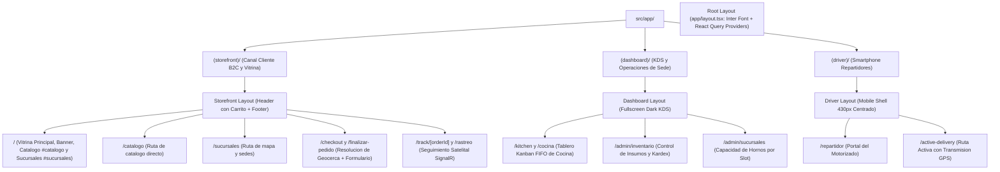

# 01. Estructura de Rutas y Route Groups en Frontend

## 1. Descripcion General
El frontend esta construido sobre Next.js 16 con App Router y TypeScript estricto en el directorio `frontend/src/`. Utiliza el patron de **Route Groups** con carpetas entre parentesis para separar los contextos visuales y de navegacion sin alterar la jerarquia de URLs finales.

---

## 2. Mapa de Route Groups, Layouts y Rutas del Sistema



---

## 3. Matriz de Rutas y Accesos Directos

La plataforma implementa un panel de accesos directos en [`src/app/(storefront)/page.tsx`](file:///c:/Users/DESARROLLADOR/Desktop/Proyectos/delivery-platform/frontend/src/app/(storefront)/page.tsx) para navegacion rapida de pruebas y control operacional:

| Modulo / Dominio | Ruta Externa (Lleva a Otra Pagina) | Ancla en Misma Pagina | Proposito Operativo |
| :--- | :--- | :--- | :--- |
| **Tienda & Clientes** | `/catalogo` | `#catalogo` | Catalogo completo de combos y productos |
| **Tienda & Clientes** | `/sucursales` | `#sucursales` | Informacion de sedes, horarios y telefonos |
| **Tienda & Clientes** | `/finalizar-pedido` / `/checkout` | N/A | Flujo de seleccion de direccion y confirmacion |
| **Tienda & Clientes** | `/rastreo` / `/track/[orderId]` | N/A | Telemetria y seguimiento de motorizado en vivo |
| **Cocina & Admin** | `/cocina` / `/kitchen` | N/A | Terminal KDS con semaforizacion FIFO y audio |
| **Cocina & Admin** | `/admin/inventario` | N/A | Gestion de stock de pollo, papas y empaques |
| **Cocina & Admin** | `/admin/sucursales` | N/A | Throttling de hornos (pedidos por slot de 20 min)|
| **Repartidor** | `/repartidor` | N/A | Portal y lista de pedidos asignados al conductor|
| **Repartidor** | `/active-delivery` | N/A | Transmision continua de geolocalizacion GPS |

> [!NOTE]
> Las anclas `#catalogo` y `#sucursales` en el encabezado ([`Header.tsx`](file:///c:/Users/DESARROLLADOR/Desktop/Proyectos/delivery-platform/frontend/src/features/catalog/components/Header.tsx)) permiten desplazamiento suave directo a las secciones de la vitrina principal sin recargar la aplicacion.

---

## 4. Descripcion de Canales y Experiencia de Usuario

### 4.1. Canal Storefront (`src/app/(storefront)/`)
* **URL Publica:** `/`, `/checkout`, `/finalizar-pedido`, `/track/[orderId]`
* **Diseno Visual:** Paleta sobria asadero (fondos neutros oscuros `bg-neutral-950` y acentos ambar/rojo asadero). Cero emojis y cero insignias infladas de garantia.
* **Ergonomia Comercial:** Tarjetas de producto con botones de accion directa `+ PEDIR` e insignias de oferta sobrias.
* **Header Interactivo:** Indicador de carrito reactivo en vivo mediante `CartButtonBadge.tsx`.

### 4.2. Canal Dashboard / KDS (`src/app/(dashboard)/`)
* **URL Publica:** `/kitchen`, `/cocina`, `/admin/inventario`, `/admin/sucursales`
* **Diseno Visual:** Diseno optimizado para pantallas tactiles de cocina (1080p en modo horizontal) sin barras de desplazamiento innecesarias y alto contraste.

### 4.3. Canal Repartidor (`src/app/(driver)/`)
* **URL Publica:** `/active-delivery`, `/repartidor`
* **Diseno Visual:** Shell restringido a ancho de smartphone (maximo 512px) con botones de toque amplio para facilitar operacion a una sola mano en motocicleta.

---

## 5. Gestion de Estado Global (Zustand Store)

El estado del carrito se administra mediante `src/features/cart/store/useCartStore.ts` con persistencia automatica en `localStorage`:

```typescript
interface CartItem {
  id: string; // Hash deterministico: `${productId}_${modifierIds.sort().join('-')}`
  productId: number;
  productName: string;
  basePrice: number;
  quantity: number;
  modifiers: SelectedModifier[];
  itemTotal: number;
}
```

> [!NOTE]
> La clave deterministica `id` permite que si el cliente anade dos veces el mismo combo con exactamente los mismos modificadores, se incremente la cantidad en lugar de duplicar lineas en la comanda.

---

## Navegacion de Documentacion
* **Anterior:** [02. Especificacion de Redis: GEO, Cache e Idempotencia](../03-base-de-datos/02-redis-geo-cache.md)
* **Siguiente:** [02. Pantalla de Cocina y Kitchen Display System (KDS)](./02-pantalla-cocina-kds.md)
* **Indice General:** [README Principal](../../README.md)
