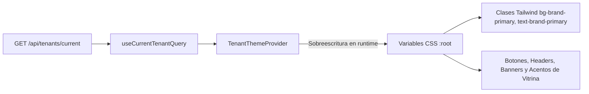

# 04. Sistema de Diseno, Tokens y Temas Dinamicos

## 1. Descripcion General y Filosofia Visual

El sistema visual de la plataforma esta concebido bajo estandares de **ingenieria de interfaces premium para gastronomia contemporanea de alta conversion** (pizzerias, hamburgueserias, sushi, asaderos y cocina de autor), con tokens dinamicos por comercio y optimizado para dos contextos de operacion:
1. **Storefront B2C, Directorio de Plataforma y Checkout:** Modo claro comercial de alto apetito (`--surface-canvas: #f9fafb`), contraste limpio, tipografia display condensada y tarjetas en grid con badges `backdrop-blur`.
2. **KDS de Cocina y Despacho:** Modo oscuro antirreflejo profundo (`--surface-dark: #09090b`), tarjetas de comanda de alto contraste con semaforo FIFO y legibilidad a distancia sobre terminales tactiles de 1080p.

---

## 2. Design Tokens Oficiales (`globals.css`)

Los tokens de diseno estan centralizados en [`frontend/src/app/globals.css`](../../frontend/src/app/globals.css) y expuestos como variables CSS nativas y utilidades de Tailwind CSS:

### 2.1. Paleta de Identidad de Marca Base
| Variable CSS | Valor Predeterminado | Proposito Operativo |
| :--- | :--- | :--- |
| `--brand-primary` | `#e4002b` | Rojo asadero vivo para botones primarios, precios y acentos clave |
| `--brand-primary-hover`| `#c40024` | Estado hover y active para botones primarios |
| `--brand-primary-light`| `#fee2e2` | Fondos sutiles de seleccion y badges de descuento |
| `--brand-accent` | `#f59e0b` | Dorado ambar para guarniciones, badges y alertas operativas |
| `--brand-accent-hover`| `#d97706` | Estado hover de botones secundarios |
| `--brand-accent-light`| `#fef3c7` | Fondos de advertencia leve o destacados de menu |

### 2.2. Superficies y Fondos
| Variable CSS | Modo Claro (Storefront) | Modo Oscuro (KDS) | Uso en UI |
| :--- | :--- | :--- | :--- |
| Canvas Principal | `#f9fafb` | `#09090b` | Fondo estructural de la pagina |
| Tarjeta / Superficie | `#ffffff` | `#18181b` | Tarjetas de producto, modales, comandas |
| Hover de Tarjeta | `#f3f4f6` | `#27272a` | Interaccion sobre elementos clicables |
| Borde Estandar | `#e5e7eb` | `#27272a` | Separadores y divisores de seccion |
| Borde Sutil | `#f3f4f6` | `#3f3f46` | Contornos tenues en modo oscuro |

### 2.3. Estados Semanticos de Operacion
| Estado | Color Solido | Fondo Muted (Alpha 12%) | Borde Muted (Alpha 28%) |
| :--- | :--- | :--- | :--- |
| **Success** | `#16a34a` (Verde) | `rgba(22, 163, 74, 0.12)` | `rgba(22, 163, 74, 0.28)` |
| **Warning** | `#f59e0b` (Ambar) | `rgba(245, 158, 11, 0.12)` | `rgba(245, 158, 11, 0.28)` |
| **Danger** | `#dc2626` (Rojo) | `rgba(220, 38, 38, 0.12)` | `rgba(220, 38, 38, 0.28)` |
| **Info** | `#0284c7` (Azul) | `rgba(2, 132, 199, 0.12)` | `rgba(2, 132, 199, 0.28)` |

---

## 3. Sistema Tipografico Dual Calibrado

Queda prohibido el uso arbitrario de fuentes no configuradas. La plataforma calibra exactamente dos familias tipograficas:

1. **Display / Titulares de Marca (`--font-display`):** `Barlow Condensed`
   - Uso: Nombres de combos, encabezados de vitrina hero, badges y numeros de comanda KDS.
   - Caracteristicas: Estilo gotico condensado pesado (`font-black`, `uppercase`, `tracking-wide`) que evoca tradicionales asaderos al carbon.
2. **Cuerpo / Formularios / Precios (`--font-sans`):** `Inter`
   - Uso: Descripciones de platos, formularios de checkout, tablas de administracion y valores monetarios.
   - Caracteristicas: Cifras tabulares monoespaciadas (`font-feature-settings: 'tnum'`) para evitar que los decimales y totales bailen al recalcular.

---

## 4. Inyeccion de Temas Dinamicos en Tiempo Real (`TenantThemeProvider`)

Para soportar multiples franquicias con identidades visuales totalmente distintas (ej. rojo vivo en *La Granjita* vs. verde esmeralda en *Brasas del Valle*), el componente [`TenantThemeProvider.tsx`](../../frontend/src/features/tenant/components/TenantThemeProvider.tsx) inyecta las variables CSS directamente en `:root`:



### 4.1. Codigo de Inyeccion
```typescript
export function TenantThemeProvider({ children }: { children: React.ReactNode }) {
  const { data: tenant } = useCurrentTenantQuery();

  useEffect(() => {
    if (!tenant) return;
    const root = document.documentElement;
    if (tenant.brandPrimaryColor) {
      root.style.setProperty('--brand-primary', tenant.brandPrimaryColor);
    }
    if (tenant.brandPrimaryHoverColor) {
      root.style.setProperty('--brand-primary-hover', tenant.brandPrimaryHoverColor);
    }
    if (tenant.brandAccentColor) {
      root.style.setProperty('--brand-accent', tenant.brandAccentColor);
    }
  }, [tenant]);

  return <>{children}</>;
}
```

---

## 5. Ergonomia Tactil y Reglas de Accesibilidad

1. **Objetivos Tactiles (Minimo 44px):**
   Todos los botones de adicion (`+ PEDIR`), selectores de modificadores, interruptores de comanda KDS y acciones de repartidor cumplen con la pauta WCAG 2.1 AA de tamano minimo de 44x44 pixeles (`min-h-[44px]`, `min-w-[44px]`).
2. **Barras de Desplazamiento Flotantes sin Flechas:**
   Scrollbars ultra-delgados con esquinas redondeadas (`scrollbar-width: thin`), sin botones de flechas clasicos de Windows que rompan la estetica moderna.
3. **Cero Emojis:**
   Toda iconografia operacional y comercial se renderiza vectorialmente mediante iconos sobrios de [`lucide-react`](https://lucide.dev) (ej. `Flame`, `Clock`, `Truck`, `ChefHat`, `ShoppingBag`).

---

## 6. Estructuras Visuales Canonicas del Storefront B2C

La interfaz comercial del cliente esta normalizada bajo cuatro composiciones visuales primarias:

### 6.1. Cabecera Comercial y Hero Panoramico
* **Cabecera (`StorefrontLayout`):** Altura `h-[70px] sm:h-[76px]`, logotipo dual en `font-display` (`LA GRANJITA ASADERO / ASADERO & LEÑA`), enlaces centrales (`Ordenar`, `Sucursales`, `Rastrear Pedido`, `Personalizar`), conmutador de franquicia con punto pulsante (`TenantSwitcher`), buscador píldora `#f8f7f5` con lupa y bolsa de compras roja con contador reactivo.
* **Carrusel Hero (`CatalogHero`):** Ancho completo (`w-full`), badge rojo superior (`AHORRO FAMILIAR`), titular gigante condensado (`SUPER COMBO ASADOR / 12 PRESAS`), botones píldora (`ORDENA AQUÍ ->` y `VERIFICAR COBERTURA` con icono de mapa), flechas circulares y paginación con dot activo alargado.

### 6.2. Selector de Modalidad Operativa ("¿Como te gustaria ordenar hoy?")
* **Selector (`OrderModeSelector`):** Bloque centrado con ancho maximo de 760px, encabezado `¿CÓMO TE GUSTARÍA ORDENAR HOY?` y dos tarjetas grandes en rojo vivo asadero (`bg-brand-primary` con esquinas `rounded-2xl sm:rounded-3xl`):
  - **A Domicilio:** Icono de motocicleta (`Bike`) en circulo blanco translucido y subtitulo de marca.
  - **Recoge en Local:** Icono de tienda (`Store`) en circulo blanco translucido y subtitulo de marca.
  - **Barra Promocional Inferior:** Capsula blanca con borde y porcentaje rojo: `% PROMOCIONES ESPECIALES DE {BRAND}`.

### 6.3. Banners de Especialidad y Vitrina de Catalogo
* **Banners (`PromotionalBanners`):** Cuadricula de 2 columnas con fotografia gastronomica oscurecida con degradado (`24 HORAS DE MARINADO A FUEGO LENTO` con boton rojo `CONOCE MÁS ->` y `HECHO A LA BRASA` con boton blanco `VER COMBOS ->`).
* **Catalogo y Filtros:** Eyebrow `ESPECIALIDADES AL CARBÓN`, titulo de seccion y filtros horizontales tipo capsula (`TODOS` en rojo activo, `COMBOS` y `PORCIONES` en blanco con borde).
* **Tarjetas de Producto (`ProductCard`):** Grid de 3 columnas en blanco puro `rounded-3xl border border-neutral-200`, fotografia con zoom suave, badges flotantes (`COMBOS` en blanco, `PERSONALIZABLE` en negro translucido), titulo en Barlow Condensed mayusculas, descripcion, etiqueta `PRECIO BASE`, importe en `font-mono tabular-nums` y boton pildora rojo `+ PEDIR`.

### 6.4. Pantalla de Perfil y Acceso al Sistema (`/login`)
* **Miga de Pan y Titular:** `Inicio > Perfil` y encabezado `HOLA, BIENVENIDO/A A {BRAND}` en Barlow Condensed.
* **Estructura Asimetrica de 2 Columnas:**
  - **Columna Izquierda:** Tarjeta roja de fidelizacion `PROGRAMA DE CLIENTES / ÚNETE A BENEFICIOS {BRAND}` y menu lateral blanco con iconos limpios (`PEDIDOS & RASTREO`, `CONTACTOS & LOCALES`, `TÉRMINOS Y CONDICIONES`).
  - **Columna Derecha:** Tarjeta blanca flotante de `INICIAR SESIÓN` con boton `VOLVER`, campos de entrada grises `bg-neutral-50` para correo y contrasena, y boton pildora rojo ancho `ACCEDER AL SISTEMA`.

---

## Navegacion de Documentacion
* **Anterior:** [03. Herramienta Movil del Repartidor y Telemetria GPS](./03-pantalla-repartidor-gps.md)
* **Siguiente:** [05. Flujo de Checkout y Resolucion de Cobertura](./05-flujo-checkout-y-cobertura.md)
* **Indice General:** [README Principal](../../README.md)

