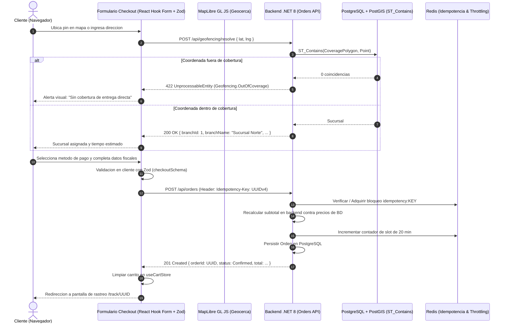

# 05. Flujo de Checkout y Resolucion de Cobertura Espacial

## 1. Descripcion General del Proceso de Compra

El flujo de checkout en la plataforma esta disenado para **eliminar la friccion de compra** permitiendo adquisicion rapida sin obligar a registrarse con contrasena. Opera en [`src/app/(storefront)/finalizar-pedido/page.tsx`](../../frontend/src/app/%28storefront%29/finalizar-pedido/page.tsx) (con alias `/checkout`) combinando captura de datos fiscales, resolucion de geocerca espacial en mapa interactivo y blindaje transaccional con idempotencia.

---

## 2. Diagrama de Secuencia del Flujo de Checkout



---

## 3. Resolucion Geoespacial de Cobertura (`GeofenceChecker.tsx`)

A traves del componente [`GeofenceChecker.tsx`](../../frontend/src/features/checkout/components/GeofenceChecker.tsx), el sistema garantiza que ningun pedido a domicilio se admita sin tener una sucursal fisica asignada:

1. **Resolucion por Coordenadas Satelitales:**
   El cliente puede usar el boton de geolocalizacion automatica (`navigator.geolocation.getCurrentPosition`) o arrastrar manualmente el marcador sobre el mapa vectorial MapLibre GL JS.
2. **Evaluacion en Backend (`POST /api/geofencing/resolve`):**
   El backend ejecuta la consulta espacial con NetTopologySuite contra las geocercas poligonales de `Branches` indexadas en GiST (SRID 4326).
3. **Modalidad Retiro en Local (Takeout):**
   Si el cliente selecciona "Retiro en Local", la comprobacion espacial de domicilio se desactiva y se presenta un selector de sucursal para retiro inmediato.

---

## 4. Esquema de Validacion React Hook Form y Zod (`checkoutSchema.ts`)

La integridad de los datos ingresados en el cliente esta garantizada por [`checkoutSchema.ts`](../../frontend/src/features/checkout/schemas/checkoutSchema.ts):

* **Identificacion Fiscal:**
  - `identificationType`: Opciones validas `'CEDULA'`, `'RUC'`, `'PASAPORTE'`, `'CONSUMIDOR_FINAL'`.
  - `identificationNumber`: Si es `'CONSUMIDOR_FINAL'`, asigna por defecto `'9999999999999'`. Si es Cédula o RUC, exige longitud numerica exacta y formato valido en Ecuador.
* **Datos de Contacto:**
  - `customerName`: Obligatorio, minimo 3 caracteres, maximo 150.
  - `customerPhone`: Obligatorio, formato de telefonia movil ecuatoriana (10 digitos, inicia con `09`).
  - `customerEmail`: Opcional para Consumidor Final, pero obligatorio si el cliente solicita factura con datos para envio del RIDE y XML.
* **Direccion de Entrega:**
  - `addressStreet`: Obligatorio, detalle de calles y numeracion.
  - `addressReference`: Descripcion contextual (color de fachada, interseccion, piso).

---

## 5. Metodos de Pago y Liquidacion Financiera

El componente [`PaymentMethodSection.tsx`](../../frontend/src/features/checkout/components/PaymentMethodSection.tsx) adapta su contenido segun la configuracion del comercio activo:

### 5.1. Efectivo Contra Entrega (`CashOnDelivery`)
* Solicita la denominacion del billete con el que cancelara el cliente (`cashAmountPaid`, ej. $20.00).
* Calcula reactivamente el vuelto a entregar (`changeDue`). Si el monto es inferior al total a pagar, bloquea el boton de envio con validacion de error.

### 5.2. Transferencia Bancaria Directa (`BankTransfer`)
* Carga automaticamente la informacion bancaria del tenant activo:
  - Nombre del banco (`bankName`, ej. *Banco Pichincha*).
  - Tipo de cuenta (`bankAccountType`, ej. *Corriente*).
  - Numero de cuenta (`bankAccountNumber`).
  - Titular y RUC/Cedula (`bankAccountHolder`, `bankAccountTaxId`).
* Permite al cliente adjuntar el comprobante o captura de la transferencia.
* La orden ingresa al sistema en estado `PendingPaymentValidation` hasta que el cajero valida los fondos en cuenta bancaria y aprueba la comanda.

---

## 6. Proteccion Contra Pagos Duplicados (Idempotencia)

Cada intento de checkout genera en cliente un identificador deterministico UUIDv4 que se transmite en la cabecera HTTP:

```http
POST /api/orders HTTP/1.1
Content-Type: application/json
Idempotency-Key: e81d4fae-7dec-11d0-a765-00a0c91e6bf6
```

Si el usuario hace doble clic rapido o la conexion celular experimenta un microcorte, Redis intercepta la segunda peticion mediante la clave `idempotency:{key}` con TTL de 24 horas y retorna el resultado anterior sin duplicar cobros ni generar comandas dobles en cocina.

---

## Navegacion de Documentacion
* **Anterior:** [04. Sistema de Diseno, Tokens y Temas Dinamicos](./04-sistema-de-diseno-y-temas.md)
* **Siguiente:** [06. Personalizacion de Storefront y Plantillas](./06-personalizacion-storefront-y-plantillas.md)
* **Indice General:** [README Principal](../../README.md)

