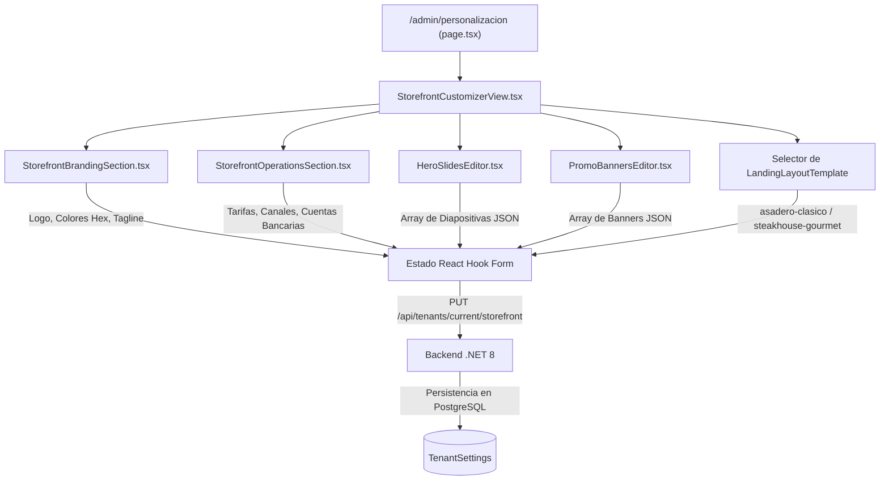

# 06. Personalizacion de Storefront y Plantillas de Landing

## 1. Descripcion General del Modulo

El modulo de personalizacion accesible en [`/admin/personalizacion`](../../frontend/src/app/%28dashboard%29/admin/personalizacion/page.tsx) permite a los administradores de franquicia (`TenantAdmin`) configurar la identidad visual de su vitrina comercial, disenar banners interactivos y seleccionar plantillas de diseno sin requerir despliegues de codigo ni reinicios de servidores.

---

## 2. Arquitectura de Componentes del Personalizador



### 2.1. Desglose de Secciones Modulares

| Componente | Archivo Fuente | Responsabilidad Operativa |
| :--- | :--- | :--- |
| **Identidad y Marca** | `StorefrontBrandingSection.tsx` | Selector de color primario, hover y acento en tiempo real, URL del logo, dominio propio (`CustomDomain`), eslogan y subtitulo hero. |
| **Operaciones y Tarifas** | `StorefrontOperationsSection.tsx` | Tarifa base de delivery (`BaseDeliveryFee`), interruptores de servicio (delivery/takeout/dine-in), metodos de cobro y datos de cuenta bancaria. |
| **Editor de Hero Slides** | `HeroSlidesEditor.tsx` | Gestion interactiva de carrusel hero: agregar, reordenar y alternar diapositivas con badge, titular, subtitulo y boton de accion. |
| **Editor de Banners** | `PromoBannersEditor.tsx` | Administracion de banners intermedios para promociones especiales o combos de temporada. |
| **Vista Maestra** | `StorefrontCustomizerView.tsx` | Orquesta los paneles, maneja estados asincronos (`idle`, `loading`, `error`, `success`) y previsualizacion. |

---

## 3. Motor de Plantillas de Landing Page (`layouts/`)

La plataforma soporta multiples plantillas visuales intercambiables alojadas en `frontend/src/features/tenant/layouts/`:

### 3.1. Plantilla Asadero Clasico (`AsaderoClassicLandingLayout.tsx`)
* **Identificador:** `asadero-clasico`
* **Estilo Visual:** Inspirado en asaderos tradicionales ecuatorianos al carbon y cadenas de pollo frito (rojos vivos, contrastes claros, tipografia Barlow condensada en titulares y badges llamativos).
* **Estructura de Bloques:**
  1. Barra de accesos directos operacionales (si esta habilitada en `QuickLinksEnabled`).
  2. Banner Hero con carrusel dinamico de slides.
  3. Banners promocionales de combos y descuentos.
  4. Selector de categorias con ancla suave y buscador rapido.
  5. Cuadricula de productos con adicion directa al carrito.
  6. Seccion de sucursales con mapa, telefonos y horarios.

### 3.2. Plantilla Steakhouse Gourmet (`SteakhouseGourmetLandingLayout.tsx`)
* **Identificador:** `steakhouse-gourmet`
* **Estilo Visual:** Disenado para parrillas argentinas, cortes finos Angus y restaurantes de carnes maduradas (tonos verdes esmeralda profundos `#047857` o cobrizos, fondos oscuros sofisticados y tipografia sobria).
* **Estructura de Bloques:**
  1. Encabezado sobrio con enfasis en procedencia de carnes y leña de quebracho.
  2. Hero centrado con badges de maduracion y terminos de coccion.
  3. Catalogo con fotos de cortes a pantalla completa y detalles de gramaje.

### 3.3. Plantilla Fast-Casual Urbano (`FastCasualUrbanLandingLayout.tsx`)
* **Identificador:** `fast-casual-urbano`
* **Estilo Visual:** Disenado para pizzerias artesanales, hamburgueserias smash, sushis y dark kitchens urbanas (fondos blancos ultra limpios, badges redondeados backdrop-blur, botones solidos y presentacion de producto de conversion inmediata).
* **Estructura de Bloques:**
  1. Hero fotografico a sangre completa con selector de servicio dual.
  2. Banners a 2 columnas con promociones y especialidades.
  3. Catalogo de comida rapida con filtros horizontales tipo capsula.
  4. Formulario de contacto y sucursales geolocalizadas.

---

## 4. Almacenamiento y Taxonomía Canónica de Imágenes (`public/images/`)

La carpeta `frontend/public/images/` implementa una separación estricta en tres dominios canónicos para garantizar orden, escalabilidad multi-tenant y cero colisiones:

```
frontend/public/images/
├── platform/               # Identidad y banners de la plataforma global SaaS
│   ├── logo.png
│   └── hero-platform.jpg
├── shared/                 # Recursos compartidos y fallbacks genéricos
│   └── placeholders/
│       ├── logo-default.png
│       └── dish-default.webp
└── tenants/                # Activos aislados por comercio y cargas dinámicas
    ├── la-granjita/
    │   ├── identidad/logo.png
    │   ├── banners/hero-*.jpg, promo-*.jpg
    │   └── menu/*.webp
    ├── brasas-del-valle/
    │   ├── identidad/logo.png
    │   ├── banners/hero-*.jpg, promo-*.jpg
    │   └── menu/*.webp
    └── uploads/            # Cargas dinámicas mediante API
```

* **Plataforma Global (`platform/`):** Logotipo general del portal multimarca y fotografía del Hero de bienvenida en la raíz `/`.
* **Recursos Compartidos (`shared/placeholders/`):** Fallbacks predeterminados (`logo-default.png`, `dish-default.webp`) para cualquier comercio o producto nuevo creado sin activos asignados.
* **Comercios Aislados (`tenants/{slug}/`):** Cada restaurante afiliado dispone de su propio espacio de identidad visual, carrusel y catálogo.
* **API de Carga (`POST /api/uploads`):** Admite archivos PNG, WebP, JPEG o SVG de hasta 5 MB, sanitiza los nombres de archivo con UUID y los almacena en `public/images/tenants/uploads/` retornando la URL pública lista para asociarse al catálogo o marca.

---

## 5. Persistencia y Contrato de API

Las modificaciones efectuadas en el personalizador se transmiten mediante una llamada unica atomica:

* **Endpoint:** `PUT /api/tenants/current/storefront`
* **Autorizacion Requerida:** Roles `TenantAdmin` o `SuperAdmin`.
* **Payload JSON:**
  ```json
  {
    "name": "La Granjita Asadero",
    "tagline": "El mejor pollo al carbon desde 1998",
    "description": "Pollos y carnes a la brasa con lena natural.",
    "heroSubtitle": "Personaliza tu orden con papas rusticas y aji artesanal",
    "logoUrl": "https://.../logo.png",
    "brandPrimaryColor": "#E4002B",
    "brandPrimaryHoverColor": "#C40024",
    "brandAccentColor": "#F59E0B",
    "contactPhone": "0987654321",
    "contactEmail": "contacto@lagranjita.com",
    "landingLayoutTemplate": "asadero-clasico",
    "baseDeliveryFee": 1.50,
    "enableDelivery": true,
    "enableTakeout": true,
    "enableDineIn": false,
    "acceptsCash": true,
    "acceptsBankTransfer": true,
    "acceptsCard": false,
    "bankInfo": {
      "bankName": "Banco Pichincha",
      "accountType": "Corriente",
      "accountNumber": "2100123456",
      "accountHolder": "La Granjita S.A.S.",
      "taxId": "1792345678001"
    },
    "heroSlides": [],
    "promotionalBanners": [],
    "termsAndConditionsMarkdown": "...",
    "privacyPolicyMarkdown": "..."
  }
  ```

---

## Navegacion de Documentacion
* **Anterior:** [05. Flujo de Checkout y Resolucion de Cobertura](./05-flujo-checkout-y-cobertura.md)
* **Siguiente:** [01. Infraestructura Local con Docker Compose](../05-despliegue-y-operaciones/01-infraestructura-docker.md)
* **Indice General:** [README Principal](../../README.md)

