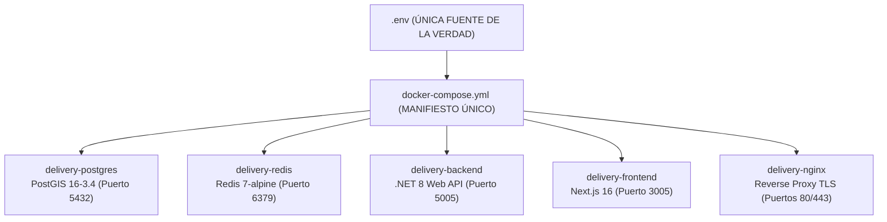

# 01. Infraestructura Docker Compose y Orquestación Unificada

## 1. Descripción General
La persistencia, el motor de caché, la API backend, el frontend web y el proxy perimetral Nginx están orquestados bajo un **único archivo canónico: `docker-compose.yml`** en la raíz del repositorio. Este manifiesto gobierna tanto el entorno de desarrollo local como el despliegue automatizado en servidores de producción.

Toda la parametrización de puertos, contraseñas y claves criptográficas se alimenta exclusivamente del archivo `.env` en la raíz (Única Fuente de la Verdad).

---

## 2. Definición Canónica de Servicios



### 2.1. Base de Datos Principal: `delivery-postgres`
* **Imagen:** `postgis/postgis:16-3.4`
* **Contenedor:** `delivery-postgres`
* **Enlace y Puerto:** `${POSTGRES_BIND_IP:-127.0.0.1}:${POSTGRES_PORT:-5432}:5432` (aislado a localhost en producción).
* **Variables de Entorno:**
  - `POSTGRES_DB=${POSTGRES_DB:-delivery}`
  - `POSTGRES_USER=${POSTGRES_USER:-postgres}`
  - `POSTGRES_PASSWORD=${POSTGRES_PASSWORD:?Definir POSTGRES_PASSWORD en .env}`
* **Volumen Persistente:** `delivery_postgres_data:/var/lib/postgresql/data`
* **Script de Inicialización:** `scripts/db/init-postgis.sql` montado en `/docker-entrypoint-initdb.d/01-init-postgis.sql:ro` (extensiones `postgis` y `uuid-ossp`).
* **Healthcheck:**
  ```yaml
  test: ["CMD-SHELL", "pg_isready -U ${POSTGRES_USER:-postgres} -d ${POSTGRES_DB:-delivery}"]
  interval: 5s
  timeout: 5s
  retries: 5
  start_period: 10s
  ```

### 2.2. Motor de Caché y GEO: `delivery-redis`
* **Imagen:** `redis:7-alpine`
* **Contenedor:** `delivery-redis`
* **Enlace y Puerto:** `${REDIS_BIND_IP:-127.0.0.1}:${REDIS_PORT:-6379}:6379` (aislado a localhost en producción).
* **Comando de Arranque:** `redis-server --requirepass ${REDIS_PASSWORD:?Definir REDIS_PASSWORD en .env} --appendonly yes`
* **Volumen Persistente:** `delivery_redis_data:/data`
* **Healthcheck:**
  ```yaml
  test: ["CMD", "redis-cli", "-a", "${REDIS_PASSWORD}", "ping"]
  interval: 5s
  timeout: 5s
  retries: 5
  start_period: 5s
  ```

### 2.3. Backend API .NET 8: `delivery-backend`
* **Imagen:** `${BACKEND_IMAGE:-${IMAGE_REGISTRY_PREFIX:-ghcr.io/jorgedoicela/delivery-platform}/delivery-backend:latest}`
* **Contenedor:** `delivery-backend`
* **Puerto:** `${API_BIND_IP:-127.0.0.1}:${API_PORT:-5005}:5005`
* **Variables de Entorno:**
  - `ASPNETCORE_ENVIRONMENT=${ASPNETCORE_ENVIRONMENT:-Production}`
  - `ASPNETCORE_URLS=http://+:5005`
  - `ConnectionStrings__DefaultConnection=Host=postgres;Port=5432;Database=${POSTGRES_DB:-delivery};Username=${POSTGRES_USER:-postgres};Password=${POSTGRES_PASSWORD:?Definir POSTGRES_PASSWORD en .env}`
  - `ConnectionStrings__Redis=redis:6379,password=${REDIS_PASSWORD:?Definir REDIS_PASSWORD en .env}`
  - `Jwt__SecretKey=${JWT_SECRET:?Definir JWT_SECRET en .env}`
  - `INITIAL_ADMIN_PASSWORD=${INITIAL_ADMIN_PASSWORD:?Definir INITIAL_ADMIN_PASSWORD en .env}`
  - `GOOGLE_CLIENT_ID=${GOOGLE_CLIENT_ID:-}`
* **Dependencias:** `postgres` y `redis` en estado saludable (`service_healthy`).
* **Healthcheck:**
  ```yaml
  test: ["CMD", "curl", "-f", "http://127.0.0.1:5005/health"]
  interval: 10s
  timeout: 5s
  retries: 5
  start_period: 20s
  ```

### 2.4. Frontend Web Next.js 16: `delivery-frontend`
* **Imagen:** `${FRONTEND_IMAGE:-${IMAGE_REGISTRY_PREFIX:-ghcr.io/jorgedoicela/delivery-platform}/delivery-frontend:latest}`
* **Contenedor:** `delivery-frontend`
* **Puerto:** `${FRONTEND_BIND_IP:-127.0.0.1}:${PORT:-3005}:3005`
* **Variables de Entorno:**
  - `NODE_ENV=production`
  - `PORT=3005`
  - `HOSTNAME=0.0.0.0`
  - `INTERNAL_API_URL=${INTERNAL_API_URL:-http://backend:5005}`
  - `NEXT_PUBLIC_API_URL=${NEXT_PUBLIC_API_URL:-}`
  - `NEXT_PUBLIC_WS_URL=${NEXT_PUBLIC_WS_URL:-}`
  - `NEXT_PUBLIC_PLATFORM_DOMAIN=${NEXT_PUBLIC_PLATFORM_DOMAIN:-mesafy.doicela.dev}`
  - `NEXT_PUBLIC_GOOGLE_CLIENT_ID=${NEXT_PUBLIC_GOOGLE_CLIENT_ID:-}`
* **Dependencias:** `backend` en estado saludable (`service_healthy`).
* **Healthcheck:**
  ```yaml
  test: ["CMD", "curl", "-f", "http://127.0.0.1:3005/api/health"]
  interval: 10s
  timeout: 3s
  retries: 3
  start_period: 20s
  ```

### 2.5. Proxy Perimetral TLS: `delivery-nginx`
* **Imagen:** `${NGINX_IMAGE:-${IMAGE_REGISTRY_PREFIX:-ghcr.io/jorgedoicela/delivery-platform}/delivery-nginx:latest}`
* **Contenedor:** `delivery-nginx`
* **Puertos Expuestos:** `80:80` (HTTP) y `443:443` (HTTPS).
* **Volúmenes:** `./docker/nginx/certs:/etc/nginx/certs`
* **Variables de Entorno:**
  - `PLATFORM_DOMAIN=${PLATFORM_DOMAIN:-${NEXT_PUBLIC_PLATFORM_DOMAIN:-mesafy.doicela.dev}}`
* **Dependencias:** `frontend` y `backend` en estado saludable (`service_healthy`).
* **Healthcheck:**
  ```yaml
  test: ["CMD", "curl", "-f", "http://127.0.0.1/health"]
  interval: 10s
  timeout: 3s
  retries: 3
  start_period: 10s
  ```

---

## 3. Flujo de Desarrollo y Ciclo de Vida

Para garantizar máxima velocidad de desarrollo sin conflictos de puertos en el host:

1. **Modo Híbrido con Auto-Recarga en Host (Recomendado):**  
   Inicia la persistencia en Docker y ejecuta la API y el Frontend directamente en tu sistema operativo:
   * `pnpm infra:up`: Inicia exclusivamente `postgres` y `redis` (`docker compose up -d postgres redis`).
   * `pnpm dev:backend:watch`: Inicia la API con `dotnet watch` y recarga en caliente (~200ms).
   * `pnpm dev:frontend`: Inicia Next.js con Fast Refresh en el puerto `3005`.

2. **Modo 100% Contenedorizado:**  
   Inicia el stack completo de 5 servicios mediante `pnpm docker:all` (`docker compose up -d`).

---

## 4. Comandos Estandarizados en `package.json`

| Comando | Acción Técnica |
| :--- | :--- |
| `pnpm infra:up` | Levanta únicamente `postgres` y `redis` (`docker compose up -d postgres redis`). |
| `pnpm infra:down` | Detiene y remueve los contenedores de infraestructura (`docker compose down`). |
| `pnpm infra:status` | Consulta el estado y salud activa de los contenedores (`docker compose ps`). |
| `pnpm dev:backend` | Inicia la API de .NET 8 localmente en el puerto `5005`. |
| `pnpm dev:backend:watch` | Inicia la API con recarga en caliente continua (`dotnet watch`). |
| `pnpm dev:frontend` | Inicia el frontend de Next.js en el puerto `3005`. |
| `pnpm docker:all` | Compila y levanta todo el stack en Docker (`docker compose up -d`). |

---

## 5. Scripts de Operación y Despliegue en Producción
Para la gestión del ciclo de vida en servidores remotos y contingencias de producción, los scripts operativos residen en `scripts/deploy/`:
* `scripts/deploy/deploy.sh`: Automatización de despliegue con verificación activa de health checks, preservación de snapshots `:previous` y limpieza automática `prune`.
* `scripts/deploy/rollback.sh`: Reversión inmediata a imágenes Docker con etiqueta `:previous`.

Consulte la guía detallada de CI/CD y despliegue continuo en [03-guia-despliegue-devops.md](./03-guia-despliegue-devops.md).

---

## Navegación de Documentación
* **Anterior:** [03. Herramienta Móvil del Repartidor y Telemetría GPS](../04-frontend-web/03-pantalla-repartidor-gps.md)
* **Siguiente:** [02. Empaquetado Móvil con Capacitor](./02-empaquetado-capacitor.md)
* **Índice General:** [README Principal](../../README.md)
