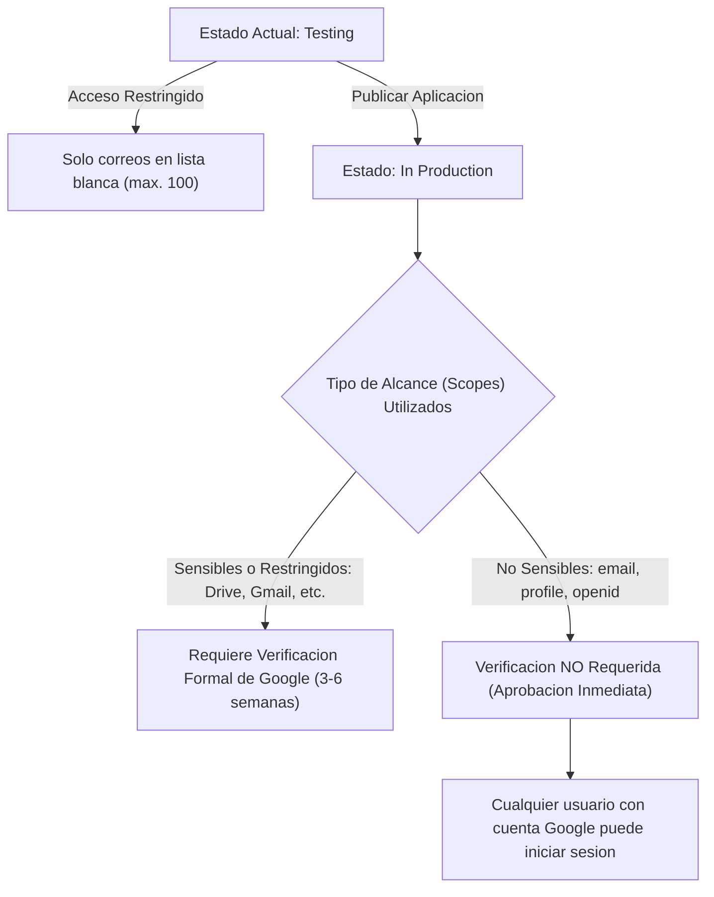

# 04. Checklist y Guia de Puesta en Produccion: Autenticacion, Google OAuth y Dominios

Este documento establece el procedimiento tecnico obligatorio, los requisitos de cumplimiento de Google Cloud y la configuracion de infraestructura para trasladar la plataforma y el subsistema de autenticacion federada (Google Identity Services) a un entorno de produccion real.

---

## 1. Transicion de Google Cloud Console (De Pruebas a Produccion)

Durante la etapa de desarrollo local, la aplicacion opera bajo el modo **Testing** de Google Cloud, restringiendo el inicio de sesion exclusivamente a los correos agregados manualmente en *Usuarios de prueba*. En produccion, se requiere publicar la aplicacion para admitir cualquier cuenta de Google.

### 1.1. Modos de Publicacion en OAuth Consent Screen



Debido a que **Delivery Platform** unicamente consume los alcances estandar de OpenID Connect (`email`, `profile`, `openid`), el paso a produccion **no requiere auditoria de seguridad de terceros ni costos de verificacion**. La activacion es inmediata al pulsar **Publish App**.

### 1.2. Requisitos Previos en Google Cloud Console antes de Publicar

1. **Informacion de la Marca (Brand Information):**
   * **Nombre de la aplicacion:** `Mesafy` (o el nombre comercial de la plataforma).
   * **Correo de soporte del usuario:** Correo corporativo del administrador (ej. `soporte@doicela.dev`).
   * **Logotipo de la aplicacion:** Imagen cuadrada de 120x120 px en formato PNG/JPG alojada en un endpoint publico HTTPS.
   * **Dominio de la aplicacion:**
     * Pagina principal: `https://mesafy.doicela.dev`
     * Enlace a las Condiciones del Servicio: `https://mesafy.doicela.dev/terminos`
     * Enlace a la Politica de Privacidad: `https://mesafy.doicela.dev/privacidad`
   * **Dominios autorizados (Authorized domains):**
     * Agregar el dominio raiz: `doicela.dev` (permite que cualquier subdominio `*.doicela.dev` sea utilizado).

2. **Publicacion de la Pantalla de Consentimiento:**
   * Ir a **Google Auth Platform** -> **Público** (o **Pantalla de consentimiento de OAuth**).
   * En *Estado de publicacion*, hacer clic en **Publicar aplicacion (Publish App)**.
   * Confirmar la advertencia. A partir de este momento, cualquier comensal podra iniciar sesion sin requerir alta manual en usuarios de prueba.

---

## 2. Registro de Origenes y Redirecciones en Produccion

En el cliente OAuth 2.0 (*Google Auth Platform -> Clientes -> Mesafy Web Client*), se deben registrar los dominios publicos con protocolo HTTPS estricto.

### 2.1. Matriz de URIs Requeridas

| Campo en Google Cloud Console | URI en Produccion | Observaciones Tecnicas |
| :--- | :--- | :--- |
| **Orígenes autorizados de JavaScript** | `https://mesafy.doicela.dev` | Portal principal de la plataforma. **Prohibido incluir barra final `/`**. |
| **Orígenes autorizados de JavaScript** | `https://lagranjita.doicela.dev` | Subdominio del tenant base. |
| **Orígenes autorizados de JavaScript** | `https://pedidos.lagranjita.com` | Dominio personalizado del restaurante (si aplica). |
| **URIs de redireccionamiento autorizados** | `https://mesafy.doicela.dev` | Destino de retorno post-login de plataforma. |
| **URIs de redireccionamiento autorizados** | `https://lagranjita.doicela.dev` | Destino de retorno post-login del tenant. |
| **URIs de redireccionamiento autorizados** | `https://lagranjita.doicela.dev/login` | Ruta directa de autenticacion del establecimiento. |

> [!IMPORTANT]
> **Regla de Sintaxis Google:** Ningun origen de JavaScript debe contener rutas ni terminar con `/` (ej. `https://mesafy.doicela.dev/` es invalido y Google lo rechazara o causara error 403).

---

## 3. Matriz de Variables de Entorno en el Servidor de Produccion (`.env`)

En el servidor de produccion (`/opt/delivery-platform/.env`), las credenciales deben apuntar a los secretos reales y a los dominios bajo HTTPS:

```ini
# ==============================================================================
# CONFIGURACION DE PRODUCCION (.env)
# ==============================================================================

# 1. Puertos e IP Binds (Aislamiento Perimetral)
HTTP_PORT=80
HTTPS_PORT=443
PORT=3005
API_PORT=5005
POSTGRES_PORT=5432
REDIS_PORT=6379
POSTGRES_BIND_IP=127.0.0.1
REDIS_BIND_IP=127.0.0.1
API_BIND_IP=127.0.0.1
FRONTEND_BIND_IP=127.0.0.1

# 2. Base de Datos PostgreSQL 16 + PostGIS
POSTGRES_HOST=127.0.0.1
POSTGRES_DB=delivery
POSTGRES_USER=postgres
POSTGRES_PASSWORD=ClaveDeProduccionGeneradaAleatoriaDe32CaracteresMinimo!

# 3. Redis 7
REDIS_HOST=127.0.0.1
REDIS_PASSWORD=ClaveRedisProduccionGeneradaAleatoriaDe32CaracteresMinimo!

# 4. Backend API (.NET 8)
ASPNETCORE_ENVIRONMENT=Production
API_URL=https://api.mesafy.doicela.dev
JWT_SECRET=ClaveSecretaJWTProduccionCriptograficaMayorA32BytesHS256!
JWT_ISSUER=DeliveryPlatform.Api
JWT_AUDIENCE=DeliveryPlatform.Clients
INITIAL_ADMIN_PASSWORD=PasswordSeguroSuperAdminInicial2026!

# 5. Autenticacion Federada Google OAuth 2.0
GOOGLE_CLIENT_ID=747427996536-srqjcuroq0m7r9knu7dotqlefc7qp1oc.apps.googleusercontent.com
NEXT_PUBLIC_GOOGLE_CLIENT_ID=747427996536-srqjcuroq0m7r9knu7dotqlefc7qp1oc.apps.googleusercontent.com

# 6. Frontend Web (Next.js 16)
PLATFORM_DOMAIN=mesafy.doicela.dev
NEXT_PUBLIC_PLATFORM_DOMAIN=mesafy.doicela.dev
NEXT_PUBLIC_API_URL=https://api.mesafy.doicela.dev
NEXT_PUBLIC_WS_URL=https://api.mesafy.doicela.dev/hubs
INTERNAL_API_URL=http://127.0.0.1:5005

# 7. Correo Electronico SMTP Transaccional (Google Gmail / SendGrid / Amazon SES)
SMTP_HOST=smtp.gmail.com
SMTP_PORT=587
SMTP_USER=notificaciones@doicela.dev
SMTP_PASSWORD=clave_de_aplicacion_google_16_caracteres
SMTP_SECURE=true
SMTP_FROM_EMAIL=notificaciones@doicela.dev
SMTP_FROM_NAME=Mesafy Platform
```

---

## 4. Configuracion de Nginx Reverse Proxy y Certificados SSL/TLS

Para produccion, Nginx o Caddy debe actuar como terminador SSL, redirigiendo el trafico HTTPS hacia los puertos internos locales:

```nginx
# Configuracion recomendada Nginx (/etc/nginx/sites-available/mesafy.conf)

# 1. API Backend y WebSockets SignalR
server {
    server_name api.mesafy.doicela.dev;

    listen 443 ssl http2;
    ssl_certificate /etc/letsencrypt/live/mesafy.doicela.dev/fullchain.pem;
    ssl_certificate_key /etc/letsencrypt/live/mesafy.doicela.dev/privkey.pem;

    location / {
        proxy_pass http://127.0.0.1:5005;
        proxy_http_version 1.1;
        proxy_set_header Upgrade $http_upgrade;
        proxy_set_header Connection "upgrade";
        proxy_set_header Host $host;
        proxy_cache_bypass $http_upgrade;
        proxy_set_header X-Forwarded-For $proxy_add_x_forwarded_for;
        proxy_set_header X-Forwarded-Proto $scheme;
    }
}

# 2. Frontend Web y Tiendas Multi-Tenant (*.doicela.dev)
server {
    server_name mesafy.doicela.dev *.doicela.dev;

    listen 443 ssl http2;
    ssl_certificate /etc/letsencrypt/live/mesafy.doicela.dev/fullchain.pem;
    ssl_certificate_key /etc/letsencrypt/live/mesafy.doicela.dev/privkey.pem;

    location / {
        proxy_pass http://127.0.0.1:3005;
        proxy_http_version 1.1;
        proxy_set_header Upgrade $http_upgrade;
        proxy_set_header Connection "upgrade";
        proxy_set_header Host $host;
        proxy_cache_bypass $http_upgrade;
        proxy_set_header X-Forwarded-For $proxy_add_x_forwarded_for;
        proxy_set_header X-Forwarded-Proto $scheme;
    }
}
```

---

## 5. Politicas de Seguridad y Cookies en Canales HTTPS

Cuando el entorno pasa a `ASPNETCORE_ENVIRONMENT=Production`:

1. **Cookies HttpOnly y Secure:** La cookie de sesion `refreshToken` emitida en `POST /api/v1/auth/google` activa automaticamente el atributo `Secure = true`, lo que exige que todo trafico viaje sobre HTTPS para ser transmitida por el navegador.
2. **SameSite Mode:** Se mantiene en `SameSiteMode.Lax` o `Strict` para prevenir peticiones cruzadas no autorizadas desde sitios de terceros.
3. **CORS Dinamico Multi-Tenant:** `Program.cs` en el backend valida dinamicamente que el host de la peticion coincida con `mesafy.doicela.dev` o cualquier subdominio `*.mesafy.doicela.dev`, bloqueando dominios desconocidos.

---

## 6. Procedimiento de Verificacion y Prueba de Humo (Smoke Test)

Una vez desplegado en produccion, ejecute la siguiente lista de comprobacion para certificar la estabilidad operativa:

| Paso | Accion de Verificacion | Resultado Esperado |
| :---: | :--- | :--- |
| **1** | `curl -k https://api.mesafy.doicela.dev/health` | HTTP 200 con payload `{"status":"Healthy","service":"Delivery.Api"}` |
| **2** | Abrir `https://mesafy.doicela.dev/la-granjita/login` en ventana privada | El boton oficial de Google se monta limpiamente sin advertencias de origen ni errores 403 en consola. |
| **3** | Iniciar sesion con una cuenta de Google externa (que no este en la lista de desarrolladores) | Se abre la ventana emergente, se selecciona la cuenta y se redirige con sesion activa sin requerir permisos especiales. |
| **4** | Comprobar la base de datos de produccion | Se verifica la creacion del usuario con `IsEmailVerified = true` y el cliente con codigo `CF-{userId}` sin duplicidad de clave unica. |
| **5** | Cerrar sesion | Se invoca `POST /api/v1/auth/logout`, se expira la cookie `refreshToken` y la interfaz retorna al estado no autenticado. |

---

## Navegacion de Documentacion
* **Anterior:** [03. Guia de Despliegue DevOps y CI/CD](./03-guia-despliegue-devops.md)
* **Siguiente:** [01. Especificacion Funcional y Roadmap](../06-roadmap-y-especificacion/01-especificacion-funcional-y-roadmap.md)
* **Indice General:** [README Principal](../../README.md)

