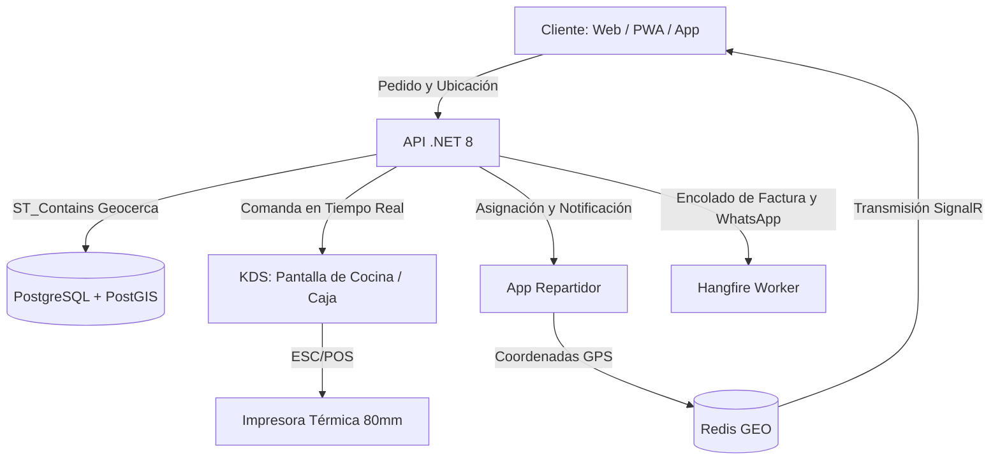
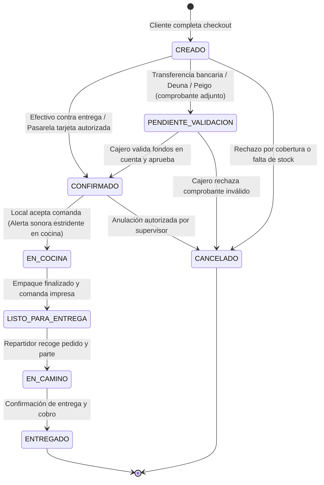
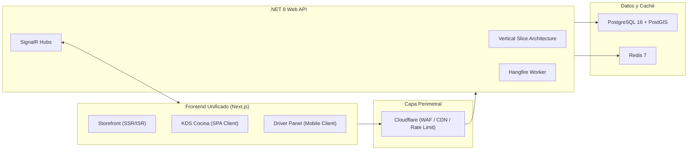
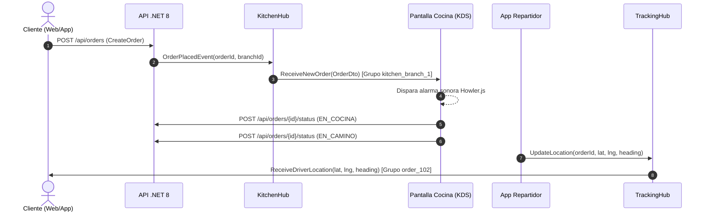
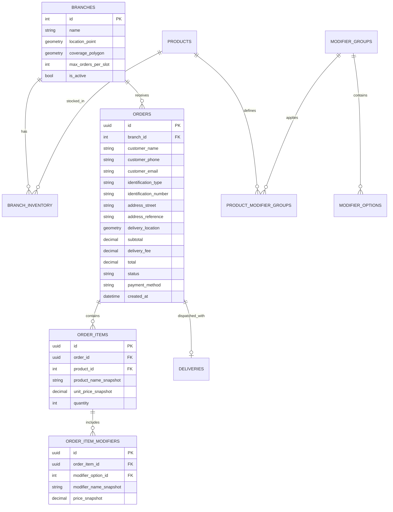

# 01. Especificacion Funcional y Roadmap de Implementacion

Documento de Especificacion Tecnica, Alcance Operativo y Roadmap del Negocio  
Proyecto: Plataforma de Delivery Directo para 2 Sucursales  
Estado: Aprobado / En Operacion y Mantenimiento  

---

## 1. Alcance y Contexto de Negocio

El sistema resuelve la dependencia de plataformas intermediarias de entrega (Uber Eats, PedidosYa) que retienen entre el 25% y el 30% del margen bruto de venta. La solución implementa un canal propio de venta directa y despacho logístico para dos sucursales operativas.

### 1.1. Restricciones Operativas Críticas
* **Ventanas de Demanda Concentrada y Capacidad de Horno:** El 80% del volumen transaccional ocurre en dos franjas diarias: almuerzo (12:00 a 14:00) y merienda/cena (18:30 a 20:30). La preparación de pollo asado toma entre 45 y 60 minutos por lote de horneado. El sistema implementa control de capacidad operativa y limitación de pedidos por intervalo de tiempo (throttling operativo) basado en franjas de 20 minutos (`max_orders_per_slot`), evitando el colapso de cocina.
* **Fricción Mínima de Checkout:** Se descarta el registro tradicional mediante formularios extensos. El flujo permite compra rápida como invitado solicitando únicamente: nombre, teléfono, dirección textual con referencia y geolocalización en mapa, o autenticación ligera mediante código OTP por WhatsApp.
* **Enrutamiento Geográfico por Polígonos:** Asignación automática de pedidos a la sucursal correspondiente mediante análisis espacial exacto de la ubicación del cliente con índices espaciales GiST en PostGIS, con capacidad de redirección operativa en caso de agotamiento de inventario en una sede.
* **Facturación Electrónica y Datos de Despacho:** Generación asíncrona de comprobantes electrónicos autorizados por el SRI posterior a la confirmación de pago. El checkout admite Consumidor Final como valor predeterminado o captura datos fiscales obligatorios (`identification_type`, `identification_number`, `customer_email`), garantizando además la persistencia textual de la dirección y referencia (`address_street`, `address_reference`) para la comanda impresa.

---

## 2. Definición Funcional de Módulos



### 2.1. Canal del Cliente (Storefront)
* Catálogo interactivo de combos, cuartos, medios y pollos enteros con modificadores obligatorios (elección de guarnición, tipo de ají) y opcionales con costo (bebidas, porciones adicionales).
* Validación de cobertura previa a la selección de productos mediante pin en mapa o dirección detectada.
* Modalidades de servicio: Entrega a domicilio (Delivery) o Retiro en local (Takeout).
* Pantalla de seguimiento en tiempo real con indicador de fase y mapa dinámico con la ubicación del repartidor.

### 2.2. KDS y Panel de Operación Local (Kitchen Display System)
* Tablero tipo Kanban con estados operativos de órdenes.
* Alerta sonora continua en bucle ante la entrada de nuevos pedidos hasta su aceptación manual.
* Impresión desatendida de comandas térmicas de 80mm al momento de confirmar el pedido.
* Interruptor de inventario rápido para deshabilitar productos o modificadores específicos en la sucursal activa en tiempo real.

### 2.3. Herramienta de Repartidores (Driver Operations)
* Lista de pedidos asignados con dirección, datos del cliente y monto a cobrar.
* Enlaces directos a aplicaciones de navegación externa (Waze y Google Maps) con coordenadas exactas.
* Transmisión periódica de coordenadas de geolocalización hacia el servidor.
* Registro de liquidación en entrega (confirmación de cobro en efectivo y vuelto).

### 2.4. Panel de Administración Central
* Configuración de polígonos de cobertura (geocercas) y horarios de servicio de cada sucursal.
* Administración centralizada del catálogo base y fijación de precios diferenciados o unificados.
* Reportes de ventas por sede, métricas de tiempos de preparación y liquidación de efectivo de repartidores al cierre de turno.

---

## 3. Máquina de Estados del Pedido

El ciclo de vida de cada orden es estrictamente secuencial y gestionado mediante transiciones validadas en el backend:



| Estado | Origen de Cambio | Efecto Operativo | Notificación |
|---|---|---|---|
| `CREADO` | Cliente | Valida inventario temporal e idempotencia. | Ninguna |
| `PENDIENTE_VALIDACION` | Cliente (adjunta comprobante) | Notificación visual suave en terminal de caja ("Comprobante por verificar"). Cocina NO recibe la orden aún. | WhatsApp al cliente: "Comprobante en revisión" |
| `CONFIRMADO` | Pasarela / Cajero (aprueba transferencia) / Sistema (efectivo) | Asigna sucursal definitiva, reserva inventario. Despacha evento SignalR a KDS. | Alerta sonora estridente en KDS (Howler.js) |
| `EN_COCINA` | Operador KDS | Comanda enviada a producción. Impresión de ticket térmico 80mm. | WhatsApp al cliente: "Pedido en preparación" |
| `LISTO_PARA_ENTREGA` | Operador KDS | Pedido empaquetado, pasa a zona de despacho. | Alerta a flota de reparto |
| `EN_CAMINO` | Repartidor | Se habilita la suscripción al canal de GPS en vivo. | WhatsApp con enlace GPS en vivo |
| `ENTREGADO` | Repartidor | Cierre de orden. Registro de caja. | Encolado de emisión de factura SRI |
| `CANCELADO` | Administrador / Cajero | Liberación de stock reservado. En caso de transferencia rechazada, registro de motivo. | WhatsApp de cancelación |

---

## 4. Arquitectura de Software

El sistema adopta una arquitectura desacoplada cliente-servidor compuesta por un único proyecto frontend y un único proyecto backend, reduciendo la fricción operativa y asegurando consistencia de datos.



### 4.1. Decisiones Arquitectónicas Fundamentales

1. **Frontend Único (Next.js):**
   - Elimina la fragmentación de repositorios. Un solo proyecto aloja la tienda pública de clientes, la interfaz de cocina y la herramienta del repartidor.
   - El cliente experimenta exactamente la misma interfaz (landing, combos y checkout) accediendo desde el navegador web o desde la aplicación móvil instalada.

2. **Backend Monolítico Modular (.NET 8 con Vertical Slice Architecture):**
   - Agrupación del código por casos de uso verticales (Features) en lugar de capas horizontales genéricas. Cada funcionalidad encapsula su comando/consulta, validador, lógica de negocio y DTO.
   - Rendimiento superior en concurrencia y bajo consumo de memoria.

3. **Persistencia Híbrida Especializada:**
   - PostgreSQL con PostGIS para la totalidad de datos transaccionales y validaciones geométricas.
   - Redis como capa volátil de alta frecuencia para coordenadas de repartidores, candados de idempotencia y cola de tareas.

4. **Tiempo Real Bidireccional (SignalR):**
   - Conexiones persistentes mediante SignalR Hubs con segmentación de grupos por sucursal y por orden, con tolerancia automática a desconexiones en redes móviles inestables.

---

## 5. Especificación del Frontend (Next.js)

### 5.1. Stack Tecnológico
* **Framework:** Next.js (App Router).
* **Estilos:** Tailwind CSS.
* **Componentes Base:** shadcn/ui (Radix UI primitives).
* **Iconografía:** Lucide React (árbol depurado por tree-shaking).
* **Gestión de Estado del Cliente:** Zustand (persistencia de carrito de compras en LocalStorage).
* **Consumo de API y Caché:** TanStack Query v5 (React Query) con políticas de reintento automático.
* **Validación de Formularios:** React Hook Form integrado con Zod.
* **Visualización de Mapas:** MapLibre GL JS (renderizado vectorial de alto rendimiento sin costo por petición).
* **Audio Operativo:** Howler.js (gestión de desbloqueo de audio y reproducción cíclica de alarma en KDS).
* **Cliente Tiempo Real:** `@microsoft/signalr`.
* **Envoltorio Móvil:** Capacitor (configurado en modo URL para distribución en Android/iOS).

### 5.2. Estrategia de Renderizado y Enrutamiento

```
src/app/
├── (storefront)/                  # SSR / ISR - Clientes
│   ├── layout.tsx                 # Metadata global, viewport móvil, banner PWA
│   ├── page.tsx                   # Landing comercial, combos y catálogo dinámico
│   ├── checkout/
│   │   └── page.tsx               # Formulario de despacho, geocodificación y pago
│   └── track/
│       └── [orderId]/
│           └── page.tsx           # Seguimiento en vivo y visualización de ruta
│
├── (dashboard)/                   # Client-Side ('use client') - Operación Interna
│   ├── layout.tsx                 # Autenticación de personal y shell administrativo
│   ├── kitchen/
│   │   └── page.tsx               # Tablero KDS con alarma y conexión a SignalR
│   └── admin/
│       ├── branches/page.tsx      # Gestión de sucursales y geocercas
│       └── inventory/page.tsx     # Conmutador de disponibilidad inmediata
│
└── (driver)/                      # Client-Side ('use client') - Repartidores
    ├── layout.tsx                 # Layout ergonómico táctil para smartphones
    └── active-delivery/
        └── page.tsx               # Datos de entrega, botones Waze/Maps y reporte GPS
```

### 5.3. Estrategia Móvil PWA y Capacitor
* **Modo PWA (Web Instalable):** Definición de `manifest.json` y Service Worker con `display: "standalone"`. El comensal instala la plataforma sin pasar por tiendas de aplicaciones.
* **Modo Capacitor (Empaquetado Nativo):** Se configura `capacitor.config.json` apuntando directamente a la URL de producción:
  ```json
  {
    "appId": "com.delivery.app",
    "appName": "Delivery App",
    "webDir": "public",
    "server": {
      "url": "https://pedidos.delivery.com",
      "cleartext": false
    }
  }
  ```
  Esto permite compilar un archivo `.apk` de Android con acceso al hardware (geolocalización en segundo plano con `@capacitor-community/background-geolocation`) garantizando que cualquier actualización en el frontend web se refleje instantáneamente en la aplicación móvil sin necesidad de resometer binarios a revisión en tiendas.

### 5.4. Arquitectura Modular Frontend (Feature-Driven)
Toda la lógica de dominio se estructura en `src/features/`:

```
src/features/
├── catalog/
│   ├── components/                # ProductCard, ModifierModal, ComboSelector
│   ├── hooks/                     # useMenuQuery
│   └── services/                  # catalogApi.ts
├── cart/
│   ├── store/                     # useCartStore (Zustand con persistencia)
│   └── components/                # CartDrawer, CartItemRow, PriceSummary
├── checkout/
│   ├── schemas/                   # checkoutSchema.ts (Zod)
│   └── components/                # AddressSelector, PaymentMethodPicker
├── tracking/
│   ├── hooks/                     # useLiveTracking (SignalR + MapLibre)
│   └── components/                # OrderMap, DriverMarker, StatusTimeline
└── kitchen/
    ├── hooks/                     # useKitchenSignalR, useAudioAlarm
    └── components/                # KanbanColumn, OrderTicketCard
```

---

## 6. Especificación del Backend (.NET 8)

### 6.1. Stack Tecnológico
* **Framework:** .NET 8 (C#) ASP.NET Core Web API.
* **Mapeo y Persistencia:** Entity Framework Core 8 con `Npgsql.EntityFrameworkCore.PostgreSQL.NetTopologySuite`.
* **Tiempo Real:** ASP.NET Core SignalR.
* **Caché y Redis:** `StackExchange.Redis`.
* **Procesamiento Asíncrono:** Hangfire (almacenamiento en Redis o PostgreSQL).
* **Validaciones:** FluentValidation.
* **Arquitectura de Código:** Vertical Slice Architecture (VSA).

### 6.2. Estructura de Proyecto Vertical Slice
El backend elimina divisiones por capas tradicionales y organiza el sistema por casos de uso independientes:

```
src/
├── Delivery.Api/
│   ├── Program.cs                 # Configuración de servicios, middlewares y SignalR
│   ├── Middlewares/               # ExceptionHandlingMiddleware, IdempotencyMiddleware
│   └── Extensions/                # ServiceCollectionExtensions
│
├── Delivery.Core/
│   ├── Common/                    # Result<T>, Error, BaseEntity
│   ├── Domain/
│   │   ├── Entities/              # Branch, Product, ModifierGroup, Order, OrderItem
│   │   └── Enums/                 # OrderStatus, PaymentMethod, DeliveryType
│   └── Infrastructure/
│       ├── Persistence/           # AppDbContext, Configuraciones EF Core
│       ├── Redis/                 # RedisGeoService, IdempotencyService
│       └── SignalR/               # Hubs (KitchenHub, TrackingHub)
│
└── Delivery.Features/
    ├── Catalog/
    │   ├── GetActiveMenu/         # Query, Handler, DTO
    │   └── ToggleProductStatus/   # Command, Validator, Handler
    ├── Geofencing/
    │   └── ResolveBranchByPoint/  # Query espacial ST_Contains
    ├── Orders/
    │   ├── CreateOrder/           # Command, Validator, Handler (Transaccional)
    │   ├── ApproveTransferOrder/  # Command para validar comprobante de transferencia
    │   ├── UpdateOrderStatus/     # Command, Notificación SignalR
    │   └── GetOrderById/          # Query, DTO
    ├── Kitchen/
    │   └── GetActiveKitchenOrders/# Query para KDS inicial
    └── Tracking/
        ├── IngestDriverLocation/  # Command con escritura en Redis
        └── GetDriverLocation/     # Query para cliente
```

### 6.3. Manejo de Errores e Invariantes (Result Pattern)
Se prohíbe el uso de excepciones para el flujo de control de negocio. Todas las operaciones retornan una estructura `Result<T>`:

```csharp
public class Result<T>
{
    public bool IsSuccess { get; }
    public T? Value { get; }
    public Error? Error { get; }

    protected Result(T value) { IsSuccess = true; Value = value; }
    protected Result(Error error) { IsSuccess = false; Error = error; }

    public static Result<T> Success(T value) => new(value);
    public static Result<T> Failure(Error error) => new(error);
}
```

---

## 7. Arquitectura de Tiempo Real (SignalR)

SignalR opera mediante dos concentradores (Hubs) independientes para segmentar la carga de eventos y evitar transferencias innecesarias de datos a clientes no interesados:



### 7.1. KitchenHub
* **Ruta:** `/hubs/kitchen`
* **Autenticación:** Requerida (Rol: Cocinero, Cajero, Administrador).
* **Gestión de Grupos:** Cada terminal de cocina se suscribe al grupo correspondiente: `kitchen_branch_{branchId}`.
* **Eventos Emitidos:**
  - `ReceiveNewOrder(OrderPayload payload)`: Transmite la nueva orden a preparar.
  - `StockUpdated(int productId, bool isAvailable)`: Notifica cambios en el stock local.

### 7.2. TrackingHub
* **Ruta:** `/hubs/tracking`
* **Autenticación:**
  - Repartidores: JWT autenticado con ID de conductor.
  - Clientes: Token de rastreo efímero (`trackingToken`) generado al crear la orden.
* **Gestión de Grupos:**
  - Repartidores emiten a: `SendDriverLocation(string orderId, double lat, double lng, double? heading)`.
  - Clientes se unen exclusivamente al canal: `order_tracking_{orderId}`.
* **Políticas de Transmisión:** El cliente únicamente recibe coordenadas si la orden se encuentra en estado `EN_CAMINO`. Al marcarse como `ENTREGADO`, el grupo se destruye y la conexión se cierra.

---

## 8. Persistencia y Geocercas (PostgreSQL + PostGIS)

### 8.1. Modelo Entidad-Relación



### 8.2. Determinación Espacial de Cobertura y Sucursal
La asignación de pedidos no utiliza aproximaciones euclidianas ni círculos de radio fijo. Se define un polígono geométrico real por cada sucursal en PostGIS tipado estrictamente como `geometry(Polygon, 4326)`.

Para garantizar que el motor de PostgreSQL resuelva la intersección espacial en tiempo logarítmico $O(\log N)$ y no realice un escaneo secuencial (*Sequential Scan*) sobre toda la tabla ante cada checkout, es obligatorio definir un índice espacial GiST:

```sql
-- Creación obligatoria del índice espacial GiST sobre la cobertura
CREATE INDEX idx_branches_coverage_polygon 
ON "Branches" USING GIST (coverage_polygon);
```

En la configuración de persistencia con Entity Framework Core 8 y NetTopologySuite:

```csharp
// Configuración explícita del tipo geométrico y SRID
builder.Property(b => b.CoveragePolygon)
       .HasColumnType("geometry(Polygon, 4326)")
       .IsRequired();
```

La consulta espacial nativa evaluada por EF Core opera sobre coordenadas geográficas en orden `(Longitud, Latitud)`:

```sql
-- Consulta espacial nativa evaluada con índice GiST
SELECT b.id, b.name, b.max_orders_per_slot
FROM "Branches" b
WHERE b.is_active = TRUE
  AND ST_Contains(b.coverage_polygon, ST_SetSRID(ST_Point(@ClientLng, @ClientLat), 4326))
LIMIT 1;
```

Si el punto de entrega cae dentro de la cobertura de la Sucursal 1, el pedido se asigna a dicha sucursal. Si el punto no interseca ningún polígono activo, el backend rechaza la orden con código `422 Unprocessable Entity` notificando fuera de zona de reparto.

### 8.3. Inmutabilidad y Congelamiento de Datos Financieros
Para asegurar la integridad contable, auditoría fiscal del SRI y reportes históricos ante cambios de precios en el menú:
* La tabla `OrderItems` almacena `product_name_snapshot` y `unit_price_snapshot` al momento exacto de la venta.
* La tabla `OrderItemModifiers` almacena `modifier_name_snapshot` y `price_snapshot` (registrando el recargo exacto de la opción seleccionada, ej. $1.50 por bebida agrandada o $0.00 si era guarnición base incluida).
* **Fórmula de Auditoría Inmutable:**
  $$\text{Total} = \text{delivery\_fee} + \sum (\text{unit\_price\_snapshot} \times \text{quantity} + \sum \text{price\_snapshot})$$
* Si el precio del pollo o de los acompañamientos se incrementa en el catálogo maestro, las órdenes históricas permanecen inalteradas y cuadran al centavo en conciliación bancaria.

---

## 9. Caché, Redis y Tareas en Segundo Plano

### 9.1. Ingesta de Ubicación GPS de Flota
Las coordenadas transmitidas por los repartidores (cada 5 a 10 segundos o cada 15 metros recorridos) no se persisten en PostgreSQL para evitar saturación de I/O y fragmentación de índices. Se procesan en Redis mediante tipos geoespaciales:

```bash
# Ingesta en Redis por conductor activo
GEOADD active_drivers:locations <lng> <lat> <driverId>

# Almacenamiento del último vector de dirección (TTL: 60 segundos)
SET driver:<driverId>:heading <heading_degrees> EX 60
```

### 9.2. Idempotencia en Checkout
Para evitar la duplicación de órdenes provocada por doble pulsación en dispositivos móviles o cortes de red:
1. El cliente genera un UUID en el encabezado HTTP: `Idempotency-Key: 7b3d9...`
2. El middleware de la API valida en Redis:
   - Si la clave existe en estado `PROCESSING`, rechaza la petición con `409 Conflict`.
   - Si la clave no existe, la registra con TTL de 120 segundos e inicia la transacción.
   - Al finalizar exitosamente la creación de la orden, almacena el `OrderId` generado y el payload de respuesta en la clave de Redis.
   - Peticiones subsiguientes con la misma clave reciben inmediatamente la respuesta previa sin reejecutar la lógica de negocio.

### 9.3. Tareas en Segundo Plano (Hangfire)
* **Emisión de Comprobantes Electrónicos:** Cola `invoicing`. Genera el archivo XML, firma digitalmente mediante certificado `.p12` y envía el comprobante al servicio web del SRI. Si el servicio tributario no responde, Hangfire ejecuta reintentos con retroceso exponencial.
* **Notificaciones de WhatsApp:** Cola `notifications`. Envía mensajes automáticos en transiciones clave (`CONFIRMADO`, `EN_CAMINO`).

### 9.4. Control de Capacidad Operativa y Throttling en Redis
Para evitar que una ráfaga de pedidos sature la capacidad física de horneado y empaque:
1. **Contador Atómico por Franja Temporal:** Cada orden confirmada incrementa un contador atómico en Redis agrupado en ventanas de 20 minutos:
   ```bash
   # Clave con expiración de 2 horas (TTL: 7200s)
   INCR branch:{branchId}:slot:{timestamp_20min}
   EXPIRE branch:{branchId}:slot:{timestamp_20min} 7200 NX
   ```
2. **Evaluación de Umbrales Operativos:**
   - **Flujo Normal:** Si el valor acumulado es menor o igual al umbral `max_orders_per_slot` de la sucursal (ej. 15 pedidos en 20 minutos), el pedido se acepta con el tiempo estándar de entrega (35-45 min).
   - **Demanda Extendida:** Si el valor supera `max_orders_per_slot`, la API notifica al frontend para informar en tiempo real en el checkout: *"Tiempo estimado de entrega extendido a 60-75 min por alta demanda en horno"*, gestionando la expectativa del cliente sin cancelar ventas.
   - **Tope Físico Crítico:** Si el contador alcanza el límite de saturación máxima (ej. 150% del umbral), el sistema suspende temporalmente la admisión de nuevos pedidos en esa sucursal por 10 minutos para proteger la operación.

---

## 10. Hardware, Pagos y Logística Local

### 10.1. Impresión Térmica de Comandas (80mm ESC/POS)
Los navegadores web estándar no tienen permisos para comunicarse directamente con dispositivos de puerto serie, USB o red local sin desplegar el diálogo de impresión del sistema operativo. La solución opera mediante herramientas puente locales:
* **En PC de Caja / Cocina (Windows):** Servicio local `QZ Tray`. Recibe comandos en lenguaje ESC/POS por WebSocket local (`ws://localhost:8182`) y envía el flujo de bytes crudos a la impresora térmica en menos de 300 ms.
* **En Tablets Android de Cocina:** Aplicación puente `RawBT`. Permite imprimir silenciosamente a impresoras térmicas Bluetooth o WiFi mediante intents locales.

**Formato del Ticket Térmico de Comanda:**
```
========================================
              DELIVERY APP
          SUCURSAL #1 (NORTE)
========================================
ORDEN: #1042           TIPO: A DOMICILIO
FECHA: 2026-10-27 13:15
----------------------------------------
CLIENTE: Carlos Mendoza
TEL: 0987654321
DIR: Av. Amazonas y República (Edif. Sky)
REF: Timbre 4B, junto a la farmacia
----------------------------------------
CANT  PRODUCTO                    TOTAL
----------------------------------------
 1    COMBO FAMILIAR             $ 22.00
      - 1 Pollo Asado Entero
      - Papas Fritas Grandes
      - Menestra de Fréjol
      - 4 Porciones de Ají Casero
 1    COLA 1.5L (Manzana)        $  2.50
----------------------------------------
SUBTOTAL:                        $ 24.50
ENVIO:                           $  1.50
TOTAL A COBRAR:                  $ 26.00
----------------------------------------
METODO DE PAGO: EFECTIVO
PAGA CON: $ 30.00
CAMBIO A ENTREGAR: $ 4.00
========================================
```

### 10.2. Flujo de Pagos y Liquidación de Efectivo
1. **Efectivo contra Entrega:** El checkout obliga a responder: *"¿Con cuánto billete pagará?"*. El sistema calcula el vuelto exacto y lo imprime en la comanda. El repartidor parte del local con el cambio exacto. Al final de la jornada, el reporte de liquidación cruza el total de pedidos entregados contra el dinero en efectivo entregado a caja.
2. **Transferencias Bancarias / Deuna / Peigo:** Visualización de QR y datos bancarios oficiales. El cliente adjunta el comprobante (imagen) en el checkout. La orden pasa al estado `PENDIENTE_VALIDACION`. El panel de caja recibe una notificación visual suave ("Comprobante por verificar"). El cajero verifica el ingreso de fondos en su aplicación bancaria y presiona "Aprobar Pago". En ese instante la orden transiciona a `CONFIRMADO`, se reserva el inventario y se dispara la alerta sonora estridente en la pantalla de cocina (KDS) para iniciar la preparación. Si el comprobante es falso o ilegible, el cajero presiona "Rechazar", la orden pasa a `CANCELADO` y se despacha un mensaje de notificación automática al cliente por WhatsApp.
3. **Pasarela de Tarjeta (Payphone / Kushki):** Transacción procesada mediante webhook seguro que valida la firma criptográfica antes de marcar la orden como `CONFIRMADA`.

### 10.3. Integración de Navegación del Repartidor
La interfaz del repartidor cuenta con dos disparadores que abren directamente las aplicaciones de navegación mediante Deep Links nativos con las coordenadas de destino:
* **Google Maps:** `https://www.google.com/maps/dir/?api=1&destination={lat},{lng}`
* **Waze:** `https://waze.com/ul?ll={lat},{lng}&navigate=yes`

---

## 11. Seguridad e Infraestructura Cloud (DevSecOps)

### 11.1. Perímetro y Protección (Cloudflare)
* **Firewall WAF y Mitigación DDoS:** Reglas de mitigación de ataques a nivel de capa 7.
* **Rate Limiting Estricto:**
  - `POST /api/orders`: Máximo 5 peticiones por minuto por dirección IP.
  - `POST /api/auth/otp`: Máximo 3 peticiones cada 5 minutos por número de teléfono para evitar costos excesivos de API de mensajería.
* **Optimización de Assets en el Edge:** Conversión y almacenamiento en caché de imágenes de productos en formato WebP con compresión adaptativa para redes móviles lentas.

### 11.2. Integridad Transaccional y Cálculo de Precios
* **Blindaje del Subtotal:** El frontend nunca envía precios calculados al servidor. La petición de compra solo envía identificadores y cantidades:
  ```json
  {
    "branchId": 1,
    "items": [
      {
        "productId": 10,
        "quantity": 1,
        "selectedModifierIds": [102, 105]
      }
    ]
  }
  ```
* El backend consulta el catálogo maestro en base de datos, valida que los modificadores pertenezcan al producto, aplica las tarifas de envío calculadas por PostGIS y liquida el total de forma segura.

### 11.3. Esquema de Despliegue en AWS
* **Cómputo:** Contenedores Docker orquestados mediante AWS ECS Fargate o instancia EC2 con Docker Compose para el backend (.NET 8) y el frontend (Next.js).
* **Base de Datos:** AWS RDS PostgreSQL con extensión PostGIS habilitada y respaldos automatizados.
* **Caché y Colas:** AWS ElastiCache for Redis o contenedor Redis dedicado con volumen persistente AOF.
* **Almacenamiento:** AWS S3 o Cloudflare R2 para comprobantes de pago e imágenes del menú.

---

## Navegacion de Documentacion
* **Anterior:** [03. Guia Tecnica de CI/CD, Despliegue Automatizado y Rollback](../05-despliegue-y-operaciones/03-guia-despliegue-devops.md)
* **Indice General:** [README Principal](../../README.md)
