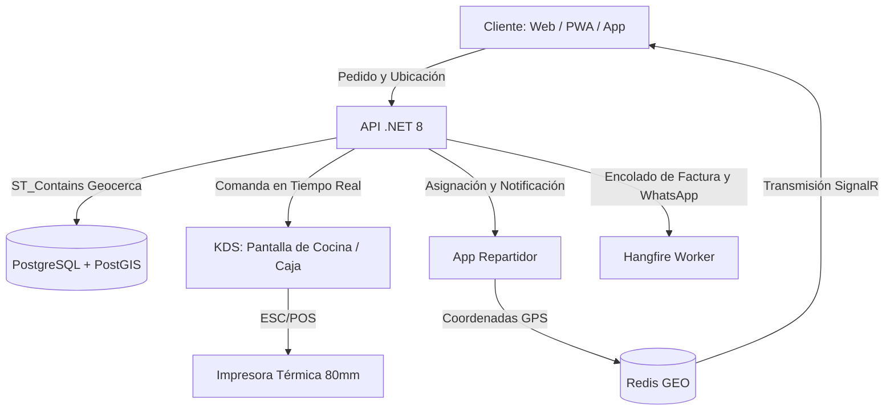
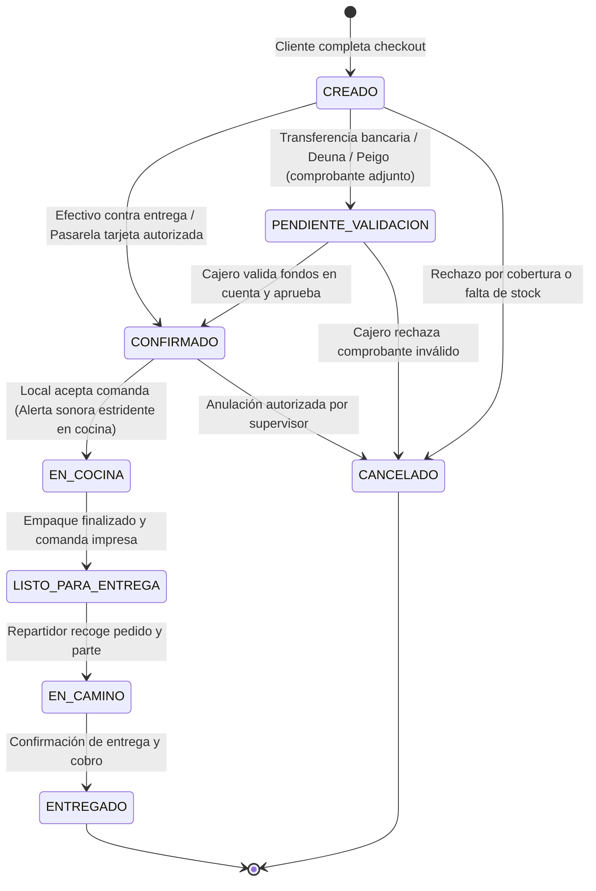
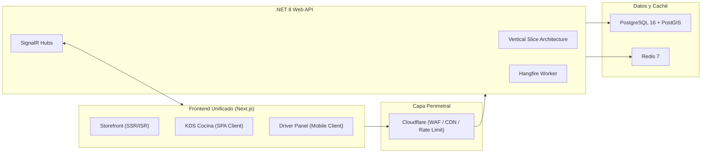
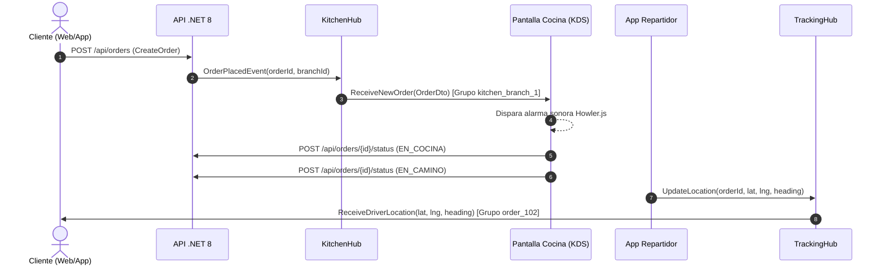
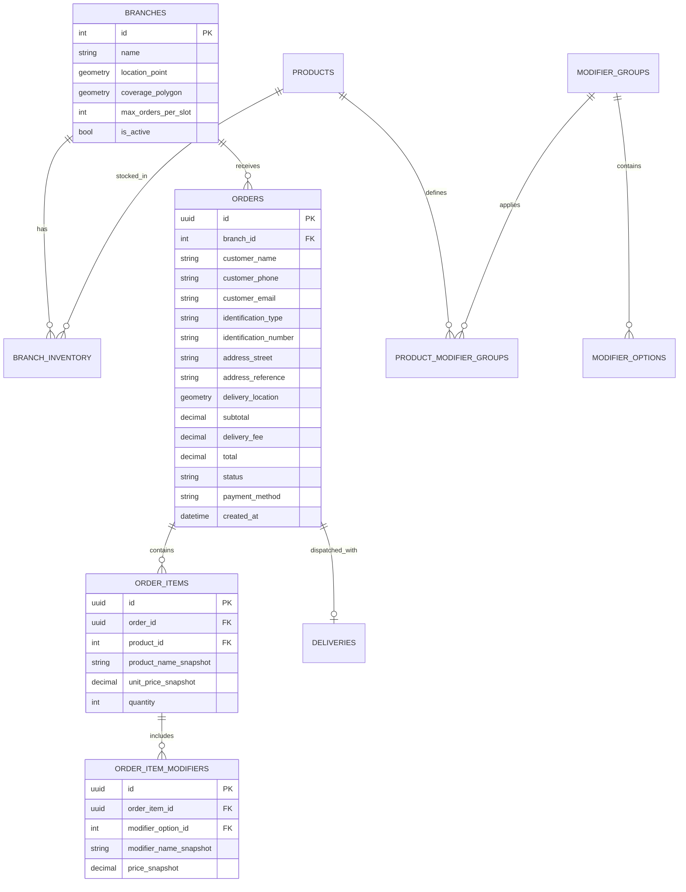

# 01. Especificacion Funcional y Roadmap de Implementacion

Documento de Especificacion Tecnica, Alcance Operativo y Roadmap del Negocio  
Proyecto: Plataforma de Delivery Directo para 2 Sucursales  
Estado: Aprobado / En Operacion y Auditoria  

> [!NOTE]
> **Convencion de Auditoria y Estado:**
> * `[x]` Funcionalidad implementada, verificada en codigo y con pruebas unitarias/integracion operativas.
> * `[ ]` Funcionalidad planificada o pendiente de integracion, parametrizacion o revision operativa.

---

## 1. Alcance y Contexto de Negocio

El sistema resuelve la dependencia de plataformas intermediarias de entrega (Uber Eats, PedidosYa) que retienen entre el 25% y el 30% del margen bruto de venta. La solución implementa un canal propio de venta directa y despacho logístico para dos sucursales operativas.

### 1.1. Restricciones Operativas Críticas
- [x] **Ventanas de Demanda Concentrada y Capacidad de Horno:** El 80% del volumen transaccional ocurre en dos franjas diarias: almuerzo (12:00 a 14:00) y merienda/cena (18:30 a 20:30). La preparación de pollo asado toma entre 45 y 60 minutos por lote de horneado. El sistema implementa control de capacidad operativa y limitación de pedidos por intervalo de tiempo (throttling operativo) basado en franjas de 20 minutos (`max_orders_per_slot`), evitando el colapso de cocina.
- [x] **Fricción Mínima de Checkout:** Se descarta el registro tradicional mediante formularios extensos. El flujo permite compra rápida como invitado solicitando únicamente: nombre, teléfono, dirección textual con referencia y geolocalización en mapa.
- [ ] **Autenticación Ligera por WhatsApp / OTP:** Verificación alternativa mediante código OTP para clientes frecuentes sin contraseña.
- [x] **Enrutamiento Geográfico por Polígonos:** Asignación automática de pedidos a la sucursal correspondiente mediante análisis espacial exacto de la ubicación del cliente con índices espaciales GiST en PostGIS.
- [ ] **Redirección Operativa por Agotamiento:** Capacidad de redirección automática de pedido hacia la otra sucursal en caso de agotamiento de stock en la sede principal.
- [ ] **Facturación Electrónica SRI Automática:** Generación asíncrona de comprobantes electrónicos autorizados por el SRI posterior a la confirmación de pago.
- [x] **Captura de Datos Fiscales y Despacho:** Soporte de Consumidor Final como predeterminado o captura de datos fiscales (`identification_type`, `identification_number`, `customer_email`), garantizando la persistencia textual de la dirección y referencia (`address_street`, `address_reference`).

---

## 2. Definición Funcional de Módulos



### 2.1. Canal del Cliente (Storefront)
- [x] Catálogo interactivo de combos, cuartos, medios y pollos enteros con modificadores obligatorios (elección de guarnición, tipo de ají) y opcionales con costo (bebidas, porciones adicionales).
- [x] Validación de cobertura previa a la selección de productos mediante pin en mapa o coordenadas detectadas.
- [x] Modalidades de servicio: Entrega a domicilio (Delivery) o Retiro en local (Takeout).
- [x] Pantalla de seguimiento en tiempo real con indicador de fase y mapa dinámico con la ubicación del repartidor.

### 2.2. KDS y Panel de Operación Local (Kitchen Display System)
- [x] Tablero tipo Kanban con estados operativos de órdenes ordenadas bajo criterio FIFO.
- [x] Alerta sonora continua en bucle ante la entrada de nuevos pedidos hasta su aceptación manual (Web Audio API / Howler).
- [ ] Impresión desatendida de comandas térmicas de 80mm al momento de confirmar el pedido (ESC/POS vía QZ Tray / RawBT).
- [ ] Interruptor de inventario rápido para deshabilitar productos o modificadores específicos en la sucursal activa en tiempo real.

### 2.3. Herramienta de Repartidores (Driver Operations)
- [x] Lista de pedidos asignados con dirección, datos del cliente y monto a cobrar.
- [x] Enlaces directos a aplicaciones de navegación externa (Waze y Google Maps) con coordenadas exactas.
- [x] Transmisión periódica de coordenadas de geolocalización hacia el servidor (Redis GEO) con modo de simulación local.
- [x] Registro de liquidación en entrega (confirmación de cobro en efectivo y cálculo de vuelto).

### 2.4. Panel de Administración Central
- [ ] Configuración de polígonos de cobertura (geocercas) y horarios de servicio de cada sucursal en UI administrativa.
- [ ] Administración centralizada del catálogo base y fijación de precios diferenciados o unificados.
- [ ] Reportes de ventas por sede, métricas de tiempos de preparación y liquidación de efectivo de repartidores al cierre de turno.

---

## 3. Máquina de Estados del Pedido

El ciclo de vida de cada orden es estrictamente secuencial y gestionado mediante transiciones validadas en el backend:



### 3.1. Matriz de Estados y Verificación de Flujo

| Estado | Origen de Cambio | Efecto Operativo | Notificación | Estado de Verificación |
|---|---|---|---|---|
| `CREADO` (1) | Cliente | Valida inventario e idempotencia en backend. | Ninguna | [x] Implementado en `CreateOrder` |
| `PENDIENTE_VALIDACION` (2) | Cliente (adjunta comprobante) | Notificación visual en caja ("Comprobante por verificar"). | WhatsApp al cliente: "Comprobante en revisión" | [ ] Pendiente carga de adjuntos |
| `CONFIRMADO` (3) | Cajero / Sistema (efectivo) | Asigna sucursal definitiva, reserva inventario. Despacha evento a KDS. | Alerta sonora en KDS | [x] Implementado y probado |
| `EN_COCINA` (4) | Operador KDS | Comanda enviada a producción. Impresión de ticket térmico 80mm. | WhatsApp al cliente: "En preparación" | [x] Transición activa en KDS |
| `LISTO_PARA_ENTREGA` (5) | Operador KDS | Pedido empaquetado, pasa a zona de despacho. | Alerta a flota de reparto | [x] Transición activa en KDS |
| `EN_CAMINO` (6) | Repartidor | Habilita suscripción al canal de GPS en vivo en SignalR. | Enlace de tracking dinámico | [x] Transición activa en Driver |
| `ENTREGADO` (7) | Repartidor / Cajero | Cierre de orden. Registro de liquidación en caja. | Encolado de emisión fiscal | [x] Transición activa |
| `CANCELADO` (8) | Administrador / Cajero | Liberación de stock reservado. Registro de motivo. | WhatsApp de cancelación | [x] Regla de bloqueo estricta |

---

## 4. Arquitectura de Software

El sistema adopta una arquitectura desacoplada cliente-servidor compuesta por un único proyecto frontend y un único proyecto backend, reduciendo la fricción operativa y asegurando consistencia de datos.



### 4.1. Decisiones Arquitectónicas Fundamentales

- [x] **Frontend Único (Next.js 16 App Router):** Monorepo que aloja el canal público B2C, la interfaz de cocina KDS y la herramienta de los repartidores.
- [x] **Backend Monolítico Modular (.NET 8 con Vertical Slice Architecture):** Organización por casos de uso verticales en `Delivery.Features` eliminando capas horizontales anémicas.
- [x] **Persistencia Híbrida Especializada:** PostgreSQL 16 con NetTopologySuite para modelos espaciales GiST y Redis 7 para telemetría GEO volátil e idempotencia.
- [x] **Tiempo Real Bidireccional (SignalR):** Hubs con segmentación de grupos por sucursal (`kitchen_branch_{id}`) y por orden (`order_tracking_{id}`).

---

## 5. Especificación del Frontend (Next.js)

### 5.1. Stack Tecnológico
- [x] **Framework:** Next.js (App Router con TypeScript estricto).
- [x] **Estilos:** Tailwind CSS con tokens de paleta asadero oscuro/ámbar.
- [x] **Componentes Base:** Primitivas accesibles tipo Radix UI / custom tailwind.
- [x] **Iconografía:** Lucide React con árbol depurado.
- [x] **Gestión de Estado del Cliente:** Zustand con persistencia en LocalStorage (`useCartStore`).
- [x] **Consumo de API y Caché:** TanStack Query v5 (React Query) con reintentos y estados asíncronos completos.
- [x] **Validación de Formularios:** React Hook Form integrado con esquemas tipados en Zod.
- [x] **Visualización de Mapas:** MapLibre GL JS sin costo por petición.
- [x] **Audio Operativo:** Sintetizador Web Audio API puro sin dependencias pesadas de audio externo.
- [x] **Cliente Tiempo Real:** `@microsoft/signalr` con reconexión automática.
- [x] **Envoltorio Móvil:** Capacitor (`capacitor.config.ts`) preparado para exportación webview.

### 5.2. Estrategia de Renderizado y Enrutamiento
- [x] `src/app/(storefront)/page.tsx` — Landing comercial, catálogo y combos activos.
- [x] `src/app/(storefront)/checkout/page.tsx` — Formulario reactivo, resolución espacial de sucursal y liquidación.
- [x] `src/app/(storefront)/track/[orderId]/page.tsx` — Seguimiento satelital y stepper de estados en vivo.
- [x] `src/app/(dashboard)/kitchen/page.tsx` — Tablero KDS con alarma sonora y columnas Kanban FIFO.
- [ ] `src/app/(dashboard)/admin/branches/page.tsx` — Gestión administrativa interactiva de geocercas y sedes.
- [ ] `src/app/(dashboard)/admin/inventory/page.tsx` — Conmutador de disponibilidad inmediata de productos.
- [x] `src/app/(driver)/active-delivery/page.tsx` — Shell táctil para smartphone con telemetría GPS y deep links.

### 5.3. Estrategia Móvil PWA y Capacitor
- [x] **Modo PWA (Web Instalable):** Definición de `manifest.json` y metatags para comportamiento `display: "standalone"`.
- [x] **Modo Capacitor (Empaquetado Nativo):** Archivo base `capacitor.config.ts` apuntando al build web.
- [ ] **Plugin Nativo de Background Geolocation:** Integración de `@capacitor-community/background-geolocation` en el paquete nativo para seguimiento con pantalla apagada.

### 5.4. Arquitectura Modular Frontend (Feature-Driven)
- [x] `src/features/catalog/` — Componentes de catálogo y consultas TanStack Query.
- [x] `src/features/cart/` — Store de carrito con hash determinístico de modificadores.
- [x] `src/features/checkout/` — Esquemas de validación Zod y selectores de cobertura.
- [x] `src/features/tracking/` — Marcador de motorizado, mapa MapLibre y simulación de recorrido.
- [x] `src/features/kitchen/` — Tarjetas de comanda con semáforo de tiempos y sintetizador de audio.

---

## 6. Especificación del Backend (.NET 8)

### 6.1. Stack Tecnológico
- [x] **Framework:** .NET 8 (C# 12) ASP.NET Core Web API con Controllers y Minimal APIs.
- [x] **Mapeo y Persistencia:** Entity Framework Core 8 con `Npgsql.EntityFrameworkCore.PostgreSQL.NetTopologySuite`.
- [x] **Tiempo Real:** ASP.NET Core SignalR.
- [x] **Caché y Redis:** `StackExchange.Redis`.
- [ ] **Procesamiento Asíncrono:** Hangfire (configurado para desarrollo; workers de tareas pendientes de parametrización).
- [x] **Validaciones:** FluentValidation con pipeline automático de validación de comandos.
- [x] **Arquitectura de Código:** Vertical Slice Architecture (VSA).

### 6.2. Estructura de Proyecto y Cobertura de Vertical Slices
El backend elimina divisiones por capas tradicionales y organiza el sistema por casos de uso independientes:

```
src/
├── Delivery.Api/
│   ├── Program.cs                 # Configuración de servicios, middlewares y SignalR
│   ├── Middlewares/               # ExceptionHandlingMiddleware, IdempotencyMiddleware
│   └── Extensions/                # ServiceCollectionExtensions
│
├── Delivery.Core/
│   ├── Common/                    # Result<T>, Error, BaseEntity
│   ├── Domain/
│   │   ├── Entities/              # Branch, Product, ModifierGroup, Order, OrderItem
│   │   └── Enums/                 # OrderStatus, PaymentMethod, DeliveryType
│   └── Infrastructure/
│       ├── Persistence/           # AppDbContext, Configuraciones EF Core
│       ├── Redis/                 # RedisGeoService, IdempotencyService
│       └── SignalR/               # Hubs (KitchenHub, TrackingHub)
│
└── Delivery.Features/
    ├── Catalog/
    │   ├── GetActiveMenu/         # Query, Handler, DTO
    │   └── ToggleProductStatus/   # Command, Validator, Handler
    ├── Geofencing/
    │   └── ResolveBranchByPoint/  # Query espacial ST_Contains
    ├── Orders/
    │   ├── CreateOrder/           # Command, Validator, Handler (Transaccional)
    │   ├── ApproveTransferOrder/  # Command para validar comprobante de transferencia
    │   ├── UpdateOrderStatus/     # Command, Notificación SignalR
    │   └── GetOrderById/          # Query, DTO
    ├── Kitchen/
    │   └── GetActiveKitchenOrders/# Query para KDS inicial
    └── Tracking/
        ├── IngestDriverLocation/  # Command con escritura en Redis
        └── GetDriverLocation/     # Query para cliente
```

#### Checklist de Vertical Slices Operativos:
- [x] `Geofencing/ResolveBranchByPoint`: Resolución espacial contra polígonos GiST (`ST_Contains`).
- [x] `Catalog/GetActiveMenu`: Consulta de categorías y modificadores jerárquicos.
- [ ] `Catalog/ToggleProductStatus`: Interruptor administrativo de disponibilidad de producto.
- [x] `Orders/CreateOrder`: Creación atómica con recálculo de precios, vuelto y blindaje en backend.
- [ ] `Orders/ApproveTransferOrder`: Aprobación administrativa de transferencias bancarias.
- [x] `Orders/UpdateOrderStatus`: Transición formal en máquina de estados con SignalR push.
- [x] `Orders/GetOrderById`: Consulta de orden con snapshots inmutables de compra.
- [x] `Kitchen/GetActiveKitchenOrders`: Listado FIFO de pedidos activos para KDS.
- [x] `Tracking/IngestDriverLocation`: Ingesta de geoposición del motorizado en Redis GEO.
- [x] `Tracking/GetDriverLocation`: Consulta de última ubicación satelital del pedido.

### 6.3. Manejo de Errores e Invariantes (Result Pattern)
- [x] Implementación estricta de `Result<T>` y `Error` tipados para flujo de negocio sin excepciones.
- [x] Middleware global `ExceptionHandlingMiddleware` mapeado a RFC 7807 ProblemDetails.

---

## 7. Arquitectura de Tiempo Real (SignalR)

SignalR opera mediante dos concentradores (Hubs) independientes para segmentar la carga de eventos y evitar transferencias innecesarias de datos a clientes no interesados:



### 7.1. KitchenHub
- [x] **Ruta WebSocket:** `/hubs/kitchen`.
- [x] **Gestión de Grupos:** Suscripción por sede a `kitchen_branch_{branchId}`.
- [x] **Evento `ReceiveNewOrder`:** Notificación push inmediata con comanda al confirmarse la orden.
- [x] **Evento `OrderStatusChanged`:** Reflejo de avance de estado entre estaciones.
- [ ] **Evento `StockUpdated`:** Difusión en vivo de quiebre de stock a terminales de cocina.

### 7.2. TrackingHub
- [x] **Ruta WebSocket:** `/hubs/tracking`.
- [x] **Gestión de Grupos:** Conexión aislada a `order_tracking_{orderId}` por cada pedido.
- [x] **Evento `DriverLocationUpdated`:** Difusión de coordenadas `(lat, lng, heading)` hacia el mapa del cliente.
- [x] **Evento `OrderStatusChanged`:** Actualización reactiva del stepper de entrega en el storefront.
- [ ] **Destrucción Automática de Conexión:** Cierre forzado del grupo al marcarse `Delivered`.

---

## 8. Persistencia y Geocercas (PostgreSQL + PostGIS)

### 8.1. Modelo Entidad-Relación



### 8.2. Determinación Espacial de Cobertura y Sucursal
La asignación de pedidos no utiliza aproximaciones euclidianas ni círculos de radio fijo. Se define un polígono geométrico real por cada sucursal en PostGIS tipado estrictamente como `geometry(Polygon, 4326)`.

- [x] **Índice Espacial GiST Obligatorio:** Resuelve la intersección espacial en tiempo logarítmico $O(\log N)$ evitando escaneos secuenciales sobre la tabla:
  ```sql
  CREATE INDEX idx_branches_coverage_polygon 
  ON "Branches" USING GIST (coverage_polygon);
  ```
- [x] **Mapeo Tipado en EF Core 8:** Configuración explícita en `AppDbContext`:
  ```csharp
  builder.Property(b => b.CoveragePolygon)
         .HasColumnType("geometry(Polygon, 4326)")
         .IsRequired();
  ```
- [x] **Evaluación Espacial Nativa:** Validación `ST_Contains` con NetTopologySuite para asignación automática o rechazo `422 Unprocessable Entity` fuera de cobertura.

### 8.3. Inmutabilidad y Congelamiento de Datos Financieros
Para asegurar la integridad contable, auditoría fiscal del SRI y reportes históricos ante cambios de precios en el menú:
- [x] **Snapshot de Ítems:** La tabla `OrderItems` almacena `product_name_snapshot` y `unit_price_snapshot` al momento exacto de la venta.
- [x] **Snapshot de Modificadores:** La tabla `OrderItemModifiers` almacena `modifier_name_snapshot` y `price_snapshot` (registrando recargos exactos de la opción).
- [x] **Fórmula de Auditoría Inmutable:**
  $$\text{Total} = \text{delivery\_fee} + \sum (\text{unit\_price\_snapshot} \times \text{quantity} + \sum \text{price\_snapshot})$$
- [x] **Protección de Precios Históricos:** Variaciones futuras en el catálogo maestro no alteran órdenes pasadas.

---

## 9. Caché, Redis y Tareas en Segundo Plano

### 9.1. Ingesta de Ubicación GPS de Flota
- [x] **Ingesta en Memoria (Redis GEO):** `GEOADD active_drivers:locations <lng> <lat> <driverId>` evitando saturación en disco PostgreSQL.
- [x] **Rumbo con Autolimpieza (TTL):** `SET driver:<driverId>:heading <heading_degrees> EX 60` para expirar conductores desconectados.

### 9.2. Idempotencia en Checkout
- [x] **Cabecera HTTP:** `Idempotency-Key: <UUIDv4>` generada en frontend.
- [x] **Candado Atómico en Redis:** Llave con TTL de 24 horas (`idempotency:{key}`).
- [x] **Cache Lookup:** Respuesta inmediata `X-Cache-Lookup: HIT` ante peticiones duplicadas.

### 9.3. Tareas en Segundo Plano (Hangfire)
- [ ] **Emisión de Comprobantes Electrónicos SRI:** Generación de XML, firma criptográfica `.p12` y despacho al servicio web del SRI con reintentos exponenciales.
- [ ] **Notificaciones Transaccionales por WhatsApp:** Envío de mensajes automáticos en transiciones clave (`CONFIRMADO`, `EN_CAMINO`).

### 9.4. Control de Capacidad Operativa y Throttling en Redis
- [x] **Contador Atómico por Ranura Temporal:** Incremento por cada orden en ventanas de 20 minutos (`INCR branch:{branchId}:slot:{timestamp_20min}`).
- [x] **Tiempo Estándar de Entrega:** Pedidos aceptados normalmente si el acumulado es menor o igual a `max_orders_per_slot`.
- [ ] **Aviso de Demanda Extendida en Checkout:** Notificación visual al cliente extendiendo el tiempo estimado a 60-75 min al superar el umbral estándar.
- [ ] **Suspensión Temporal de Admisión:** Bloqueo automático por 10 minutos si se supera el 150% de la capacidad física de horneado.

---

## 10. Hardware, Pagos y Logística Local

### 10.1. Impresión Térmica de Comandas (80mm ESC/POS)
- [ ] **Puente WebSocket Local en PC (Windows):** Servicio local `QZ Tray` (`ws://localhost:8182`) para comandos ESC/POS sin diálogo del navegador.
- [ ] **Puente Bluetooth/WiFi en Android:** Integración con `RawBT` para impresión en tablets de cocina.
- [x] **Especificación del Ticket de Comanda:** Formato definido con desglose de ítems, modificadores, cambio en efectivo y referencias de entrega.

### 10.2. Flujo de Pagos y Liquidación de Efectivo
- [x] **Efectivo contra Entrega:** Captura obligatoria de denominación del billete (`cashAmountPaid`), cálculo de cambio (`changeDue`) y reporte de liquidación.
- [ ] **Transferencias Bancarias / Deuna / Peigo:** Carga de comprobante visual, estado intermedio `PendingValidation` y botón de aprobación en caja.
- [ ] **Pasarela de Tarjetas (Payphone / Kushki):** Integración por Webhook criptográfico para confirmación automática.

### 10.3. Integración de Navegación del Repartidor
- [x] **Deep Link Google Maps:** `https://www.google.com/maps/dir/?api=1&destination={lat},{lng}`.
- [x] **Deep Link Waze:** `https://waze.com/ul?ll={lat},{lng}&navigate=yes`.

---

## 11. Seguridad e Infraestructura Cloud (DevSecOps)

### 11.1. Perímetro y Protección (Cloudflare)
- [ ] **Firewall WAF y Mitigación DDoS:** Reglas de mitigación de capa 7 en Cloudflare.
- [ ] **Rate Limiting en Edge:** Límites estrictos para `/api/orders` y `/api/auth/otp`.
- [ ] **Optimización de Imágenes:** Conversión y compresión automática a WebP en CDN.

### 11.2. Integridad Transaccional y Cálculo de Precios
- [x] **Blindaje del Subtotal:** El cliente solo envía `productId`, `quantity` y `selectedModifierIds`; el total se calcula exclusivamente en base de datos.
- [x] **Validación de Modificadores:** Verificación en backend de que cada modificador pertenezca estrictamente al producto ordenado.

### 11.3. Esquema de Despliegue y Orquestación
- [x] **Contenedores de Desarrollo:** `docker-compose.yml` (PostgreSQL 16 + PostGIS, Redis 7).
- [x] **Contenedores de Producción:** `docker-compose.prod.yml` con healthchecks activos y reinicio automático.
- [x] **Scripts de Despliegue y Rollback:** `scripts/deploy/deploy.sh` y `scripts/deploy/rollback.sh`.
- [x] **Pipelines de CI/CD:** GitHub Actions (`ci.yml`, `deploy.yml`, `rollback.yml`).
- [ ] **Infraestructura Cloud Final (AWS / VPS Producción):** Aprovisionamiento en servidor final con dominio y certificados SSL.

---

## Navegacion de Documentacion
* **Anterior:** [03. Guia Tecnica de CI/CD, Despliegue Automatizado y Rollback](../05-despliegue-y-operaciones/03-guia-despliegue-devops.md)
* **Indice General:** [README Principal](../../README.md)
